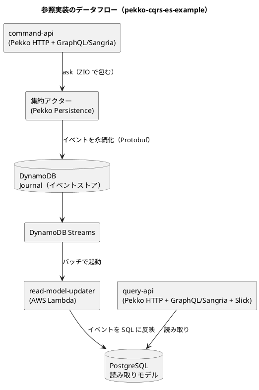
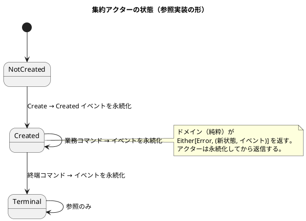
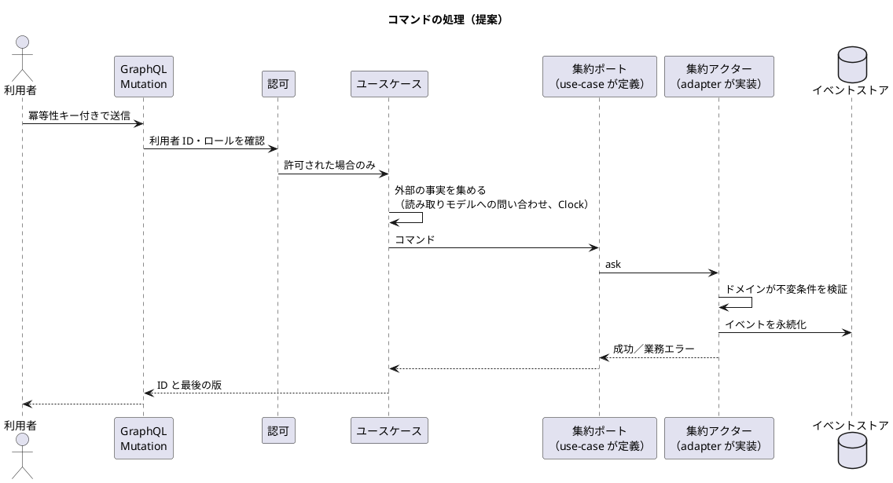
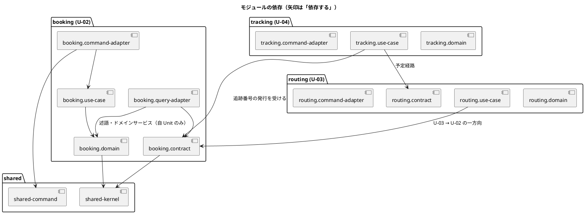
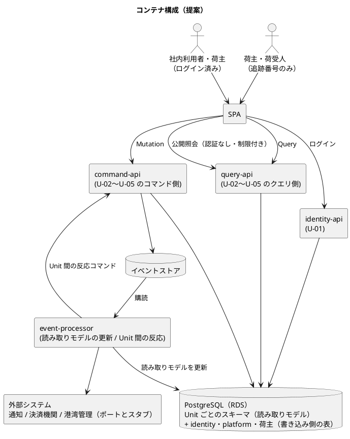

# バックエンドアーキテクチャ設計：国際貨物輸送管理システム

参照実装 `tmp/pekko-cqrs-es-example`（Apache Pekko による CQRS/イベントソーシングの実装例。以下「参照実装」。`tmp/` は Git 管理外で、出典は j5ik2o/pekko-cqrs-es-example）を土台に、本プロジェクトのバックエンドアーキテクチャを設計します。

- 入力: [要件定義書](../requirements/requirements_definition.md)、[ビジネスユースケース](../requirements/business_usecase.md)、[システムユースケース](../requirements/system_usecase.md)、[ユーザーストーリー](../requirements/user_story.md)、[Unit 定義](../requirements/units.md)、[リスク台帳](../requirements/risk_register.md)、[用語集](glossary.md)
- 姉妹文書: [フロントエンド](architecture_frontend.md)、[インフラストラクチャ](architecture_infrastructure.md)
- **本書の判断はすべて「提案」です**。リスク台帳 R-08 に従い、アーキテクチャ判断は人が承認してから ADR に残します。承認前の AI は選択肢の提示までとし、本書を根拠に実装へ進みません。判断の一覧と決定期限は[第 11 章](#11-設計判断の一覧adr-候補)にあります
- 参照実装の名前・用語・採番（`UserAccount`、`pcqrses` など）は持ち込みません（R-07）。持ち込むのは「構造とパターン」だけです

---

## 1. 設計の前提

### 1.1 設計を左右する要件

| 要件 | 出典 | アーキテクチャへの影響 |
| :--- | :--- | :--- |
| 荷役作業の記録が追跡情報へ即座に反映される | インセプションデッキ リスク #3、U-04 NFR | 書き込みと読み取りのモデルを分け、反映までの遅延を計測できる経路にする（R-08） |
| 貨物予約（8 状態）・追跡情報（9 状態）は状態遷移を持ち、不正な遷移を許さない | 要件定義書 状態モデル、U-02 NFR | 状態遷移を集約の中に閉じ込める |
| 例外・通関・キャンセルの履歴が残り、料金調整の根拠になる | US28 AC-06、US29 AC-09、US30 AC-09 | 状態の変更を捨てず、イベントとして残す |
| 金額を扱い、端数処理を一意に定める | U-05 NFR | 計算を純粋関数にし、確定した値を履歴として残す |
| 5 つの Unit が独立して開発・デプロイできる | Unit 定義 | Unit 間の依存を一方向にし、コンパイル時に強制する |
| 追跡照会はログイン無しで使える | US18 AC-01、R-02 | 公開エンドポイントを分離し、推測と過負荷に耐える |
| 港湾は UN/LOCODE、時刻は国際輸送 | R-09、US07 | 港湾コードを値オブジェクトで検証し、時刻の扱いを一箇所に決める |
| 外部システム（通知・決済・港湾・税関）の仕様は不明 | R-01 | すべてポート（インタフェース）とスタブで先行する |

数値の NFR（反映時間・算出時間・同時接続数など）は、本書では決めません（[非機能要件定義](non_functional.md)に仮置きの数値を提案済み。承認までは確定でない）。数値が必要な箇所は「非機能要件定義で決める」と書きます。

### 1.2 業務領域の分類

[ビジネスアーキテクチャ分析](../strategy/business_architecture.md)は予約管理・経路設計・荷役管理・貨物追跡・精算管理を「コア」に分類しています。認証（BUC22）は能力マップに無い共通機能で、汎用（一般）の領域として扱います。

---

## 2. 参照実装の分析

参照実装は、1 種類の集約（UserAccount）で CQRS/イベントソーシングの全経路を通した最小の実装例です。本プロジェクトは 5 つの Unit・複数の集約・Unit 間連携・認証・外部連携を持つため、**そのまま拡大するのではなく、採る・変える・足す・捨てるを分けます**。

### 2.1 参照実装の構成



### 2.2 採る・変える・足す・捨てる

| 区分 | 要素 | 参照実装 | 本プロジェクトでの扱い | 理由 |
| :--- | :--- | :--- | :--- | :--- |
| 採る | CQRS（コマンド側とクエリ側の分離） | `modules/command`・`modules/query`・`apps/*` | 採る | 反映時間の計測点を持てる。読み取りを業務ごとに最適化できる |
| 採る | イベントソーシング | `UserAccountAggregate` が状態を `NotCreated`／`Created`／`Deleted` で持ち、イベントを永続化 | 採る（U-02・U-03・U-04・U-05。[第 3 章](#3-パターンの選択)） | 履歴が料金調整・監査の根拠になる |
| 採る | 純粋なドメイン | `UserAccount.rename` が `Either[Error, (新状態, イベント)]` を返し、副作用を持たない | 採る | ドメインを Pekko なしでテストできる |
| 採る | イベントの版管理 | `UserAccountEvent.Created_V1` と、`event_type_name`・`event_type_version`・`payload` を持つ Protobuf の Envelope | 採る | 長期保存するイベントの後方互換を守る |
| 採る | 集約 ID に ULID | `char(26)`、`airframe-ulid` | 採る。ただし業務番号は別（[4.4](#44-識別子と一意性)） | 時系列に並び、衝突しにくい |
| 採る | 集約レジストリのローカル／クラスター切り替え | `GenericAggregateRegistry`（`LocalMode`／`ClusterMode`） | 採る。最初はローカル（BE-12） | 規模が要るまで分散のコストを払わない |
| 採る | Flyway + 生成 DAO | `V1__create_tables.sql`、sbt-dao-generator | 採る（Unit ごとのスキーマ。R-03 の承認ゲートを通す） | スキーマ変更を差分で確認できる |
| 変える | use-case 層が Pekko に依存 | `UserAccountUseCaseImpl` が `ActorRef[Protocol.Command]` を直接 ask する | 出力ポートを use-case が定義し、アクターは adapter が実装する（[5.2](#52-層の責務と依存の向き)） | アーキテクチャ設計ガイドの「外側から内側への単方向依存」。アクターなしでユースケースをテストできる |
| 変える | 1 つの `command` ツリーに全集約 | `modules/command/domain` に `users` パッケージのみ | Unit ごとのモジュールに分ける（[5.1](#51-モジュール構成)） | パッケージの規約では Unit 間の依存を強制できない |
| 変える | イベント配信の購読者が 1 つ | Lambda 1 本が読み取りモデルだけを更新 | 複数の購読者（読み取りモデル × Unit 数、反応側）を扱える方式にする（[6.3](#63-イベントの配信と購読)） | Unit 間連携にイベント購読が要る。DynamoDB Streams は同一シャードの購読者数に目安がある |
| 変える | Lambda が ActorSystem を起動してデシリアライズ | `LambdaHandler` の `lazy val system = ActorSystem(...)` | シリアライザを ActorSystem から切り離すか、常駐プロセスにする（BE-03） | 起動時間とパッケージサイズが運用負荷になる |
| 足す | 複数の集約と、集約間の連携 | 無し（集約は 1 種類） | Unit 間連携（[第 7 章](#7-unit-間の連携)） | R-08 の中心課題 |
| 足す | 認証・認可 | 無し | U-01（[第 8 章](#8-認証認可と公開エンドポイント)） | R-02 |
| 足す | 外部システムのポート | 無し | 通知・決済・港湾・税関のポートとスタブ（[6.5](#65-外部システムとのポート)） | R-01 |
| 足す | コマンドの冪等性 | 無し（再送すると別の ID で重複作成される） | 冪等性キー（[4.5](#45-コマンドの冪等性)） | HTTP の再送で予約が二重に登録されるのを防ぐ |
| 足す | 読み取りモデルの冪等な更新 | 無し | イベント ID と集約の版で重複・順序逆転を弾く（[6.2](#62-読み取りモデルの更新規約)） | 再配信とリプレイで追記専用の行が増えるのを防ぐ |
| 足す | 個人情報の扱い | 無し（氏名・メールがイベントに入る） | イベントに個人情報を載せない（BE-10） | イベントは消せない |
| 足す | 時刻と業務日付の方針 | `DateTime.now()` を各所で直接呼ぶ | Clock をポートにする（BE-11） | 期限判定のテストと境界バグ |
| 捨てる | `UserAccount` の名前・属性 | — | 持ち込まない | R-07 |
| 捨てる | `-no-indent`・`-rewrite`・`-experimental` などのコンパイラ設定 | `build.sbt` の `scalacOptions` | 技術スタック選定で決める | 書き方の規約は本プロジェクトの判断 |
| 捨てる | Docker Compose のポート・ホスト名・パッケージ名 | `50501`、`pekko-cqrs-es-example_p-cqrs-es-network` など | 持ち込まない | 環境固有の値 |

### 2.3 参照実装を使うときの注意

参照実装を読んで気づいた、そのまま写すと問題になる点です。

- **Lambda のパッケージサイズ**: `docker-compose-common.yml` が LocalStack の Lambda の上限を zip 500 MB／展開後 2 GB に引き上げて動かしている。実 AWS の zip 配布の上限（50 MB／250 MB）を超える可能性があり、コンテナイメージでの配布が前提になる（要確認。BE-03・IF-04）
- **個人製の依存**: Journal プラグイン（`pekko-persistence-dynamodb-journal-v2` 1.0.57）と `pekko-persistence-effector`（0.8.11）は個別のメンテナによる。1.0 未満のバージョンもあり、導入は「外部ライブラリの導入」にあたり承認が要る（BE-04）
- **GraphQL ライブラリ**: Sangria を使っている。採用時にメンテナンス状況を確認する（BE-06）
- **命令の再送**: `createUserAccount` はユースケースの中で ID を採番するため、クライアントが再送すると別の集約ができる

---

## 3. パターンの選択

### 3.1 判断フローの適用

アーキテクチャ設計ガイドのバックエンド選択フローを Unit ごとに当てはめます。

| Unit | 業務領域 | 金額・分析・監査 | 永続化モデル | 選択 | 根拠 |
| :--- | :--- | :--- | :--- | :--- | :--- |
| U-01 認証 | 補完・一般 | 監査ログは要る（記録のみ） | 単一 | **レイヤード 3 層 + トランザクションスクリプト** | データ構造が単純。ロック回数の判定は即時に正確でなければならず、結果整合の読み取りモデルが馴染まない |
| U-02 貨物予約 | 中核 | 見積・キャンセル料（金額）、キャンセルの履歴（US30 AC-09） | 複数 | **イベント履歴式ドメインモデル + CQRS** | 状態遷移が中心で、履歴が根拠になる |
| U-03 航海スケジュール・経路設計 | 中核 | 経路の確定・差し替えの履歴、再算出率などの分析（測定基準） | 複数 | **イベント履歴式ドメインモデル + CQRS**（BE-01 に代替案） | 他の Unit と同じ配信の仕組みに揃える。経路算出は読み取りモデルを使う |
| U-04 荷役・追跡 | 中核 | 通関・例外の履歴（US29 AC-09、US28 AC-06） | 複数 | **イベント履歴式ドメインモデル + CQRS** | 追跡イベントは本質的にイベントの列 |
| U-05 精算 | 中核 | 金額 | 複数 | **イベント履歴式ドメインモデル + CQRS** | 料金・割引・精算書の履歴が精算の誤りを調べる根拠になる |

選択フローの結果は、U-02〜U-05 が**イベント履歴式ドメインモデル + CQRS**、U-01 が**レイヤード 3 層**です。

> **確認ポイント（BE-01）**: 「過剰適用は複雑さを増すだけ」という懸念があります。U-03 は金額の確定も監査要求も無く、最も根拠が弱い Unit です。U-03 をイベントソーシングにしない代替案は、航海を PostgreSQL の表で管理する「ドメインモデル + ポートとアダプター」にして、経路の確定を Outbox 経由で他の Unit に知らせる方式です。**推奨はイベントソーシング**です。理由は、Unit 間連携を 1 種類の仕組みに揃えると AI が規約どおりに生成しやすく、検査も 1 組で済むからです。

### 3.2 イベントソーシングを適用しない部分

| 対象 | 方式 | 理由 |
| :--- | :--- | :--- |
| 荷主（U-02） | PostgreSQL の表（更新・削除可） | メールアドレスの重複検出（US02 AC-02。「登録を続ける」を選べるため一意制約にはしない。要確認）、個人情報の訂正・削除、監査要求が無い（BE-10） |
| 経路候補（U-03） | 永続化しない（算出して返すだけ） | 候補は確定するまで業務上の事実ではない |
| 認証の状態（U-01） | PostgreSQL の表 | 上記のとおり |

荷主を CRUD にするのは、荷主登録の能力が「コア」でなくなるという意味ではありません。**永続化の方式だけの例外**です。予約のイベントには荷主 ID と割引率の写しだけを載せ、氏名・住所・連絡先は載せません。

---

## 4. コマンド側の設計

### 4.1 集約アクターの形

参照実装の集約アクターを型として採ります。



- 永続化 ID は `<集約の型>-<ID>`（参照実装は `UserAccount-<ULID>`）
- ドメインは Pekko に依存せず、`(新状態, イベント)` を返す純粋関数にする
- 不変条件はドメイン（集約）に置く。GraphQL の入力検証やユースケースだけに置かない（検査は[第 10 章](#10-アーキテクチャ適合性の検査)）
- スナップショットは当初置かない。参照実装は 1,000 件ごとに取るが、予約や追跡情報の 1 集約あたりのイベント数は少ない。イベント数が増える集約が現れたら導入する

### 4.2 集約の候補

集約の確定はドメインモデル設計で行います。ここでは Unit の配置を確かめるための候補です（R-06）。

| Unit | 集約の候補 | 状態・特記事項 |
| :--- | :--- | :--- |
| U-02 | 見積、貨物予約 | 貨物予約は要件定義書の状態モデルに従う。キャンセルの申請・承認・却下の履歴を持つ（US30） |
| U-03 | 航海、経路 | 航海は航海番号を ID の元にする。経路は確定した区間の写しを持つ |
| U-04 | 追跡情報 | 貨物状態・追跡イベント・例外・通関申告を 1 つの集約に置く。「通関済でなければ引取できない」（US29 AC-04）を 1 つの集約の不変条件にするため |
| U-05 | 輸送料金、精算 | 輸送料金は「算出済」「確定」を持つ（US21 AI の仮定） |

追跡情報に通関を含めると集約が大きくなります。通関申告の一覧検索（US29 AC-08）は読み取りモデルが受け持つため、書き込み側を分ける利点が小さいと判断しています（ドメインモデル設計で再検討）。

### 4.3 コマンドとユースケースの流れ



- **認可は入力検証より先**に行う。権限の無い相手に入力の仕様を教えないため
- 集約が参照できない外部の事実（航海が実在するか、貨物種別に対応しているか、荷主種別と割引率）は、ユースケースが集めてコマンドに載せる。集約は与えられた事実だけで不変条件を検証する
- 業務エラー（不正な状態遷移など）は例外ではなく sealed な型で返し、GraphQL ではエラーコードに写す
- 応答には集約の ID と**最後のイベントの版**を含める（[6.4](#64-結果整合と画面)）

### 4.4 識別子と一意性

イベントソーシングでは、複数の集約にまたがる一意制約を単純には書けません。要件にある一意性を次のように担保します。

| 一意性の要件 | 出典 | 方式 |
| :--- | :--- | :--- |
| 航海番号は重複しない | US24 AC-04 | 航海番号を永続化 ID の元にする。2 回目の登録は `Created` 済みの集約が拒む |
| 追跡番号は他と重複せず、推測できない | US14 AC-01、US18 | 追跡情報の永続化 ID を追跡番号そのものにする。番号は推測困難な乱数部を持つ形式にし、形式と桁数は R-02 の承認時に決める |
| 同じメールアドレスの荷主は警告する | US02 AC-02 | 荷主は PostgreSQL の表で、メールアドレス（正規化後）を検索して重複を検出する。AC-02 は「登録を続ける」を選べるため**一意制約にはしない**（一意制約にするかは要確認。[ドメインモデル](domain-model.md)） |
| 予約番号・見積番号・請求番号 | US04・US01・US23 | 採番方式は未定義。人が読む番号（連番または日付付き）と、集約 ID（ULID）を分ける。採番は専用の採番集約か DB のシーケンスで行う（ドメインモデル設計で決める） |

### 4.5 コマンドの冪等性

クライアントが送る**冪等性キー**を、コマンドの先頭で確かめます。

- 同じキーのコマンドを再送したら、最初の結果を返す（二重に登録しない）
- 集約を新規作成するコマンドは、クライアントまたはゲートウェイが集約 ID を生成して渡す形にすると、集約自身が 2 回目の作成を拒める。ユースケース内で ID を採番する参照実装の形は避ける
- キーと結果の保存先は PostgreSQL の表とし、保持期間は非機能要件定義で決める

---

## 5. 構造

### 5.1 モジュール構成

参照実装は「コマンド側／クエリ側」で最上位を分けます。本プロジェクトは **Unit を最上位**にし、その中でコマンド側とクエリ側を分けます。Unit 間の依存を sbt の `dependsOn` で強制するためです。

```text
modules/
├── shared-kernel/            # 全 Unit が使う最小の部品（ULID、DomainEvent、Clock、UN/LOCODE 値オブジェクト、エラーの型）
├── shared-command/           # 集約レジストリ、イベントシリアライザの基盤、PekkoInterop
├── booking/                  # U-02 貨物予約
│   ├── domain/               # 純粋なドメイン（Pekko 非依存）
│   ├── use-case/             # ユースケースと出力ポート
│   ├── contract/             # 他 Unit に公開するもの：公開イベント（Protobuf）、受け口のポート、問い合わせの型
│   ├── command-adapter/      # 集約アクター、イベントシリアライザ、GraphQL Mutation
│   ├── query-adapter/        # 読み取りモデル（Slick DAO）、GraphQL Query、プロジェクション
│   └── migration/            # Flyway
├── routing/                  # U-03（同じ構成）
├── tracking/                 # U-04（同じ構成）
├── billing/                  # U-05（同じ構成）
└── identity/                 # U-01 認証（レイヤード 3 層。domain・service・repository・api）
apps/
├── command-api/              # 全 Unit のコマンド側を載せる 1 プロセス
├── query-api/                # 全 Unit のクエリ側を載せる 1 プロセス（公開照会を含む）
├── event-processor/          # イベントの購読（読み取りモデルの更新と Unit 間の反応）
└── identity-api/             # 認証（U-01）
```

**依存の規則**（[第 10 章](#10-アーキテクチャ適合性の検査)で検査に落とす）:



- 別の Unit の `domain`・`use-case`・`adapter` は参照しない。参照してよいのは相手の `contract` だけ
- `domain` は Pekko・Slick・GraphQL・ZIO に依存しない
- `query-adapter` は**自 Unit の `domain`（状態の述語・ドメインサービス）に依存してよい**。投影で「実行できる操作」（`available_commands`）を述語で計算するため、また経路算出（`RouteFinder`）など読み取りで使うドメインサービスのため。判定を投影側に書き直して二重に持たない。他 Unit の `domain` は引き続き参照しない（検査 A1）
- `use-case` が依存してよいのは他 Unit の `contract` だけ。`contract` は `shared-kernel` にしか依存しない葉なので、Unit 間で `contract` を双方向に参照しても、モジュールの依存は循環しない。実際の依存は[7.2 の連携の一覧](#72-連携の一覧)に一致させる（[Unit 定義の依存 DAG](../requirements/units.md#依存-dag)より多く、逆向きの結合を含む。経緯は[ドメインモデル 第 13 章](domain-model.md#13-他の設計書への影響)）

### 5.2 層の責務と依存の向き

| 層 | 責務 | 依存してよいもの |
| :--- | :--- | :--- |
| domain | 集約・値オブジェクト・ドメインサービス（経路算出など）・イベント・業務エラー | shared-kernel |
| use-case | ユースケース、認可の確認、冪等性の確認、**出力ポート**（集約ポート、読み取りポート、Clock、外部システムのポート） | domain、shared-kernel |
| contract | 他 Unit が使ってよい型：公開イベント、受け口のポート、DTO | shared-kernel |
| command-adapter | 集約アクター、永続化の設定、イベントシリアライザ、GraphQL Mutation、出力ポートの実装 | use-case、shared-command |
| query-adapter | 読み取りモデルの DAO、GraphQL Query、プロジェクション | **自 Unit の domain**（述語・ドメインサービスの読み取り専用の利用）、contract、shared-kernel |

参照実装との違いは、use-case が Pekko の `ActorRef` を持たない点です。`CargoBookingPort` のような出力ポートを use-case が定義し、adapter がアクターで実装します。

### 5.3 コンテナ構成



---

## 6. クエリ側と配信の設計

### 6.1 読み取りモデル

- PostgreSQL に、**Unit ごとのスキーマ**（`booking`・`routing`・`tracking`・`billing`）を作る。スキーマをまたぐ結合や外部キーは置かない（Unit の独立を守る）
- テーブルは画面と問い合わせから決める。例：追跡照会用の表（追跡番号を主キーに、現在状態・位置・推定到着日・イベント履歴）、予約一覧用の表、航海検索用の表（出発港・到着港・出発日・到着日・対応貨物種別・寄港地）
- スキーマ変更は Flyway で行い、適用前に人が差分を確認する（R-03）。マイグレーションは数値順に読み、適用済みのファイルは書き換えない
- DAO は参照実装と同様にスキーマから生成する。生成にはローカルの PostgreSQL が要る

### 6.2 読み取りモデルの更新規約

イベントは再配信される前提で、更新を冪等にします。

| 規約 | 内容 |
| :--- | :--- |
| イベントが運ぶ項目 | 購読側の読み取りモデルが作れる項目をイベントに載せる。購読側はコマンドを読めない。載せ忘れた項目は版を上げて追加する |
| 重複の除外 | イベント ID（`DomainEventId`）を一意キーにするか、集約ごとの版（シーケンス番号）が「保存済みの版 + 1」のときだけ適用する |
| 追記専用の行 | 追跡イベントの履歴などは、行の識別子をイベント ID から導く。リプレイで行が増えない |
| 順序 | 同じ集約のイベントは順に適用する。版が飛んだら適用せず保留または再取得する |
| 失敗 | 適用に失敗したイベントを黙って捨てない。リトライと待避先（デッドレター）に回し、件数を監視する |
| 全体の再構築 | 読み取りモデルはイベントから作り直せる。作り直しの手順を運用手順書に書く |

### 6.3 イベントの配信と購読

購読者が増えることが参照実装との最大の違いです。

| 購読者 | 数 | 内容 |
| :--- | :--- | :--- |
| 読み取りモデルの更新 | Unit ごと（4） | イベントを SQL に反映 |
| Unit 間の反応 | [第 7 章](#7-unit-間の連携)の表のとおり | イベントを受けて他 Unit のコマンドを送る |
| 通知 | 通知を伴うイベントごと | 通知ポートを呼ぶ |

**方式の候補**（BE-03。決定期限は Bolt 1 の前と、最初の反応が現れる Bolt 4 の前の 2 段階）:

| | A: 参照実装どおり（DynamoDB Journal + DynamoDB Streams + Lambda） | A′: A + 振り分け（Streams を 1 本の振り分けが受け、購読者ごとの SQS FIFO に配る） | B: PostgreSQL Journal + Pekko Projection（常駐プロセス） |
| :--- | :--- | :--- | :--- |
| 購読者の追加 | 同一シャードを読む購読者数に目安があり、増やしにくい | 購読者ごとにキューが増える | 購読者ごとに独立したオフセットで増やせる |
| 冪等性 | 自分で実装する（[6.2](#62-読み取りモデルの更新規約)） | 同左（SQS FIFO は重複排除の窓が限られる） | 読み取りモデルの更新とオフセットを同一トランザクションにできる |
| 追加の部品 | LocalStack・Lambda・DynamoDB | A に加えて SQS | PostgreSQL のみ |
| 参照実装との差 | 無し | 振り分けとキューを足す | Journal と配信を差し替える |
| 運用 | Lambda のパッケージ（コンテナイメージ）、LocalStack での再現 | A + キューの監視 | 常駐プロセスの運用、Journal の容量 |

**推奨**: Bolt 1〜3 は購読者が読み取りモデルの更新だけなので、**A（参照実装どおり）で始めてよい**。ただし、最初の Unit 間の反応（Bolt 4、`RouteDesignRequested` を受けて経路計画を開始する。追跡情報を作る `TrackingNumberIssued` の反応は Bolt 8）の前に、購読者の追加の PoC を行い、A′ か B に移るかを ADR で決める。ウォーキングスケルトン（Bolt 1）で確かめる項目は、反映時間の計測、イベントの再配信での冪等性、LocalStack での再現のしやすさとする。

> B を選ぶ場合、Journal のプラグインが標準の `pekko-persistence-jdbc` に変わり、個人製の DynamoDB プラグインへの依存が無くなります。一方で参照実装から離れる範囲が広がるため、人の判断を仰ぎます。

### 6.4 結果整合と画面

コマンドが成功しても、読み取りモデルへの反映はわずかに遅れます。画面が更新前の値を見せないように、次のようにします。

- コマンドの応答に集約の ID と最後のイベントの版を含める
- クエリは読み取りモデルが保持する版を返し、画面は「応答の版以上になるまで」短い間隔で再取得する（上限時間を超えたら、反映待ちであることを表示する）
- 画面は、更新直後に一覧を開く操作でも対象の行が見えることを検査で確かめる（[フロントエンド設計](architecture_frontend.md)）

### 6.5 外部システムとのポート

| 外部システム | ポート（Unit） | 当面の実装 | 備考 |
| :--- | :--- | :--- | :--- |
| 通知システム（メール・SMS） | `NotificationPort`（各 Unit が必要な通知を定義） | スタブ。送信内容を記録する | 通知の手段は未定（US12 AI の仮定はメール）。実在サービスの導入は承認が要る（R-01） |
| 決済機関 | `PaymentPort`（U-05） | スタブ。入金確認はポート越しの通知として受ける | 実仕様を創作しない（R-01） |
| 港湾管理システム | `PortFacilityPort`（U-03） | 未使用。要件に使う場面が無い | 使う場面が出たら定義する |
| 税関 | なし | 電子連携せず、担当者が手入力する（UC21） | **ADR が未記録**。本書の ADR 候補に BE-13 として追加 |

外部呼び出しは、失敗しても業務の状態を巻き込まないようにします。通知はイベントを購読して送る（集約の更新と同じトランザクションで送らない）。送信の成否を記録し、失敗が誰にも見えない状態にしません。

---

## 7. Unit 間の連携

[Unit 定義の依存 DAG](../requirements/units.md#依存-dag)をもとに、連携の方式を決めます。

### 7.1 方式の原則

1. **依存される側が契約を定義する**。契約は `contract` モジュールに置く（公開イベント、受け口のポート、問い合わせの型）
2. **同期の問い合わせは読み取りモデルに対してだけ**行う。他 Unit の集約アクターを直接 ask しない。問い合わせのポートは提供側の `contract` が定義し、実装は提供側の `query-adapter` が持つ。`apps` が結線する
3. **状態を変える連携は、受け口のポート（コマンド）か、イベントを受けた反応**で行う。反応は集約の ID を決定的にして、再実行しても二重に作らない
4. イベントには**消費側が必要とする値**を載せる（予定経路、最終到着日、荷主種別、割引率など）。消費側が提供側へ問い合わせに戻らなくて済むようにする

### 7.2 連携の一覧

| # | 提供 → 消費 | きっかけ | 方式 | 契約 |
| :--- | :--- | :--- | :--- | :--- |
| 1 | U-02 → U-03 | 予約情報の引き渡し（US06）→ 経路設計の開始 | **イベント**（`RouteDesignRequested`）を U-03 が購読し、経路計画を開始する。U-03 は表示に要る予約の要約を自分の写しとして持つ | `booking.contract`：公開イベント。出発地・目的地・希望期限・貨物仕様の要約を載せる |
| 2 | U-03 → U-02 | 経路の紐付け（US11） | U-03 のユースケースが U-02 の**受け口のポート**（経路の紐付け）を呼ぶ | `booking.contract`：受け口のポート。U-02 が定義し、U-03 が呼ぶ |
| 3 | U-02 → U-04 | 追跡番号の発行（US14） | **イベント**（`TrackingNumberIssued`）を U-04 が購読し、追跡情報を作る | `booking.contract`：公開イベント。予定経路の港・推定到着日を載せる |
| 4 | U-02 → U-04 | 輸送中キャンセルの承認（US30） | **イベント**（`CancellationApproved`）。U-04 が荷降しを手配する | 同上。陸揚げ地を載せる |
| 5 | U-02 → U-05 | キャンセル料の算定依頼（US30 AC-08） | **イベント**（同上）。U-05 が料金を算定する | 同上。キャンセル時の予約状態を載せる |
| 6 | U-02 → U-05 | 荷主種別・割引率（US22） | **イベント**（`BookingConfirmed`）が写しを運び、U-05 が自分の前提情報として保持する | `booking.contract`：公開イベント。既定は予約確定時の値。料金算出時の最新にするかは**要確認** |
| 7 | U-04 → U-05 | 配送完了（US16 AC-04） | **イベント**（`CargoDelivered`）を U-05 が購読し、料金算出の対象にする | `tracking.contract`：公開イベント。実績（経路・荷役作業）を載せる |
| 8 | U-03 → U-04 | 予定経路の変更（US28 の再設計後） | **イベント**（`RouteConfirmed`）を U-04 が購読する | `routing.contract`：公開イベント |
| 9 | U-04 → U-03 | 誤配後の再設計（US28 AC-04） | 画面が U-04 の読み取りモデルから現在地を取り、**U-03 の再設計の開始（出発地）として渡す**（画面での合成） | `routing.contract`：出発地を指定できる再設計の開始 |
| 10 | U-04 → U-02 | 最初の荷役作業（US15）、引取（US16 AC-02） | U-04 の反応が U-02 の**受け口のポート**（輸送開始・配送完了）を呼ぶ | `booking.contract`：受け口のポート。呼び出し元のイベント ID を受け、冪等 |
| 11 | U-05 → U-02 | 精算済（US23 AC-02） | U-05 の反応が U-02 の**受け口のポート**（精算済）を呼ぶ | 同上 |
| 12 | U-04 → U-03 | 誤配の起票（US28 AC-02） | U-04 の反応が U-03 の**受け口のポート**（経路の誤配）を呼ぶ | `routing.contract`：受け口のポート |
| 13 | U-02 → U-03 | 見積の経路概算（US01） | U-02 のユースケースが U-03 の**問い合わせ**（経路概算）を呼ぶ | `routing.contract`：問い合わせ（読み取り専用） |
| 14 | U-02 → U-04 | キャンセル承認の陸揚げ地候補（US30 AC-05） | U-02 のユースケースが U-04 の読み取りに**問い合わせ**（現在地の港・次の寄港地）、外部の事実としてコマンドに載せる | `tracking.contract`：問い合わせ（読み取り専用） |
| 15 | U-03 → U-02 | 誤配後の再設計の確定（US28 AC-05） | 新しい経路計画が紐付いたとき、U-03 が U-02 の**受け口のポート**（輸送中の経路の差し替え `ReplaceRouteInTransit`）を呼ぶ。#2 と同じ向き | `booking.contract`：受け口のポート。呼び出し元のイベント ID を受け、冪等 |
| 16 | U-02 → U-03 | 予約のキャンセル（US13 AC-04、US30） | **イベント**（`BookingCancelled`／`CancellationApproved`）を U-03 が購読し、経路計画を中止する（`Abandon`） | `booking.contract`：公開イベント（#4・#5 と同じイベントの 3 つ目の購読者）。ドメインモデル 10.2 の購読者表に一致 |
| 17 | U-02 → U-03 | 荷主が経路の変更を希望（US13 AC-03） | **イベント**（`RouteDetached`）を U-03 が購読し、紐付け済の経路計画を扱う（置換または設計中へ戻す） | `booking.contract`：公開イベント。**U-03 側の遷移がドメインモデルに無い（要確認：ドメインモデル Q17）** |

- #3 を U-04 の購読にするのは、U-02 が U-04 のコマンドを直接呼ばないためです。#10〜#12 は、状態を変える側（U-04・U-05）が、状態を持つ側（U-02・U-03）の受け口を呼ぶ形にして、状態モデルを 1 つの集約に保ちます
- #10〜#14 は、Unit 定義の依存 DAG に無い逆向きの結合です（#15 は #2、#16・#17 は #1 と同じ向きで、DAG の範囲内）。ストーリーが要求するため（予約状態の後半、見積、キャンセル承認）、`contract` 経由で結びます（[ドメインモデル 第 13 章](domain-model.md#13-他の設計書への影響)）。DAG の説明を直すかは人が決めます
- **#16 の補足（キャンセル料の精算）**：キャンセル料の精算が完了すると #11（`MarkSettled`）が呼ばれるが、予約はキャンセル済みで B10 が状態を変える操作を拒む。拒まれ続けて待避先に回らないよう、「**キャンセル済みの予約への `MarkSettled` は、状態を変えずに成功として受理する**」ことを提案する（要確認：ドメインモデル Q18）
- #2 は購読ではなく受け口の呼び出しです。経路の紐付けは利用者の操作の結果で、U-03 が U-02 の結果を知る必要があるため、同期の呼び出しにします。失敗時の扱い（経路は確定したが紐付けに失敗）はドメインモデル設計で決める

### 7.3 反応の実装規約

イベントを受けて他 Unit のコマンドを送る「反応」は、次を守ります。

- 冪等：同じイベントを 2 回受けても結果が同じになる。作成系は集約 ID を元イベントから導く（例：追跡情報の ID は追跡番号）
- 順序：同じ集約から出るイベントの順序を前提にしない。前提が満たされない場合は保留する
- 失敗：リトライ上限の後、待避先に回し、件数を監視する
- 検査：1 つの Unit の内側で完結する検査は緑のまま、購読側に届いていないことがある。**Unit をまたぐ往復の検査**（提供側のコマンド → 購読側の読み取りモデルに結果が現れる）を、連携の数だけ置く

---

## 8. 認証・認可と公開エンドポイント

### 8.1 U-01 の位置づけ

U-01 は方式が未決です（R-02）。本書は、他の Unit が**認証済みの利用者情報（利用者 ID・ロール）だけに依存する**構造を先に決め、方式（セッションかトークンか、パスワードの保存方式、ロックの時間）は ADR（BE-09）で人が決めます。

| 項目 | 設計 |
| :--- | :--- |
| 配置 | `identity-api`（レイヤード 3 層）。状態は PostgreSQL に置く |
| 他 Unit との境界 | `shared-kernel` の `Principal(userId, role)` だけを共有する。認証方式の詳細は他 Unit に漏らさない |
| 認可 | GraphQL のリゾルバではなく、**ユースケースの入口**で `Principal` とロールを検査する。リゾルバだけの検査は、別の入口を足したときに抜ける |
| ロールと操作の対応表 | 画面単位は[UI 設計 4.2](ui_design.md)に草案あり。**操作（コマンド）単位の表は未作成**（US26 AC-04・検査 A8 の判定に必要） |
| 監査ログ | ログイン成功・失敗・ロック・解除・無効化を追記専用で残す（US31 AC-06） |
| 失敗時のメッセージ | 認証情報の誤りとロックで同じメッセージを返す（US31 AC-03）。無効化の案内（AC-05）との衝突は BE-09 で決める |

### 8.2 公開の追跡照会

荷主・荷受人は追跡番号だけで照会します（US18 AC-01）。ログインの無い入口は、推測と過負荷の標的になります。

- **別のエンドポイント**（例：`/public/graphql`）にし、公開してよい項目だけの専用スキーマにする。内部のスキーマから公開項目を絞るのではなく、公開用の型を別に定義する
- 問い合わせの深さと複雑さを制限し、イントロスペクションを無効にする
- 追跡番号は推測困難な形式にし（[4.4](#44-識別子と一意性)）、照会回数を制限する。存在しない番号と形式不正の番号で応答を変えない
- 応答に個人情報（荷主の氏名・住所・連絡先）を含めない
- 過負荷でヘルスチェックが落ちて再起動を繰り返さないよう、ヘルスチェックは制限の対象から外す（[インフラ設計](architecture_infrastructure.md)）

---

## 9. 横断的な方針

### 9.1 時刻と業務日付（BE-11）

- 現在時刻は `Clock` ポートから取る。ドメインとユースケースで `now()` を直接呼ばない（テストが時刻を固定できない）
- 希望期限は日付、到着は時刻付きの値です。両方を素朴に比べると、期限当日の到着を誤って拒むことがある。比較は日付単位で行い、どのタイムゾーンの日付かを決める
- 業務タイムゾーンの扱い（国際輸送のため、到着港の現地日付か、会社の基準日付か）は**要確認**。テストの「今日」も同じ `Clock` で決める

### 9.2 イベントの版管理

- イベントは `<名前>_V<版>` で定義し、Envelope に型名・版・ペイロードを持つ
- 互換性の規則：項目の追加は後方互換（既定値あり）。意味の変更や削除は新しい版を作り、旧版を読む変換（アップキャスト）を置く
- 各イベントに、シリアライズ→デシリアライズの往復テストと、固定した旧版のバイト列を読めるテストを置く

### 9.3 エラー処理

- 業務エラーは sealed な型で、ドメイン → ユースケース → GraphQL のエラーコードへと写す。層を越えて例外を投げない
- 戻り値を捨てない。外部ポートの失敗を握りつぶすと、業務の守りが外れても誰にも見えない
- ID の解析の失敗と、その後の読み出しの失敗を同じ捕捉で扱わない。原因が「見つかりません」に化ける

### 9.4 可観測性

- 構造化ログに、相関 ID（冪等性キー）・集約 ID・利用者 ID・イベント ID を載せる
- **反映遅延**を指標にする。イベントの発生時刻と、読み取りモデルへの反映時刻の差。U-04 の測定基準「荷役作業から追跡情報への反映時間」の計測点
- プロジェクションのリトライ・待避の件数、冪等性キーの衝突数、認証の失敗数を指標にする

### 9.5 Scala の書き方

言語・ライブラリのバージョン、構文（波括弧かインデントか）、フォーマッタ、`ZIO` を使うか `Future` で足りるかは技術スタック選定で決めます（BE-07）。参照実装は ZIO 2 を use-case 層に使い、`Future` から `Task` への橋渡し（`PekkoInterop`）を持ちます。ユースケースを副作用の記述として扱える利点がある一方、依存と学習の負担が増えます。

---

## 10. アーキテクチャ適合性の検査

ADR に書いた規則は、同じ変更で検査に落とします。落とさなければ守られません。

| # | 規則 | 検査 | 破ったときの現れ方 |
| :--- | :--- | :--- | :--- |
| A1 | 別の Unit の `domain`・`use-case`・`adapter` を参照しない | sbt の `dependsOn`（コンパイル）。補助に ArchUnit 等 | コンパイルエラー |
| A2 | モジュールの依存が 7.2 の連携の一覧と一致し、循環しない | `dependsOn` の一覧を、7.2 から導いた期待値と比べるテスト | テスト失敗 |
| A3 | `domain` が Pekko・Slick・GraphQL・ZIO を import しない | ArchUnit 等で import を検査 | テスト失敗 |
| A4 | 集約の不変条件を GraphQL の検証だけに置かない | 不正な状態遷移・不正な値を**画面（GraphQL）から送り、業務エラーが返る**ことを確かめる | 集約の単体テストが緑でも、画面で 500 になる |
| A5 | すべての公開イベントに往復テストと旧版のテストがある | イベントの一覧から検査を生成し、載っていないイベントを失敗にする | 載せ忘れが素通りしない |
| A6 | 購読側の更新が冪等 | 同じイベントを 2 回、順序を入れ替えて流すテスト | 行の重複・上書き |
| A7 | 公開エンドポイントが公開項目だけを返す | 公開スキーマの項目一覧を固定するテスト | 項目が増えたら失敗 |
| A8 | ロールごとの操作が許可表どおり | ロールと操作の表から全組み合わせを生成して検査 | 抜けた入口が失敗 |
| A9 | Unit をまたぐ連携が実際に届く | 連携の一覧（7.2）の数だけ、提供側から購読側までの往復テスト | 層ごとの検査は緑のまま届かない |

表に載っていないものを「通す」検査にしません。一覧にない項目・イベント・ロールは失敗にして、載せ忘れを検出します。

---

## 11. 設計判断の一覧（ADR 候補）

承認は人が行います。決定期限は[リリース計画](../development/release_plan.md)の Bolt を基準にしています。

| ID | 判断 | 推奨 | 主な代替 | 関連 | 決定期限 |
| :--- | :--- | :--- | :--- | :--- | :--- |
| BE-01 | パターンと適用範囲 | U-02〜U-05 をイベント履歴式 + CQRS、U-01 をレイヤード 3 層 | U-03 を「ドメインモデル + ポートとアダプター」にする | R-08 | Bolt 1 の前 |
| BE-02 | モジュール構成 | Unit を最上位に、`contract` を持つ | 参照実装どおり command/query を最上位にする | R-08 | Bolt 1 の前 |
| BE-03 | イベントストアと配信方式 | A（参照実装どおり）で始め、Bolt 4 の前に A′ か B へ移るかを PoC で決める | 最初から B（PostgreSQL + Pekko Projection） | R-08、R-10 | 一次: Bolt 1 の前、二次: Bolt 4 の前 |
| BE-04 | 永続化ライブラリ | まず参照実装の `pekko-persistence-effector` と DynamoDB プラグインで PoC。個人製の依存はラッパーで隔離する | 標準の `EventSourcedBehavior`（+ `pekko-persistence-jdbc`） | 外部ライブラリの導入 | Bolt 1 の前 |
| BE-05 | Unit 間連携の方式 | 第 7 章（契約モジュール、読み取りモデルへの問い合わせ、受け口のポート、イベントの反応） | 同期 API の呼び合い | R-08 | Bolt 1 の前 |
| BE-06 | API 方式 | GraphQL（Sangria）。公開照会は別エンドポイントと別スキーマ | REST、Caliban など | R-02 | Bolt 1 の前 |
| BE-07 | 実行時のエフェクトと言語機能 | 技術スタック選定で決める | ZIO／`Future` | — | 技術スタック選定時 |
| BE-08 | コマンドの冪等性 | 冪等性キー + PostgreSQL の表 | クライアント生成の集約 ID のみ | — | Bolt 1 の前 |
| BE-09 | 認証・認可の方式 | 選択肢を提示して人が決める（セッション／トークン、保存方式、ロック時間） | — | R-02 | Bolt 2 の前 |
| BE-10 | 個人情報の扱い | イベントに個人情報を載せない。荷主を CRUD にする | 荷主もイベントソーシングにし、暗号化して鍵を捨てる方式で削除に対応する | R-03 | Bolt 1 の前 |
| BE-11 | 時刻と業務日付 | `Clock` ポート。期限の比較は日付単位で、基準のタイムゾーンを決める | — | — | Bolt 1 の前 |
| BE-12 | クラスターの運用 | まずローカルモード。分散が要る NFR が出たらクラスターモード | 最初からクラスター | 非機能要件 | 非機能要件定義後 |
| BE-13 | 税関と電子連携せず手入力にする | 手入力 | 電子連携 | UC21、R-01 | Bolt 15 の前 |

> 本書の全項目が「提案」です。BE-01〜BE-06・BE-08・BE-10・BE-11 は、ウォーキングスケルトン（Bolt 1）の計画前に承認が要ります。

---

## 12. 未決事項と AI の仮定

### 12.1 人に確認する点

- BE-01：U-03 を他の Unit と同じイベントソーシングにするか
- BE-03：イベント配信の方式。ウォーキングスケルトンで A を採り、PoC の結果で見直す進め方でよいか
- BE-10：荷主を CRUD にする例外を認めるか
- 割引率を予約確定時の写しで使うか、料金算出時の最新で使うか（7.2 の #6）
- 経路の確定（U-03）と予約への紐付け（U-02）の途中で失敗したときの扱い（7.2 の #2）
- 業務タイムゾーンの基準（9.1）

### 12.2 AI の仮定

- 業務領域の分類は、ビジネスアーキテクチャの能力マップに従った（コア）。認証だけを汎用とした
- 集約の候補（4.2）は仮のもので、ドメインモデル設計で変わる
- 参照実装のバージョン（Scala 3.6.2、Pekko 1.1.3 など）は固定しない。最新の安定版は技術スタック選定で確認する
- 反映時間・同時接続数・データ量などの数値は、非機能要件定義が無いため置いていない

### 12.3 次の設計活動

1. 技術スタック選定（`analyzing-tech-stack`）：BE-03・BE-04・BE-06・BE-07 の結果を表にする
2. ドメインモデル設計（`analyzing-domain-model`）：U-02 から集約・状態・イベントを確定する
3. データモデル設計（`analyzing-data-model`）：Unit ごとの読み取りモデルと、荷主・認証・冪等性キーの表
4. 非機能要件（`analyzing-non-functional`）：反映時間・算出時間・可用性の数値
5. テスト戦略（`analyzing-test-strategy`）：第 10 章の検査を、水準（Standard／Comprehensive）に割り当てる
