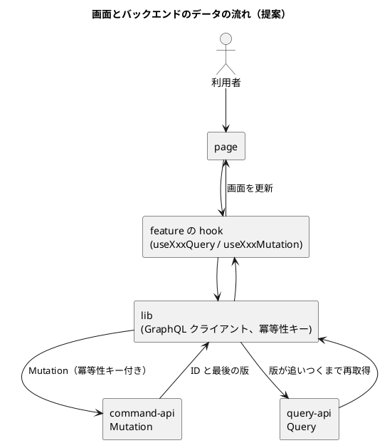

# フロントエンドアーキテクチャ設計：国際貨物輸送管理システム

[バックエンドアーキテクチャ](architecture_backend.md)（参照実装 pekko-cqrs-es-example を土台にした CQRS/イベントソーシング）が公開する GraphQL API の上に載る、フロントエンドのアーキテクチャを設計します。

- 入力: [要件定義書](../requirements/requirements_definition.md)、[ユーザーストーリー](../requirements/user_story.md)、[Unit 定義](../requirements/units.md)、[リスク台帳](../requirements/risk_register.md)、[バックエンドアーキテクチャ](architecture_backend.md)
- 参照実装 pekko-cqrs-es-example はフロントエンドを持ちません（GraphQL Playground のみ）。そのため本書は、参照実装から**フロントエンドが受ける制約**（GraphQL・結果整合・イベントの版）を読み取り、構成はアーキテクチャ設計ガイドに従って決めます
- **本書の判断はすべて「提案」です**。フレームワークの選定を含み、承認前に実装へ進みません（技術スタック選定は未実施。リスク台帳 R-08・R-02）。判断の一覧は[第 9 章](#9-設計判断の一覧adr-候補)
- 画面の一覧・レイアウト・遷移は UI 設計で決めます。本書は**画面を載せる構造**を決めます

---

## 1. 設計の前提

### 1.1 利用者と利用環境

| 利用者 | 環境 | ログイン | 主な画面（ストーリーから） |
| :--- | :--- | :--- | :--- |
| 営業担当者 | PC | 要 | 見積作成（US01）、荷主登録（US02・03）、予約登録（US04・05）、予約情報の引き渡し（US06）、予約確定・キャンセル（US13・30） |
| 経路設計者 | PC | 要 | 航海スケジュール登録・更新・検索（US24・25・07）、経路候補（US08・10）、経路確定・紐付け（US09・11）、追跡番号発行（US14）、誤配後の再設計（US28） |
| 追跡管理者 | PC | 要 | 貨物状態の更新（US17）、例外処理（US19・20）、通関申告の管理（US29）、キャンセル承認（US30）、ダッシュボード |
| 荷役作業員 | **モバイル端末** | 要 | 荷役作業の記録（US15・16）、通関申告の登録（US29）、例外の報告（US20） |
| 経理担当者 | PC | 要 | 輸送料金の算出（US21・22）、精算（US23） |
| 荷主 | PC・モバイル | 要／不要 | 追跡照会（US18）。ほかの画面はストーリーに無い（**要確認**） |
| 荷受人 | PC・モバイル | **不要** | 追跡照会（US18）のみ |
| システム管理者 | PC | 要 | アカウントのロック解除・無効化（US31 AC-04）。6 ロールに入っていない（**要確認**） |

- インセプションデッキはモバイルアプリをスコープ外とし、荷役作業員向けは「モバイル対応 UI」としています。**ブラウザで動くレスポンシブな画面**として設計します
- 画面の数・ロールごとの権限表は UI 設計と BE-09（認証・認可）で確定します

### 1.2 バックエンドから受ける制約

| 制約 | 出典 | フロントエンドへの影響 |
| :--- | :--- | :--- |
| API は GraphQL。コマンド（Mutation）とクエリ（Query）が別のエンドポイント | バックエンド BE-06 | 2 つのエンドポイントを使い分ける。型はスキーマから生成する |
| 書き込みの結果が読み取りに反映されるまで遅れる（結果整合） | バックエンド 6.4 | Mutation 直後に一覧を開いても対象が無いことがある。応答の版を使って待つ |
| コマンドは冪等性キーを持つ | バックエンド BE-08 | クライアントがキーを生成し、再送で重複しない |
| 追跡照会は認証不要の別エンドポイント | バックエンド 8.2 | 公開用の入口を分離する。制限（回数・形式）のエラーを表示できる |
| 認証方式は未決 | R-02、BE-09 | 方式に依存しない境界の内側に閉じ込める |
| 業務エラーはコードで返る | バックエンド 9.3 | エラーコードから利用者向けの文面に写す |

---

## 2. アーキテクチャの選択

アーキテクチャ設計ガイドのフロントエンド決定フローを当てはめます。

| 決定点 | 判断 | 根拠 |
| :--- | :--- | :--- |
| プロジェクトの規模 | 標準構造（11 フォルダ）から、必要なものだけを置く | 5 つの Unit と 7 つの利用者を持つ。ただし最初から全フォルダは作らない |
| レンダリング | **SPA** | 業務画面（内部ツール・ダッシュボード）が中心。公開の追跡照会も追跡番号の入力から始まり、検索エンジンへの掲載を必要としない（SEO は要件に無い） |
| サーバー状態 | GraphQL の結果を**サーバー状態**として専用のキャッシュ層で扱う | 画面の状態の大半は、バックエンドの読み取りモデルの写し |
| クライアント状態 | **Context + hooks**。グローバルストアは置かない | 認証情報と画面固有の UI 状態しか持たない。複雑になったら Zustand を足す |
| スタイル | **CSS（ユーティリティクラス）**。コンポーネントライブラリは UI 設計で決める | 荷役作業員の端末と港湾の回線を想定し、描画の軽さを優先する（ガイドの「パフォーマンス重視」の分岐） |
| 言語 | TypeScript | GraphQL のスキーマから型を生成できる |

### 2.1 フレームワークの提案（FE-01）

**推奨**: React + TypeScript + Vite の SPA。

| 候補 | 利点 | 懸念 |
| :--- | :--- | :--- |
| **React + TypeScript + Vite（推奨）** | エコシステムが大きい。GraphQL のコード生成・テスト・アクセシビリティの道具が揃う。ガイドの例（フォルダ構成・テスト）と一致する | バックエンドの Scala とは別の言語になる |
| Next.js（SSR） | — | 検索エンジンへの掲載が要件に無く、SSR の運用負荷に見合わない |
| Scala.js（Laminar など） | バックエンドと言語を揃えられる。ドメインの型を共有できる可能性 | GraphQL のコード生成や UI 部品のエコシステムが小さい。導入前に確認が要る（要確認） |

チームのスキルセットが不明なため、**人が決めます**。Scala.js を選ぶ場合も、本書の構造（features・API 層・境界の規則）は同じです。

---

## 3. 構成

### 3.1 配置とフォルダ構成

フロントエンドは `apps/web/` に置きます（`apps/` は実行物の置き場。バックエンドの `apps/command-api` などと並ぶ）。ルートの `gulpfile.js`・`package.json` とは別に、独立した `package.json` を持ちます。

```text
apps/web/
├── src/
│   ├── components/           # (1) 共通 UI。業務を知らない部品（Button、Form、Table、Dialog）
│   │   ├── ui/
│   │   └── layout/
│   ├── config/               # (2) 定数・環境変数（API の URL は環境変数。値はリポジトリに置かない）
│   ├── features/             # (3) Unit ごとの機能。業務を知る部品
│   │   ├── auth/             #     U-01：ログイン、ログアウト、ロールの判定
│   │   ├── booking/          #     U-02：見積、荷主、予約、キャンセル
│   │   ├── routing/          #     U-03：航海スケジュール、経路候補、経路確定
│   │   ├── tracking/         #     U-04：貨物状態、荷役記録、例外、通関
│   │   ├── billing/          #     U-05：料金算出、精算
│   │   └── public-tracking/  #     公開の追跡照会（認証なし）
│   ├── layouts/              # (4) 画面の枠（ログイン前、業務、公開）
│   ├── lib/                  # (5) GraphQL クライアント、エラーの変換、冪等性キー、Clock
│   ├── pages/                # (6) ルーティングの単位。features を組み合わせるだけ
│   ├── providers/            # (7) Auth、Query クライアント、Toast
│   ├── testing/              # (9) テストの道具（スキーマ由来のモック、描画ヘルパ、業務時刻のヘルパ）
│   ├── types/                # (10) 生成した GraphQL の型、共通型
│   └── utils/                # (11) 日付の整形、UN/LOCODE の整形
└── e2e/                      # 画面から踏む検査
```

- `stores/`（状態管理）は、グローバル状態が必要になるまで作らない
- 各 feature の中は `components/`・`hooks/`・`api/`（GraphQL のドキュメントと生成物）・`types/`
- **feature 同士は互いを import しない**。画面の合成は `pages/` で行う（バックエンドの「別の Unit の内側を参照しない」と同じ規則。検査は[第 8 章](#8-適合性の検査)）
- バックエンドの Unit と feature を 1 対 1 に対応させる。変更の影響が Unit の中に収まる

### 3.2 データの流れ



- 画面コンポーネントは GraphQL を直接呼ばない。`feature/api` のフックを通す
- Mutation のフックは、成功したら応答の版を返す。続く Query のフックは「その版以上になるまで」再取得する
- 一定時間を過ぎても追いつかないときは、エラーにせず「反映待ちです」を表示し、手動で更新できるようにする

---

## 4. 状態管理

| 種類 | 例 | 道具 |
| :--- | :--- | :--- |
| サーバー状態 | 予約一覧、追跡情報、航海検索結果 | サーバー状態のキャッシュ層（FE-02） |
| クライアント状態 | ログイン中の利用者・ロール | Context（`AuthProvider`） |
| UI 状態 | 入力途中のフォーム、開閉、選択中の行 | `useState`・`useReducer`（コンポーネントの中） |

### 4.1 GraphQL クライアントの提案（FE-02）

**推奨**: TanStack Query + graphql-request + graphql-codegen。

- ガイドの状態管理戦略（サーバー状態はキャッシュ層で扱う）と一致する
- 「版が追いつくまで再取得する」を `refetchInterval` で表現できる
- 型付きのドキュメントを生成し、バックエンドのスキーマ変更をコンパイルで検出する

代替は Apollo Client（正規化キャッシュが強い）と urql（軽量）です。正規化キャッシュは、結果整合の読み取りモデルでは更新の取りこぼしを隠すことがあるため、本書は採りません。

### 4.2 コマンドの冪等性

- Mutation を送るたびに、クライアントがキー（UUID など）を生成して付ける。画面を開いた時点で 1 つ作り、送信ボタンの再押下と通信エラーの再送では同じキーを使う
- 送信が成功したらキーを捨てる。同じ入力を意図して 2 回登録するときは新しいキーにする
- 荷役作業員の端末で通信が不安定でも、再送で二重に記録しない（オフライン時の扱いは[第 6 章](#6-モバイルと荷役作業員)）

---

## 5. 認証・認可・ナビゲーション

### 5.1 認証の境界

認証方式（セッションかトークンか）は BE-09 で人が決めます。フロントエンドは次の**境界の内側だけ**が方式を知る構造にします。

| 部品 | 役割 |
| :--- | :--- |
| `AuthProvider` | ログイン・ログアウト・現在の利用者（ID・ロール）を提供する。方式の詳細はここに閉じ込める |
| `useCurrentUser()` | 利用者とロールを返す。画面と feature はこれだけを使う |
| `RequireRole` | 許可されたロールだけを通す。許可されない場合は 403 の画面（US26 AC-04） |
| `lib/graphql-client` | 認証情報を要求に付ける。期限切れ（401）はログイン画面へ誘導する |

画面での出し分け（ボタンを隠す）は利便性のためで、**権限の根拠はバックエンド**です。URL を直接開いても、操作を直接送っても、バックエンドが拒否します。

### 5.2 ロール別の入口とナビゲーション

画面を作っても、そのロールが辿り着けなければ業務は進みません。画面ごとに次の 4 点を一致させ、検査に落とします。

1. UI 設計の画面一覧（ロール列つき）
2. ナビゲーションバー（ロール別のメニュー）
3. ロール別のダッシュボードの入口（US26 AC-01）
4. 到達性の検査

| 規則 | 内容 |
| :--- | :--- |
| 入口 | 各ロールは、ログイン直後のダッシュボードから担当の作業へ 2 操作以内で辿り着く |
| 状態からの到達 | 一覧の行から、その状態で開ける操作（承認・再設計・解決など）へ行ける。ボタンの出し分けは、集約の述語に対応する読み取りモデルの項目をそのまま使う（画面で状態を再判定しない） |
| 「気づく」から「行く」 | 件数や警告（留置の 3 日超過、承認待ち、誤配）は、対象の一覧へのリンクを持つ。リンク先が絞り込みを引き継ぐ |
| 共有画面 | 複数のロールが開く画面の「戻る」リンクは、開いたロールごとに出し分ける（あるロールで 403 にならない） |
| 認証の外 | ログイン画面と公開の追跡照会は認証の外にある。ログイン画面に公開照会への導線を置く |

### 5.3 公開の追跡照会

- 公開の入口（`public-tracking`）は、`layouts` も `providers` も業務画面と分ける。認証の仕組みを読み込まない
- バンドルを分け、公開ページが業務画面のコードを配らないようにする
- 照会は公開用の GraphQL エンドポイント（バックエンド 8.2）へ送る
- 「追跡番号が見つかりません」（US18 AC-03）は、存在しない番号と形式不正の番号で同じ文面にする。回数制限に達したときは、待つように案内する
- 個人情報を表示しない（バックエンドも返さない）

---

## 6. モバイルと荷役作業員

荷役作業員の画面は、手袋をはめた手・屋外・不安定な回線を想定する場面があります（インセプションデッキのリスク #5：現場スタッフの定着）。

- 画面は**モバイルファースト**のレスポンシブにする。荷役記録は、追跡番号の入力（またはスキャン）、作業種別、日時、場所の最小の入力で完結する
- 追跡番号の**スキャン**（US15 AC-01）の方式（カメラによるバーコード読み取りなど）は、端末と運用が未定のため要確認。方式が決まるまで手入力で実装する
- 場所は UN/LOCODE の選択式にし、手入力の誤りを防ぐ。予定経路に含まれない場所は、登録前に警告を出す（US15 AC-04、US28 AC-01）
- **オフライン対応は当面しない**。荷役の記録を端末にためて後で送る方式は、順序・重複・時刻の扱いが複雑になる。回線が不安定という前提が事実か、現場に確認してから判断する（FE-05）。冪等性キー（[4.2](#42-コマンドの冪等性)）があるため、再送は安全にできる

---

## 7. 品質

### 7.1 エラーと表示

- バックエンドの業務エラーのコードを、利用者向けの文面に写す表を `lib` に 1 つだけ持つ。画面ごとに文面を書かない
- 認証の失敗とロックで同じ文面を出す（US31 AC-03）。画面側で違いを作らない
- 通信エラーと業務エラーを区別する。通信エラーは再送の案内、業務エラーは入力の修正の案内

### 7.2 時刻と日付

- 日付と時刻の整形・比較は `utils` の 1 箇所に集める。業務タイムゾーンの基準はバックエンドの BE-11 に従う
- 画面で現在時刻を直接呼ばない。テストが固定できる Clock を通す
- 期限（日付）と到着（時刻付き）を画面で比べない。バックエンドが返した判定を表示する

### 7.3 アクセシビリティとデザイン

- キーボードだけで操作でき、状態（例外・留置・誤配）を色だけで伝えない
- デザインシステム（色・間隔・部品）は UI 設計で決める。候補はコンポーネントライブラリの採用か、自前の薄い部品群。外部ライブラリの導入は承認が要る
- 言語は日本語のみ（AI の仮定。要確認）

---

## 8. 適合性の検査

| # | 規則 | 検査 |
| :--- | :--- | :--- |
| F1 | feature 同士を import しない | import の規則を lint に入れる |
| F2 | 画面コンポーネントが GraphQL を直接呼ばない | lint で `lib` と `feature/api` 以外からの呼び出しを禁止する |
| F3 | GraphQL の型がバックエンドのスキーマと一致する | 公開スキーマを固定したファイルからコードを生成し、差分があればビルドを失敗にする |
| F4 | モックがバックエンドより甘くない | モックの応答をスキーマで検証する。**型が違う値を通すモック**にしない |
| F5 | すべてのロールが担当の画面へ辿り着ける | ロール × 画面の表から全組み合わせを生成して検査する（ナビ・ダッシュボード・直接 URL） |
| F6 | 権限の無いロールの URL 直打ちが 403 | 表から生成する |
| F7 | 公開の追跡照会が認証の仕組みと業務画面のコードを含まない | バンドルの内容を検査する |
| F8 | Mutation 直後に一覧で対象が見える | 画面から、一覧の行を選んで始める E2E。識別子を握って API を叩く検査にしない |
| F9 | 日時の検査が業務タイムゾーンで安定する | E2E の日時は共有ヘルパで作る。CI の時刻帯（UTC）でも一度回す |

**E2E の始め方**: 識別子を知った状態から始めず、**一覧から対象を選んで**始めます。識別子を握って API を叩く検査は、一覧から辿れない欠陥を踏みません。

---

## 9. 設計判断の一覧（ADR 候補）

| ID | 判断 | 推奨 | 主な代替 | 関連 | 決定期限 |
| :--- | :--- | :--- | :--- | :--- | :--- |
| FE-01 | 言語とフレームワーク | React + TypeScript + Vite の SPA | Scala.js、Next.js | R-08 | Bolt 1 の前 |
| FE-02 | GraphQL クライアントとサーバー状態 | TanStack Query + graphql-request + graphql-codegen | Apollo Client、urql | — | Bolt 1 の前 |
| FE-03 | 認証の境界 | `AuthProvider` に方式を閉じ込める | — | R-02、BE-09 | Bolt 2 の前 |
| FE-04 | 公開照会の分離 | 別のエントリ・別のバンドル・別のエンドポイント | 同一バンドルで出し分ける | R-02、BE-06 | Bolt 8 の前 |
| FE-05 | モバイルの方式 | レスポンシブ Web。オフライン対応は現場の確認後 | PWA、ネイティブアプリ（スコープ外） | リスク #5 | Bolt 10 の前 |
| FE-06 | デザインシステム | UI 設計で決める | コンポーネントライブラリ／自前 | 外部ライブラリの導入 | Bolt 1 の UI 設計時 |

---

## 10. 未決事項と AI の仮定

### 10.1 人に確認する点

- フロントエンドの言語とフレームワーク（FE-01）。チームのスキルセット
- 荷主ロールの画面は追跡照会以外にあるか。精算書の確認・支払い（BUC20）の画面を荷主に出すか
- システム管理者を 7 つ目のロールとして扱うか（US31 AC-04 のロック解除）
- 荷役作業員の端末と通信環境、スキャンの方式
- 画面の言語は日本語のみでよいか

### 10.2 AI の仮定

- 公開の追跡照会も SPA でよい（検索エンジンへの掲載が要件に無い）
- 画面の数・名前・レイアウトは UI 設計で変わる。第 1.1 節の画面は、ストーリーから拾った暫定の一覧
- ロールと画面の権限の対応表は[UI 設計 4.2](ui_design.md)に草案あり（操作単位の表は未作成）。ロールはアクターと 1 対 1 に対応する（US26 の AI の仮定）

### 10.3 次の設計活動

1. UI 設計（`analyzing-ui-design`）：ウォーキングスケルトン（U-02 Bolt 1）の画面から。ロール × 画面の表を作る
2. 技術スタック選定（`analyzing-tech-stack`）：FE-01・FE-02・FE-06 を表にする
3. テスト戦略（`analyzing-test-strategy`）：第 8 章の検査を水準に割り当てる
