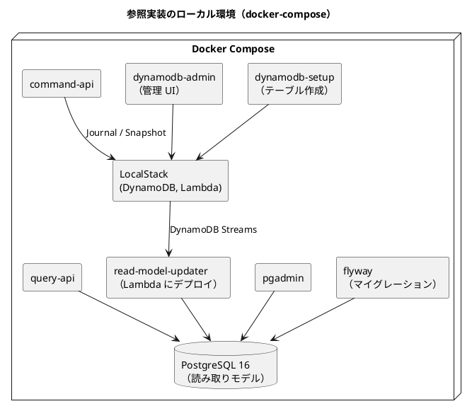
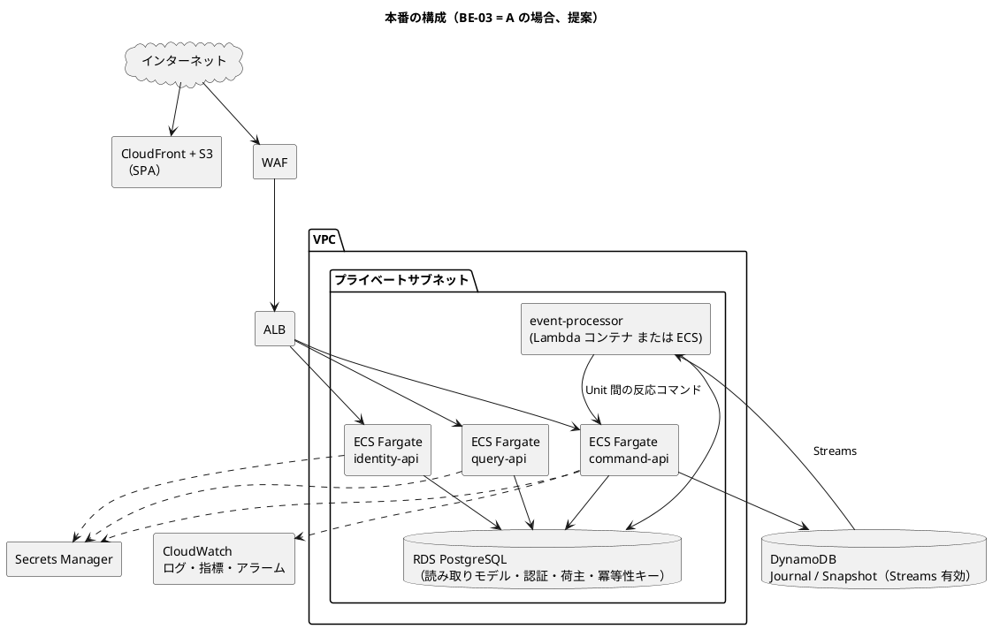
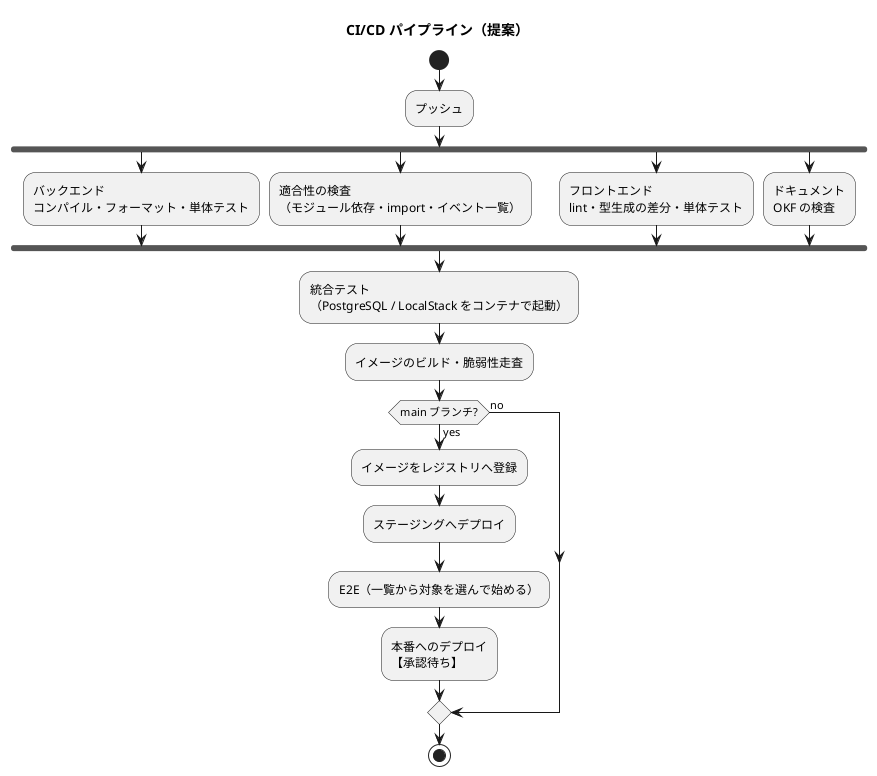

# インフラストラクチャアーキテクチャ設計：国際貨物輸送管理システム

参照実装 `tmp/pekko-cqrs-es-example`（Git 管理外）の実行環境（Docker Compose・LocalStack・DynamoDB・PostgreSQL・Lambda）を土台に、本プロジェクトの実行環境・デプロイ・運用の構成を設計します。

- 入力: [バックエンドアーキテクチャ](architecture_backend.md)、[フロントエンドアーキテクチャ](architecture_frontend.md)、[リスク台帳](../requirements/risk_register.md)、[リリース計画](../development/release_plan.md)、[運用ドキュメントの入口](../operation/index.md)
- **本書の判断はすべて「提案」です**。デプロイ設定・環境変数・本番環境に関わる判断は確認必須の操作で、承認前に実装や環境操作へ進みません（R-10）
- 可用性・性能・RPO/RTO・コストの**数値は本書では決めません**（[非機能要件定義](non_functional.md)・[運用要件定義](operation.md)に仮置きを提案済み。承認までは確定でない）。数値が要る箇所は「非機能要件定義で決める」と書きます
- 環境変数と接続情報（`.env`、`.env.vault`、SSH 接続先）の値は AI が読み書きしません。環境操作は運用手順書の定義済みタスク経由で行います（R-10、`CLAUDE.md`）

---

## 1. 設計の前提

### 1.1 インフラへの要求

| 要求 | 出典 | インフラへの影響 |
| :--- | :--- | :--- |
| 荷主が 24 時間いつでも追跡できる | U-04 Intent | 公開の追跡照会は、業務画面と独立して落ちにくくする |
| 荷役作業が追跡情報へ即座に反映される | U-04 NFR | 反映遅延を計測し、アラートにする（[バックエンド 9.4](architecture_backend.md#94-可観測性)） |
| イベントは消せず、損失すると復元できない | バックエンド 第 3 章 | イベントストアのバックアップと復旧を最優先にする |
| 読み取りモデルはイベントから作り直せる | バックエンド 6.2 | 読み取りモデルは「作り直せる」前提で運用する（作り直しの手順を持つ） |
| 追跡照会がログイン無しで使える | US18、R-02 | 公開エンドポイントに、回数制限と WAF を置く |
| 接続情報を AI が読み書きしない | R-10 | 値は Secrets Manager 等に置き、リポジトリとイメージに入れない |
| スキーマ変更は人が差分を確認する | R-03 | マイグレーションの適用を、承認を挟む手順にする |

### 1.2 現在のリポジトリの運用基盤

| 資産 | 内容 | 本書での扱い |
| :--- | :--- | :--- |
| `ops/scripts/*.js`（Gulp） | `ssh.js`・`vault.js`・`release.js`・`okf.js`・`sonar_local.js` など。`DEV_`・`STG_`・`PRD_` の接頭辞で SSH 接続先を切り替える | 新しい運用タスクはここに追加する（`operating-script`） |
| `ops/nix/environments/scala` | Scala の開発シェル | ローカルの開発環境に使う |
| `docker-compose.yml`・`Dockerfile`（ルート） | ドキュメント（MkDocs）用 | アプリケーション用とは分ける |
| `.github/workflows/` | `docs-okf.yml`・`mkdocs.yml`・`docker-publish.yml`（GHCR へのイメージ公開） | アプリケーションの CI は新規に足す |
| `docs/template/` の環境セットアップ手順書 | アプリケーション開発・開発・AWS ステージング・AWS プロダクション | 手順書の元にする。`docs/operation/` の実体は未作成 |

---

## 2. 参照実装のインフラの分析

### 2.1 構成

### 2.2 採る・変える・足す・捨てる

| 区分 | 要素 | 参照実装 | 本プロジェクトでの扱い |
| :--- | :--- | :--- | :--- |
| 採る | ローカルで AWS を再現 | LocalStack（`SERVICES=lambda,dynamodb`） | 採る（BE-03 で A を選ぶ間）。B を選ぶ場合は不要 |
| 採る | 環境変数による設定の上書き | HOCON の `host = "127.0.0.1"` に続けて `host = ${?COMMAND_API_SERVER_HOST}` | 採る。既定値は安全なローカル値、本番は環境変数で上書きする |
| 採る | イメージに秘密情報を入れない | `build.sbt` のコメント「Keep images free of secrets; pass credentials at runtime」 | 採る（R-10） |
| 採る | LB 向けの停止手順 | `load-balancer.detach-wait-duration`・`health-check-grace-period` | 採る。ECS のデプロイでの切り離しに使う（[4.3](#43-デプロイ戦略)） |
| 採る | E2E スクリプト | `scripts/test-e2e.sh`（作成 → 待機 → 照会） | 採る。Gulp タスクとして足し、待機は「版が追いつくまで」にする |
| 変える | 起動・停止のシェルスクリプト | `scripts/run-single.sh`、`run-cluster.sh` | 運用タスク（Gulp）として足す（`operating-script`）。リポジトリの運用スクリプトの規約に合わせる |
| 変える | Lambda 用の fat jar | `sbt-assembly` と多数の除外設定 | コンテナイメージ配布にする（IF-04）。LocalStack の zip 上限の引き上げ（500 MB／2 GB）に頼らない |
| 変える | ベースイメージ | `eclipse-temurin:17-jre-focal` | 技術スタック選定で JDK のバージョンを決める。ベースイメージの更新を CI で検知する |
| 変える | DAO 生成用の PostgreSQL | sbt のタスクが `docker run` で起動 | 採るが、ポート・名前を環境変数から取り、CI でも動くようにする |
| 足す | 本番相当の環境 | 無い | ステージング・本番（[第 3 章](#3-環境の構成)） |
| 足す | CI/CD | 無い | [第 6 章](#6-cicd) |
| 足す | 監視・アラート | 無い | [第 7 章](#7-監視と運用) |
| 足す | バックアップと復旧 | 無い | [第 8 章](#8-バックアップと復旧) |
| 足す | 公開エンドポイントの防御 | 無い | WAF・回数制限（[5.3](#53-ネットワークと公開エンドポイント)） |
| 捨てる | ホスト名・ポート・ダミーの認証情報 | `50501`、`AWS_ACCESS_KEY_ID: dummy`、固定の DB パスワード | 持ち込まない（R-10）。開発用の値も `.env` で個別に与える |
| 捨てる | `run-claude.sh`・`run-codex.sh`・`run-gemini.sh` | AI エージェントの起動スクリプト | 持ち込まない |

---

## 3. 環境の構成

| 環境 | 目的 | 構成 | 手順書（テンプレート） |
| :--- | :--- | :--- | :--- |
| ローカル（アプリケーション開発） | 日々の開発・単体／統合テスト | Nix の Scala 開発シェル + Docker Compose（PostgreSQL、BE-03 の方式に応じて LocalStack）。アプリは sbt から起動 | アプリケーション開発環境セットアップ手順書 |
| 開発 | 結線の確認、AI の Bolt の動作確認 | クラウド上の最小構成 | 開発環境セットアップ手順書 |
| ステージング | 本番相当の検証、PoC、クラスタ E2E | 本番と同じ構成で小さく | AWS ステージング環境セットアップ手順書 |
| 本番 | 利用者に提供 | 冗長化・バックアップ・監視あり | AWS プロダクション環境セットアップ手順書 |

- ステージングと本番は**同じ IaC から作る**（差は変数だけ）
- 本番の変更は**承認を挟む**（確認必須）。AI は計画と差分の提示までを担う
- 「開発」環境をクラウドに置くかは、費用と効果を見て決める（IF-01）。ローカルとステージングだけで足りるなら省く

---

## 4. 実行基盤

### 4.1 デプロイパターンの選択

アーキテクチャ設計ガイドのデプロイパターンを当てはめます。

| パターン | 判断 | 根拠 |
| :--- | :--- | :--- |
| モノリシック | 採らない | イベントの購読処理と API で、スケールと再起動の単位が違う |
| **コンテナ（マネージドなオーケストレーション）** | **採る** | バックエンドは 4 つの実行物（command-api・query-api・event-processor・identity-api）。デプロイ頻度が高く、自動スケーリングが要る |
| マイクロサービス（Unit ごと） | 採らない | Unit は `contract` で境界を強制しており、実行物を分ける理由（独立スケール・独立障害）が今は無い。必要になったら Unit 単位の実行物に分けられる構造にしてある |
| サーバーレス | event-processor のみ候補（IF-04） | イベント駆動の購読に合う。ただしパッケージサイズとコールドスタート |

### 4.2 AWS を前提にした構成（提案）

AWS を前提にします（IF-01）。理由は、テンプレートが AWS のステージング・本番の手順書を持つこと、参照実装が DynamoDB・Lambda を使うことです。BE-03 で B（PostgreSQL + Pekko Projection）を選ぶ場合は、AWS 固有の部品が減り、どのクラウドでも成り立ちます。

| 部品 | 役割 | 備考 |
| :--- | :--- | :--- |
| ECS Fargate | command-api・query-api・identity-api の実行 | EKS（Kubernetes）は運用負荷が高く、4 つの実行物には過剰。**推奨は ECS Fargate**。EKS を選ぶ場合は IF-01 で再評価 |
| DynamoDB | イベントストア（Journal・Snapshot） | オンデマンド課金から始める。ポイントインタイム復旧を有効にする。Streams を有効にする |
| RDS PostgreSQL | 読み取りモデル（Unit ごとのスキーマ）、認証、荷主、冪等性キー | 本番は Multi-AZ。バックアップ保持期間は非機能要件定義で決める |
| event-processor | イベントの購読 | Lambda（コンテナイメージ）か ECS の常駐かを IF-04 で決める |
| ALB + WAF | 入口、TLS、回数制限 | 公開照会のパスに回数制限（[5.3](#53-ネットワークと公開エンドポイント)） |
| CloudFront + S3 | SPA の配信 | 公開照会のページと業務画面は別のバンドル（FE-04） |
| Secrets Manager | 接続情報・鍵 | 値をリポジトリとイメージに置かない（R-10） |
| CloudWatch | ログ・指標・アラーム | [第 7 章](#7-監視と運用) |

### 4.3 デプロイ戦略

イベントソーシングでは、**新旧のバージョンが同時に動く時間**に、イベントの版が食い違いうる点が通常のアプリケーションと違います。

| 規則 | 内容 |
| :--- | :--- |
| 方式 | API は**ローリング更新**（ECS）。ブルーグリーンは、リソースが 2 倍になるため当面採らない |
| 切り離し | 参照実装の `detach-wait-duration`・`health-check-grace-period` に倣い、ALB から切り離してから停止する。ターゲットの登録解除の待ち時間と合わせる |
| イベントの版 | **読む側を先にデプロイする**。新しい版のイベントを読める実装（アップキャスト）を先に配り、書く側（新しい版のイベントを出す変更）を後から配る。同時に配ると、旧版のノードが新版のイベントを読めない |
| 破壊的な変更 | イベントの意味を変える変更は新しい版を作り、旧版も読めるまま残す。旧版の廃止は、全イベントの再書き込みではなく、読み取りの変換で扱う |
| スキーマ変更 | 読み取りモデルのスキーマ変更は Flyway。**追加 → 切り替え → 削除**の順に分け、新旧のアプリが同時に動いても壊れない形にする。適用前に人が差分を確認する（R-03）。適用済みのマイグレーションは書き換えない |
| イメージ | 同じタグのイメージを作り直したら、デプロイは新しい定義で行う（タグが同じだけではタスクが入れ替わらない）。可能ならダイジェストで指定する |
| ロールバック | イメージを前の版に戻す。**イベントは戻せない**ため、新しい版が出したイベントを旧版が読めることを、デプロイ前に確かめる |
| event-processor | 停止中に溜まったイベントは再開後に処理される。停止・再開で読み取りモデルが壊れない（冪等）ことを検査で確かめる |

### 4.4 event-processor の実行形態（IF-04）

| | Lambda（コンテナイメージ） | ECS の常駐サービス |
| :--- | :--- | :--- |
| 参照実装との差 | 小さい（ただし fat jar からコンテナイメージへ） | 大きい（Streams を自分で読む。BE-03 の B ならこちら） |
| スケール | Streams のシャードに合わせて自動 | 自分で設計する |
| コールドスタート | あり（ActorSystem の起動を含む） | なし |
| パッケージ | 実 AWS の zip 上限を超える可能性があるためコンテナ | コンテナ |
| 購読者の追加 | Streams の購読者数の目安に注意（バックエンド 6.3） | 自由 |

**推奨**: 最初は Lambda（コンテナイメージ）で始め、Bolt 4 の前の PoC（BE-03）で結論が変わるなら ECS に移す。

---

## 5. データ・ネットワーク・セキュリティ

### 5.1 データストア

| データ | 保存先 | 復元可能か | 扱い |
| :--- | :--- | :--- | :--- |
| イベント（Journal・Snapshot） | DynamoDB（A）／PostgreSQL（B） | **不可（唯一の真実）** | ポイントインタイム復旧、削除保護、アクセス権を最小に |
| 読み取りモデル | PostgreSQL（Unit ごとのスキーマ） | **可（イベントから再構築）** | バックアップは任意。再構築の手順と所要時間を測っておく |
| 荷主（個人情報） | PostgreSQL | 不可 | バックアップ必須。暗号化。削除・訂正の運用を決める（BE-10） |
| 認証（アカウント・監査ログ） | PostgreSQL | 不可 | バックアップ必須。監査ログは追記専用 |
| 冪等性キー | PostgreSQL | 不要（期限付き） | 保持期間後に削除 |

### 5.2 アプリケーションの設定

- 設定は HOCON の既定値 + 環境変数の上書き。本番の値は Secrets Manager 等から実行時に与える
- 環境変数の**値**はリポジトリ・イメージ・ログに出さない。AI は値を読まない（R-10）
- 環境ごとの差（接続先・ポート・タイムアウト）だけが設定の差。コードに環境名で分岐を書かない

### 5.3 ネットワークと公開エンドポイント

- ALB だけを公開サブネットに置く。ECS・RDS はプライベートサブネットに置く
- DynamoDB へは VPC エンドポイントで到達する（公開の経路を通さない）
- DB への運用上の接続は、運用手順書の定義済みタスク（踏み台・SSM など）を使う。独自の一時スクリプトを作らない
- **公開の追跡照会**（バックエンド 8.2）：
  - WAF で、IP あたりの要求数を制限する。アプリケーション側でも追跡番号あたりの照会回数を制限する
  - **ヘルスチェックは制限の対象から外す**。過負荷でヘルスチェックが失敗すると、タスクの再起動を繰り返す
  - 公開パスは業務パスと別のターゲットグループにし、片方の過負荷がもう片方を巻き込まないようにする

### 5.4 セキュリティの基本

| 領域 | 方針 |
| :--- | :--- |
| 通信 | TLS（ALB・CloudFront）。内部通信も暗号化を検討 |
| 認証情報 | Secrets Manager。IAM ロールを実行物ごとに分け、最小権限にする（command-api だけが Journal へ書ける、query-api は読み取りモデルの読み取りだけ、など） |
| データ | DynamoDB・RDS・S3 を保管時に暗号化。個人情報は荷主の表にだけ置く |
| 監査 | 本番の操作ログ（CloudTrail 等）を有効にする |
| 依存 | 依存ライブラリとイメージの脆弱性走査を CI に入れる。導入するライブラリ（個人製の永続化プラグインなど）は承認が要る |

---

## 6. CI/CD

### 6.1 パイプライン（提案）

- 既存の `docs-okf.yml`・`mkdocs.yml` は残す。アプリケーションのワークフローは別ファイルに足す
- テストは `sbt test` を全体で通す。モジュールを絞った実行だけで緑にしない（依存の規則の検査は全体を回して初めて働く）
- Scala の統合テストは、テストコンテナで PostgreSQL と（BE-03 が A の場合）LocalStack を起動する
- クラウドへの認証は、長期の鍵を CI に置かず、OIDC による一時的な認証にする

### 6.2 レジストリ（IF-03）

現在のワークフローは GHCR へイメージを公開します。ECS から引くには、ECR を使うか、GHCR の認証を Secrets Manager 経由で与えます。**推奨は ECR**（IAM で完結する）。

### 6.3 環境ごとの承認

| 環境 | デプロイ | 承認 |
| :--- | :--- | :--- |
| ステージング | main への反映で自動 | 不要 |
| 本番 | 手動で起動 | **必須**（確認必須の操作）。差分（イメージの版、IaC の差分、マイグレーション）を提示してから |

---

## 7. 監視と運用

### 7.1 指標

| 指標 | 内容 | 用途 |
| :--- | :--- | :--- |
| **反映遅延** | イベントの発生時刻と、読み取りモデルへの反映時刻の差 | U-04 の測定基準（荷役作業から追跡情報への反映時間）。アラームの閾値は非機能要件定義で決める |
| プロジェクションの失敗・待避の件数 | リトライ上限を超えて待避先に回った件数 | 0 でなければ調べる |
| 購読の停滞 | Streams の古さ（`IteratorAge` など）、キューの滞留 | 反映遅延の先行指標 |
| API | 要求数・エラー率・応答時間（Unit ごと） | 通常の監視 |
| コマンドの業務エラー | 状態遷移違反・認可違反の件数 | 想定外の増加で不正や不具合を知る |
| 認証 | ログイン失敗・ロックの件数 | 総当たりの検知（U-01 の測定基準） |
| 公開照会 | 回数制限に達した件数 | 推測の試行の検知 |

### 7.2 ログ

- 構造化ログ（JSON）。相関 ID（冪等性キー）・集約 ID・利用者 ID・イベント ID を載せる
- 個人情報と接続情報をログに出さない
- ヘルスチェックの要求はアクセスログから除く（量が多く、調査の邪魔になる）

### 7.3 運用タスク（案）

運用手順書の定義済みタスクとして足します（`operating-script`）。名前は案です。独自の一時スクリプトは作りません。

| 目的 | タスク（案） |
| :--- | :--- |
| ローカル環境の起動・停止 | `dev:up`・`dev:down` |
| 読み取りモデルのマイグレーションの確認・適用 | `db:migrate:info`・`db:migrate`（適用は承認後） |
| 読み取りモデルの再構築 | `readmodel:rebuild` |
| 待避先に回ったイベントの確認・再処理 | `events:dlq:list`・`events:dlq:redrive` |
| E2E | `e2e:run` |
| バックアップ・リストア | `backup:*`（`operating-backup`） |

---

## 8. バックアップと復旧

| 対象 | バックアップ | 復旧 |
| :--- | :--- | :--- |
| イベントストア | ポイントインタイム復旧 + 定期のエクスポート | **最優先**。復旧後に読み取りモデルを再構築する |
| 読み取りモデル | RDS の自動バックアップ（保持期間は NFR） | 失っても再構築できる。再構築の所要時間が復旧時間になる |
| 荷主・認証・冪等性キー | RDS の自動バックアップ + スナップショット | RDS のスナップショットから |
| 設定・IaC | Git | — |

- RPO／RTO は非機能要件定義で決める。ガイドの復旧パターン（バックアップ＆リストア、パイロットライト、ウォームスタンバイ）のうち、**バックアップ＆リストアから始め**、要求に応じて引き上げる
- 復旧の手順は**実際に回して**所要時間を測る。手順書に書いただけにしない
- 読み取りモデルの再構築は、イベント数に比例して時間がかかる。件数が増えたら、スナップショットや並列化を検討する

---

## 9. コスト

| 項目 | 方針 |
| :--- | :--- |
| 開発・ステージング | 夜間・休日は停止、またはサイズを下げる。DynamoDB はオンデマンド |
| 本番 | 最小の台数から始め、指標に基づいて増やす。長期利用の割引は、使用量が安定してから |
| ログ | 保持期間を決める。ヘルスチェックのログを除く |
| イベントストア | イベントは増え続ける。保持の方針（アーカイブの有無）は NFR で決める |

具体的な金額は、技術スタックとインスタンスの構成が決まってから見積もります。

---

## 10. 適合性の検査

| # | 規則 | 検査 |
| :--- | :--- | :--- |
| I1 | 接続情報・鍵がリポジトリとイメージに無い | 秘密情報の走査を CI に置く。イメージの履歴も対象 |
| I2 | ステージングと本番が同じ IaC から作られる | 変数以外の差が無いことを IaC の差分で確かめる |
| I3 | 公開パスが業務パスと別のターゲットグループ | IaC の検査 |
| I4 | ヘルスチェックが回数制限・同時実行制限の対象外 | 過負荷の状態でヘルスチェックが 200 を返すことを確かめる |
| I5 | 新しい版のイベントを旧版が読める | 直前の版のイメージに、新しい版のイベントを読ませる検査 |
| I6 | 読み取りモデルを再構築できる | ステージングで再構築を実際に回し、所要時間を記録する |
| I7 | マイグレーションが数値順に適用され、既存の環境で通る | 空の DB だけでなく、前の版まで適用済みの DB に対して適用する |
| I8 | 同じタグのイメージを作り直したとき、実環境が新しい定義で動く | ダイジェストで指定し、デプロイ後に実行中のイメージを確かめる |

---

## 11. 設計判断の一覧（ADR 候補）

| ID | 判断 | 推奨 | 主な代替 | 関連 | 決定期限 |
| :--- | :--- | :--- | :--- | :--- | :--- |
| IF-01 | クラウドと実行基盤 | AWS、ECS Fargate。「開発」環境をクラウドに置くかは別に決める | EKS、他社クラウド、BE-03 が B なら任意 | R-10、確認必須（本番環境） | Bolt 1 の前 |
| IF-02 | IaC | Terraform（`operating-provision`） | CloudFormation、Pulumi | 確認必須 | ステージング構築の前 |
| IF-03 | コンテナレジストリ | ECR | GHCR | — | ステージング構築の前 |
| IF-04 | event-processor の実行形態 | Lambda（コンテナイメージ）で始め、Bolt 4 の前の PoC で見直す | ECS の常駐 | BE-03 | Bolt 4 の前 |
| IF-05 | デプロイ戦略 | ローリング更新。読む側を先に配る | ブルーグリーン | — | ステージング構築の前 |
| IF-06 | バックアップと復旧の水準 | バックアップ＆リストアから | パイロットライト以上 | 非機能要件 | 非機能要件定義後 |
| IF-07 | 公開照会の防御 | WAF + アプリの回数制限 + 別のターゲットグループ | アプリの制限のみ | R-02、BE-06 | Bolt 8 の前 |
| IF-08 | 運用タスクの整備 | 7.3 の案を `operating-script` で足す | — | R-10 | Bolt 1 の前（ローカル分） |

> IF-01・IF-02・IF-03・IF-05 は、デプロイ設定・本番環境に関わるため確認必須です。ローカル環境（Docker Compose）は、Bolt 1 の前に承認を得て先に整えます。

---

## 12. 未決事項と AI の仮定

### 12.1 人に確認する点

- クラウドは AWS でよいか。「開発」環境をクラウドに置くか、ローカルとステージングだけにするか
- イベントストアの方式（BE-03）。インフラの構成はこれに連動する
- 可用性・RPO／RTO・費用の上限（非機能要件定義）
- 運用の体制（誰がアラートを受けるか）。ケーススタディのため、体制を想定するか

### 12.2 AI の仮定

- 実行物は 4 つ（command-api・query-api・event-processor・identity-api）。Unit ごとの実行物には分けない
- 実 AWS の Lambda の zip 配布の上限（50 MB／250 MB）を、参照実装の fat jar が超える可能性がある（参照実装が LocalStack の上限を引き上げていることからの推測。要確認）
- ECS 上でクラスターモード（BE-12）にする場合の、ノードの発見方式は別に調べる（要確認）
- 本書の構成図は、BE-03 = A の場合。B の場合は DynamoDB・Streams・Lambda が PostgreSQL と常駐プロセスに置き換わる

### 12.3 次の設計活動

1. 非機能要件（`analyzing-non-functional`）・運用要件（`analyzing-operation`）：数値を決める
2. 技術スタック選定（`analyzing-tech-stack`）：JDK・ベースイメージ・ライブラリの版
3. 環境構築（`operating-setup`）：ローカル環境から、承認を得て進める
4. 運用スクリプト（`operating-script`）：7.3 のタスク
