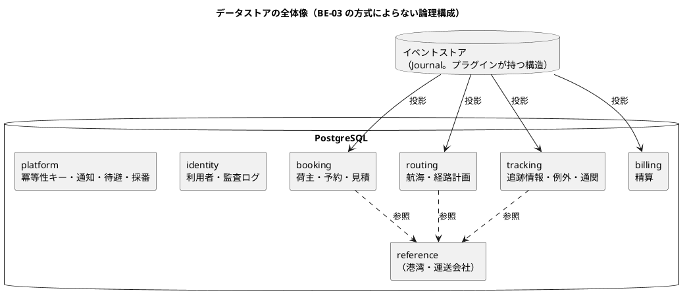
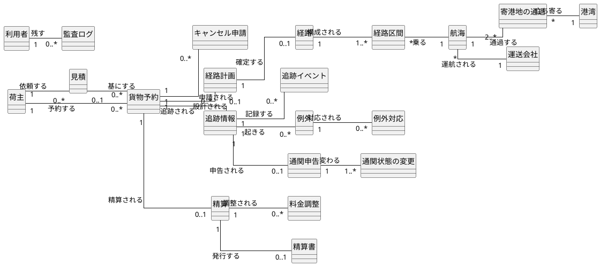
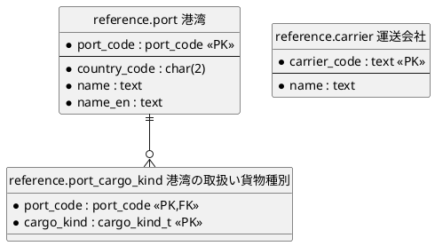
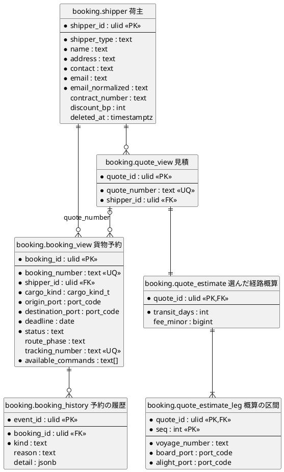
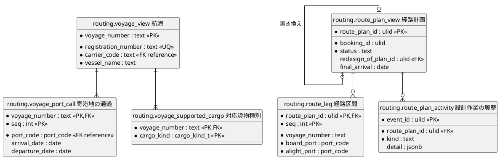
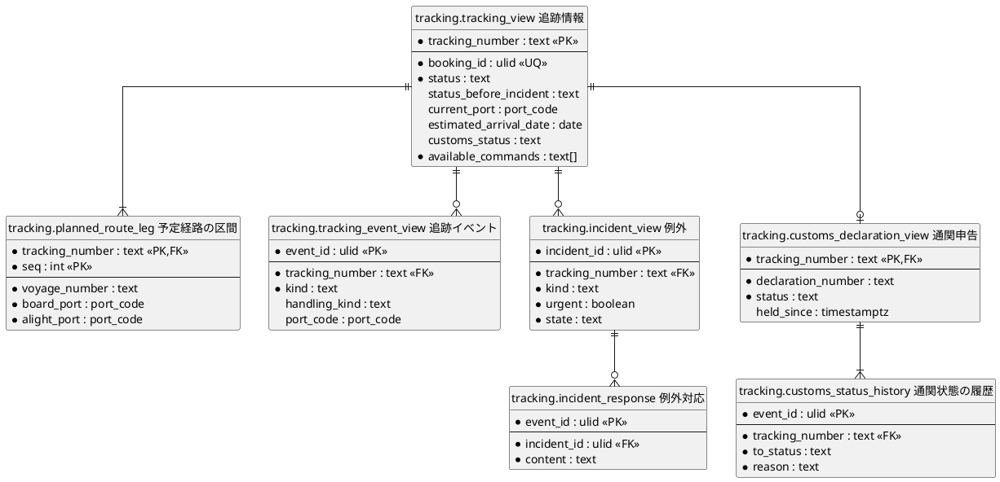
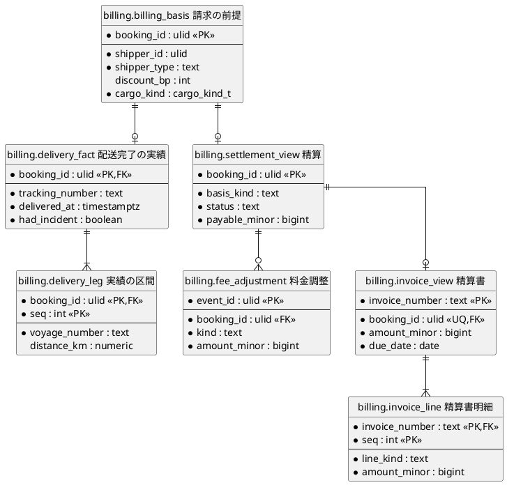
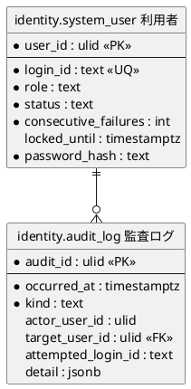

# データモデル設計：国際貨物輸送管理システム

[ドメインモデル](domain-model.md)の集約とイベントを、永続化の構造（概念データモデル → 論理データモデル）に落とします。[バックエンドアーキテクチャ](architecture_backend.md)の CQRS/イベントソーシングに合わせ、**書き込み側（イベントストア）**と**読み取り側（Unit ごとの読み取りモデル）**を分けて設計します。

- 入力: [要件定義書](../requirements/requirements_definition.md)（情報モデル）、[ユーザーストーリー](../requirements/user_story.md)、[Unit 定義](../requirements/units.md)、[リスク台帳](../requirements/risk_register.md)、[用語集](glossary.md)、[ドメインモデル](domain-model.md)、[バックエンド](architecture_backend.md)・[フロントエンド](architecture_frontend.md)アーキテクチャ、[UI 設計](ui_design.md)
- 方法は[データモデル設計ガイド](../reference/データモデル設計ガイド.md)に従います。図は PlantUML の ER 図です。テーブルは第 3 正規形を基本とし、非正規化は理由を記録します
- **本書の判断は提案です**。スキーマは確認必須の操作で、マイグレーションは適用前に人が差分を確認します（R-03）。承認前に DDL の適用や実装へ進みません
- 物理名は英語の `snake_case`、論理名は[用語集](glossary.md)の日本語です。コード上の英語名は[ドメインモデル 第 3 章](domain-model.md#3-ユビキタス言語と英語名)に合わせます
- 数値の見積り（データ量・保持期間・性能）は本書に置きません（[非機能要件定義](non_functional.md)に仮置きを提案済み。承認までは確定でない）

---

## 1. 設計の方針

| # | 方針 | 理由 |
| :--- | :--- | :--- |
| DM-01 | **真実はイベントストア**にある。読み取りモデルはイベントから作り直せる（捨てて再構築してよい） | バックエンド 6.2。読み取りモデルのスキーマ変更が、データ移行でなく再投影で済む |
| DM-02 | 読み取りモデルは **Unit ごとのスキーマ**（`booking`・`routing`・`tracking`・`billing`）。スキーマをまたぐ外部キー・結合を置かない。例外は共有の参照データ `reference`（読み取り専用。外部キーと結合を許す） | Unit の独立を守る（バックエンド 6.1）。港名などは全 Unit が表示に使う |
| DM-03 | 集約単位の行は `aggregate_version` を持ち、「保存済みの版 + 1」のときだけ更新する。追記専用の履歴行は**イベント ID を主キー**にして、再配信で行が増えないようにする | バックエンド 6.2 |
| DM-04 | 列挙値は `text` + `CHECK` で持つ（PostgreSQL の `ENUM` 型は使わない）。値は英大文字の snake（`IN_TRANSIT`）で、ドメインの名前と 1 対 1 | 値の追加・変更をマイグレーションで安全に行う |
| DM-05 | 識別子は ULID（`char(26)`）。業務番号（予約番号・追跡番号など）は別の列で持ち、一意制約を付ける。形式は未定義 | バックエンド 4.4 |
| DM-06 | 金額は**最小単位の整数**（`bigint`）と通貨（`char(3)`）。通貨と端数処理は未定義のため、列は用意し、制約は確定後に足す | ドメインモデル 第 11 章（`Money`） |
| DM-07 | 日付は `date`（業務日付）、時刻は `timestamptz`（UTC で保存）。業務日付をどのタイムゾーンで決めるかはアプリケーション側の規則（BE-11） | 国際輸送 |
| DM-08 | **個人情報は `booking.shipper` と `identity.system_user` の 2 表だけ**に置く。読み取りモデル・履歴・イベントには ID だけを持つ | BE-10。公開の追跡照会に個人情報が漏れない |
| DM-09 | 外部の仕様が未確定の項目（危険物申告情報など）は `jsonb` で持ち、確定後に列へ展開する | R-05。項目を創作しない |
| DM-10 | 「実行できる操作」（`available_commands`）を、状態を持つ読み取りモデルの行に持つ。投影のときに、**ドメインの述語**で計算して書く | UI 設計の方針 P3。画面が状態を再判定しない |
| DM-11 | 公開の追跡照会は、**専用のビュー**（`tracking.public_tracking_v`）だけを読む。公開用のデータベース権限は、そのビューの `SELECT` だけ | バックエンド 8.2、検査 A7 |
| DM-12 | 書き込み側のテーブル（荷主・利用者・冪等性キーなど）は作成・更新の日時と者を持つ。読み取りモデルは `updated_at`・`aggregate_version`・`last_event_id` を持つ | ガイドの監査証跡。読み取りモデルは更新者がイベントにある |

---

## 2. データストアの全体像

| 区分 | 場所 | 設計の扱い |
| :--- | :--- | :--- |
| イベントストア | DynamoDB（A）または PostgreSQL（B）。BE-03 で決める | 構造はプラグインが決める。本書は**イベントの論理構造**（[第 4 章](#4-イベントストアの論理構造)）だけを定める |
| 読み取りモデル | PostgreSQL のスキーマ `booking`・`routing`・`tracking`・`billing` | 本書で設計する（第 6〜9 章） |
| 書き込み側の表 | `booking.shipper`、`identity.*`、`platform.*` | 本書で設計する（イベントソーシングにしない部分。ドメインモデル 3.2、第 9 章） |
| 参照データ | `reference.*` | 本書で設計する。初期データはマイグレーションで投入 |

---

## 3. 概念データモデル

業務の言葉で、管理する対象と関係を整理します（物理的な実装は考えません）。要件定義書の情報モデルを土台に、ドメインモデルで見つけたエンティティを足しました。

要件定義書の情報モデルとの違いは次のとおりです。

| 要件定義書 | 本書 | 理由 |
| :--- | :--- | :--- |
| 経路情報 | 経路計画・経路・経路区間 | 経路を確定するまでの作業（調整・再算出）を記録し、複数回の設計（再設計）を扱う |
| 荷役情報 | 追跡イベント（種類で区別） | 用語集の統一案 7 |
| 輸送料金・精算実績 | 精算（輸送料金を含む）・料金調整・精算書 | ドメインモデル 第 8 章 |
| （無し） | キャンセル申請、通関申告、例外、利用者、監査ログ | ストーリー（US28〜US31、US26）で現れた |
| 貨物仕様 | 貨物予約の属性 | 予約と 1 対 1で、独立して変わらない（第 3 正規形でも分けない） |

---

## 4. イベントストアの論理構造

イベントストアのテーブルはプラグインが決めます。本書が決めるのは、**1 件のイベントが持つ項目**（Envelope）です。ドメインモデルの D5・D7（消費側が必要とする値を載せる・個人情報を載せない）に従います。

| 項目 | 内容 |
| :--- | :--- |
| `persistence_id` | `<集約の型>-<ID>`。例：`Booking-<ULID>`、`Tracking-<追跡番号>`、`Voyage-<航海番号>` |
| `seq_nr` | 集約内の連番。読み取りモデルの `aggregate_version` になる |
| `event_id` | `DomainEventId`（ULID）。履歴行の主キー、重複排除の鍵 |
| `event_type`・`event_version` | 例：`BookingRegistered`・`V1`（[バックエンド 9.2](architecture_backend.md#92-イベントの版管理)） |
| `occurred_at` | 発生時刻（UTC）。反映遅延の起点 |
| `actor_user_id` | コマンドを実行した利用者の ID。システムの反応は空。**履歴の「実行者」（US29 AC-09、US30 AC-09）の根拠**。個人情報は載せない |
| `command_id` | 冪等性キー。相関 ID としてログと突き合わせる |
| `payload` | 型付きの内容（Protobuf） |

> `actor_user_id` と `command_id` は、ドメインモデルの内部イベントに明示していなかった項目です。履歴の「実行者」を読み取りモデルが作れるようにするため、Envelope に加えます（承認後にドメインモデルへ反映）。

---

## 5. 共通の定義

### 5.1 ドメイン型（PostgreSQL の `DOMAIN`）

値オブジェクトの検証を、DB でも二重に守ります（安い検証だけ。状態遷移などはドメインだけが守る）。

| 型 | 定義 | 由来 |
| :--- | :--- | :--- |
| `ulid` | `char(26)`、`CHECK (VALUE ~ '^[0-9A-HJKMNP-TV-Z]{26}$')` | 集約・行の ID |
| `port_code` | `char(5)`、`CHECK (VALUE ~ '^[A-Z]{2}[A-Z2-9]{3}$')` | UN/LOCODE（形式のみ。実在は `reference.port` の外部キーが保証） |
| `cargo_kind_t` | `text`、`CHECK (VALUE IN ('GENERAL','DANGEROUS','TEMPERATURE_CONTROLLED'))` | 貨物種別 |

### 5.2 列挙値

| 区分 | 値 |
| :--- | :--- |
| 荷主種別 `shipper_type` | `INDIVIDUAL`、`CORPORATE` |
| 予約状態 `booking_status` | `RECEIVED`、`ROUTE_PROPOSAL`、`CONFIRMED`、`TRACKING_ISSUED`、`IN_TRANSIT`、`DELIVERED`、`SETTLED`、`CANCELLED` |
| 経路の段階 `route_phase` | `NO_ROUTE`、`ROUTE_SELECTED`（経路提案中のときだけ） |
| 経路計画の状態 `route_plan_status` | `DESIGNING`、`CONFIRMED`、`LINKED`、`MISROUTED`、`SUPERSEDED`、`ABANDONED` |
| 貨物状態 `cargo_status` | `AWAITING_RECEIPT`、`RECEIVED`、`LOADED`、`IN_TRANSIT`、`UNLOADED`、`AWAITING_PICKUP`、`PICKED_UP`、`INCIDENT_RAISED`、`INCIDENT_IN_RESPONSE` |
| 荷役作業種別 `handling_kind` | `RECEIPT`、`LOADING`、`UNLOADING`、`PICKUP` |
| 追跡イベント種別 `tracking_event_kind` | `HANDLING`、`STATUS_UPDATE`、`INCIDENT`、`CUSTOMS`（`HANDLING` は作業種別を持つ） |
| 例外種別 `incident_kind` | `DELAY`、`DAMAGE`、`LOSS`、`MISROUTING`、`CUSTOMS_HOLD` |
| 通関状態 `customs_status` | `UNDER_REVIEW`、`CLEARED`、`HELD`、`REJECTED` |
| 精算の状態 `settlement_status` | `CALCULATED`、`CONFIRMED`、`INVOICED`、`PAID` |
| 精算の根拠 `settlement_basis` | `DELIVERED`、`CANCELLATION` |
| 料金調整種別 | `REDUCTION`、`COMPENSATION` |
| ロール `role` | `SHIPPER`、`SALES`、`ROUTE_DESIGNER`、`TRACKING_MANAGER`、`HANDLING_WORKER`、`ACCOUNTANT`（`SYSTEM_ADMINISTRATOR` は要確認） |

### 5.3 共通列

- **集約の行**（読み取りモデル）：`aggregate_version bigint not null`、`last_event_id ulid not null`、`updated_at timestamptz not null`
- **履歴の行**（追記専用）：`event_id ulid`（主キー）、`occurred_at timestamptz not null`、`actor_user_id ulid null`（システムの反応は空）
- **書き込み側の表**：`created_at`・`created_by`・`updated_at`・`updated_by`（`timestamptz` と `ulid`）

以降の表では、共通列を省略し、固有の列だけを書きます。`PK` 主キー、`FK` 外部キー、`UQ` 一意、`NN` NOT NULL。

---

## 6. 論理データモデル：参照データ・共通（`reference`・`platform`）

### 6.1 `reference`（読み取り専用の参照データ）

| テーブル | 列と制約 | 備考 |
| :--- | :--- | :--- |
| `reference.port`（港湾） | `port_code` PK、`country_code` NN（`= left(port_code,2)` を CHECK）、`name` NN（日本語名）、`name_en` NN | **実在する UN/LOCODE を投入する**（R-09、出典：UNECE UN/LOCODE）。部分集合をマイグレーションで投入する。維持する画面・ストーリーは無い |
| `reference.port_cargo_kind`（港湾の取扱い貨物種別） | (`port_code` FK, `cargo_kind`) PK | 制約「港湾制約」の根拠（US07、R6）。**取扱い貨物種別の値は架空**（実在の港湾の実態ではない。R-09）。この表の出所は要確認 |
| `reference.carrier`（運送会社） | `carrier_code` PK、`name` NN | US24 で「運送会社を選択する」。コード体系は未定義（AI の仮定）。マスタの出所は要確認 |

### 6.2 `platform`（横断の仕組み）

| テーブル | 列と制約 | 備考 |
| :--- | :--- | :--- |
| `platform.idempotency_key`（冪等性キー） | (`principal_user_id` ulid, `idempotency_key` text) PK、`command_name` NN、`request_hash` NN、`result` jsonb NN、`created_at` NN、`expires_at` NN | 同じキーで内容が違う要求は拒む（`request_hash`）。保持期間は非機能要件で決める（BE-08） |
| `platform.dead_letter_event`（待避したイベント） | `dead_letter_id` ulid PK、`projection_name` NN、`event_id` NN、`persistence_id` NN、`seq_nr` NN、`payload` bytea NN、`error` text NN、`attempts` int NN、`failed_at` NN、`resolved_at` null | 投影が失敗したイベントを黙って捨てない（バックエンド 6.2）。件数を監視する |
| `platform.notification_log`（通知の記録） | `notification_id` ulid PK、`source_event_id` ulid **UQ**、`kind` NN、`recipient_kind` NN（`SHIPPER`・`CONSIGNEE`・`STAFF_ROLE`）、`recipient_ref` text NN（荷主 ID・ロール名など。**メールアドレスは持たない**）、`status` NN（`PENDING`・`SENT`・`FAILED`）、`attempts` int NN、`last_error` null、`created_at`、`sent_at` null | 通知はイベントを購読して送る。送信の成否を残し、失敗を見えるようにする（バックエンド 6.5、US12 AC-02「送信の記録」）。宛先は送信時に荷主 ID から引く |
| 採番（シーケンス） | `platform.booking_number_seq`、`quote_number_seq`、`invoice_number_seq`、`voyage_registration_seq`（PostgreSQL のシーケンス） | 人が読む番号の元。**番号の形式（接頭辞・日付・桁数）は未定義**で、アプリケーションが整形する（バックエンド 4.4）。追跡番号は推測困難な乱数で、シーケンスを使わない |

---

## 7. 論理データモデル：U-02 貨物予約（`booking`）

### 7.1 ER 図

### 7.2 `booking.shipper`（荷主。書き込み側の表）

| 列 | 論理名 | 型 | 制約・備考 |
| :--- | :--- | :--- | :--- |
| `shipper_id` | 荷主 ID | ulid | PK |
| `shipper_type` | 荷主種別 | text | NN、CHECK（`INDIVIDUAL`・`CORPORATE`） |
| `name` | 氏名または社名 | text | NN、空でない |
| `address` | 住所 | text | NN |
| `contact` | 連絡先 | text | NN |
| `email` | メールアドレス | text | NN、形式を CHECK |
| `email_normalized` | 正規化したメールアドレス | text | NN。小文字化して**重複の検出**に使う。**一意制約にしない**（US02 AC-02 で「登録を続ける」を選べるため。要確認） |
| `contract_number` | 契約番号 | text | 法人のとき NN、個人のとき NULL |
| `discount_bp` | 割引率（基点。1% ＝ 100） | int | 法人のとき NN、個人のとき NULL。`CHECK (discount_bp BETWEEN 0 AND 3000)`（US03 AC-02：0〜30%） |
| `deleted_at` | 論理削除日時 | timestamptz | マスタは論理削除（ガイド）。個人情報の削除要求の扱いは要確認 |
| 共通 | | | 作成・更新の日時と者 |

追加の `CHECK`：`(shipper_type = 'CORPORATE') = (contract_number IS NOT NULL AND discount_bp IS NOT NULL)` かつ `(shipper_type = 'INDIVIDUAL') = (contract_number IS NULL AND discount_bp IS NULL)`。これで「法人は契約番号と割引率を必ず持ち、個人は持たない」（ドメインの型）を DB でも守ります。

インデックス：`email_normalized`（重複検出）、`name`（部分一致の検索。方式は後で決める）。

### 7.3 `booking.booking_view`（貨物予約。1 予約 1 行）

| 列 | 論理名 | 型 | 制約・備考 |
| :--- | :--- | :--- | :--- |
| `booking_id` | 予約 ID | ulid | PK |
| `booking_number` | 予約番号 | text | NN、UQ。形式は未定義 |
| `shipper_id` | 荷主 ID | ulid | NN、FK → `booking.shipper`（同じスキーマ） |
| `quote_number` | 見積番号 | text | FK → `quote_view.quote_number`。任意 |
| `cargo_kind` | 貨物種別 | cargo_kind_t | NN |
| `item_name` | 品名 | text | NN |
| `weight_kg` | 重量（kg） | numeric(12,3) | NN、`> 0`。単位は仮 |
| `length_cm`・`width_cm`・`height_cm` | 寸法（cm） | numeric(8,2) | NN、`> 0`。仮 |
| `quantity` | 個数 | int | NN、`>= 1` |
| `hazard_declaration` | 危険物申告情報 | jsonb | 項目は**未確定（R-05）**。確定後に列へ展開。`cargo_kind = 'DANGEROUS'` のとき NN |
| `temperature_condition` | 温度管理条件 | jsonb | 同上。`cargo_kind = 'TEMPERATURE_CONTROLLED'` のとき NN |
| `origin_port`・`destination_port` | 出発地・目的地 | port_code | NN、FK → `reference.port`、`origin_port <> destination_port`（ドメイン B11、仮） |
| `preferred_handover_date` | 希望引渡日 | date | NN、`<= deadline`（仮） |
| `deadline` | 希望期限 | date | NN |
| `status` | 予約状態 | text | NN、CHECK（8 状態） |
| `route_phase` | 経路の段階 | text | `status = 'ROUTE_PROPOSAL'` のときだけ NN（CHECK）。`NO_ROUTE`・`ROUTE_SELECTED` |
| `route_plan_id` | 紐付いた経路計画 | ulid | 参照のみ（`routing` へは FK を張らない）。`ROUTE_SELECTED` 以降 NN |
| `route_final_arrival` | 経路の最終到着日 | date | |
| `route_deadline_variance_days` | 期限との差（日） | int | 期限を超えるとき正 |
| `tracking_number` | 追跡番号 | text | UQ（NULL 以外）。`TRACKING_ISSUED` 以降 NN |
| `cancellation_requested_at`・`cancellation_requested_by`・`cancellation_reason` | 承認待ちのキャンセル申請 | timestamptz・ulid・text | 申請中のときだけ NN（3 列そろって NULL か NN）。承認待ちは**状態でなく値**（ドメイン 12 章 #10） |
| `available_commands` | 実行できる操作 | text[] | NN。状態から**ドメインの述語**で計算（DM-10）。ロールでの絞り込みは API が行う |
| 共通 | | | `aggregate_version`、`last_event_id`、`updated_at`、`created_at` |

追加の `CHECK`：`(status = 'CANCELLED') = false` の行はキャンセル関連の列が NULL。キャンセル済みの行は `cancellation_*` を履歴にだけ残す。

インデックス（画面の絞り込みから）：

| インデックス | 使う画面 |
| :--- | :--- |
| (`status`, `updated_at` DESC) | SC-25 予約一覧、各ロールの作業入口（状態別の件数） |
| (`shipper_id`) | 荷主詳細から予約を引く、予約一覧の荷主絞り込み |
| UQ (`tracking_number`) WHERE NOT NULL | 追跡番号での検索（SC-25） |
| UQ (`booking_number`) | 予約番号での検索 |
| (`status`) WHERE `cancellation_requested_at IS NOT NULL` | SC-30 キャンセル承認待ち一覧（追跡管理者） |

### 7.4 `booking.booking_history`（予約の履歴。追記専用）

| 列 | 論理名 | 型 | 制約・備考 |
| :--- | :--- | :--- | :--- |
| `event_id` | イベント ID | ulid | PK（再投影で増えない） |
| `booking_id` | 予約 ID | ulid | NN、FK |
| `occurred_at` | 発生日時 | timestamptz | NN |
| `actor_user_id` | 実行者 | ulid | システムの反応は NULL |
| `kind` | 履歴の種類 | text | NN。`REGISTERED`・`CORRECTED`・`ROUTE_DESIGN_REQUESTED`・`ROUTE_ATTACHED`・`ROUTE_DETACHED`・`CONFIRMED`・`TRACKING_ISSUED`・`TRANSIT_STARTED`・`ROUTE_REPLACED`・`DELIVERED`・`SETTLED`・`CANCELLED`・`CANCELLATION_REQUESTED`・`CANCELLATION_APPROVED`・`CANCELLATION_REJECTED` |
| `reason` | 理由 | text | キャンセル・却下で NN |
| `detail` | 詳細 | jsonb | 陸揚げ地、キャンセル時の予約状態など |

インデックス：(`booking_id`, `occurred_at`)。SC-27「履歴」タブ（US30 AC-09）の根拠です。

### 7.5 `booking.quote_view`・`quote_estimate`・`quote_estimate_leg`

| テーブル | 列と制約 |
| :--- | :--- |
| `quote_view`（見積） | `quote_id` PK、`quote_number` NN UQ、`shipper_id` NN FK、`origin_port`・`destination_port` NN FK（reference）、`deadline` NN、`cargo_kind` NN、`weight_kg` NN、寸法 NN、`hazard_declaration` null（jsonb）、`issued_at` NN、共通列 |
| `quote_estimate`（選んだ経路概算） | `quote_id` PK/FK（1 対 1）、`transit_days` int NN `> 0`、`fee_minor` bigint null、`currency` char(3) null |
| `quote_estimate_leg`（概算の区間） | (`quote_id` FK, `seq`) PK、`voyage_number` NN、`board_port` NN、`alight_port` NN。1 件の概算が複数の区間（航海）を持つため、配列でなく**別表**にして第 1 正規形を守る。経由港は区間の乗降港から導ける |

> 見積は保存するのが「選んだ 1 件」だけ（ドメイン 5.3）なので、候補の表は無い。概算料金の計算式は未定義で、`fee_minor` は NULL を許す。

---

## 8. 論理データモデル：U-03 航海・経路設計（`routing`）

### 8.1 ER 図

### 8.2 航海

| テーブル | 列と制約・備考 |
| :--- | :--- |
| `voyage_view`（航海） | `voyage_number` PK（ドメインの ID の元）、`registration_number` NN UQ（US24 AC-01 の「登録番号」。`voyage_registration_seq` から採番。**航海番号と別に持つか要確認**）、`carrier_code` NN FK → `reference.carrier`、`vessel_name` NN、`registered_at` NN、共通列 |
| `voyage_port_call`（寄港地の通過） | (`voyage_number` FK, `seq`) PK（`seq` は 1 から）、`port_code` NN FK → `reference.port`、`arrival_date` date（`seq = 1` は NULL）、`departure_date` date（最後は NULL）。CHECK：最初の行は `departure_date` NN、最後の行は `arrival_date` NN、`arrival_date <= departure_date`。**行の並びで日付が非減少**であること（V4）は、投影が書く前にドメインが検証済みで、DB は行単位の CHECK だけを持つ |
| `voyage_supported_cargo`（対応貨物種別） | (`voyage_number` FK, `cargo_kind`) PK。V5「1 つ以上」は DB で表現しにくい（行が 0 件でも制約違反にならない）ため、**投影の書き込み時に 1 件以上であること**をドメインに任せる |

出発港・到着港・出発日・到着日は `voyage_port_call` の最初と最後の行から導けるので、`voyage_view` には持ちません（第 3 正規形）。一覧表示には、問い合わせで最初と最後の行を取る（一覧用のビューを置いてもよい）。

インデックス（検索の根拠。**寄港地の乗降は部分区間でも可**とする仮定による）：

| インデックス | 使う問い合わせ |
| :--- | :--- |
| (`port_code`, `departure_date`) | 乗る港と出発期間での検索（SC-40、`RouteFinder`） |
| (`port_code`, `arrival_date`) | 降りる港での検索、乗り継ぎの接続判定 |
| `voyage_supported_cargo` (`cargo_kind`, `voyage_number`) | 貨物種別での絞り込み（US07 AC-04） |

> 部分区間の検索は、同じ航海の中で「乗る港の `seq` < 降りる港の `seq`」を自己結合で見つけます。

### 8.3 経路計画

| テーブル | 列と制約・備考 |
| :--- | :--- |
| `route_plan_view`（経路計画） | `route_plan_id` PK、`booking_id` NN（参照のみ。FK を張らない）、`booking_number` NN、`cargo_kind` NN、**元の予約の条件**：`booking_origin_port`・`booking_destination_port`・`booking_deadline`（NN）、**現在の経路条件**（調整後）：`spec_origin_port`・`spec_destination_port`・`spec_deadline` NN、`status` NN CHECK（6 状態）、`redesign_of_plan_id` ulid null FK（自己参照。誤配後の再設計で、置き換える前の計画）、`recalculation_count` int NN default 0、`consultation_requested_at` null、`confirmed_at`・`linked_at`・`notified_at` null、`transit_days` null、`final_arrival` null、`deadline_variance_days` null（期限との差。超過で正）、`cost_minor`・`currency` null、`available_commands` text[] NN、共通列 |
| `route_leg`（経路区間） | (`route_plan_id` FK, `seq`) PK、`voyage_number` NN、`board_port` NN、`alight_port` NN（reference への FK）、`departure_date` NN、`arrival_date` NN。CHECK：`departure_date <= arrival_date`。連続性・接続（R1・R2）はドメインが守る。経路は**確定した時点の写し**を持ち、航海が後で更新されても変えない（US25 の仮定） |
| `route_plan_activity`（設計作業の履歴。追記専用） | `event_id` PK、`route_plan_id` FK、`occurred_at` NN、`actor_user_id`、`kind` NN（`STARTED`・`ADJUSTED`・`CALCULATED`・`CONSULTATION_REQUESTED`・`CONFIRMED`・`LINKED`・`NOTIFIED`・`MISROUTED`・`SUPERSEDED`・`ABANDONED`）、`detail` jsonb（調整内容、算出した候補の件数、検索条件） |

測定基準（再算出の発生率、経路設計 1 件あたりの所要時間）は、`route_plan_activity` から求めます（`STARTED` から `CONFIRMED` までの時間、`CALCULATED` の回数）。

インデックス：`route_plan_view` (`status`, `updated_at` DESC)（作業入口）、(`booking_id`)、`route_plan_activity` (`route_plan_id`, `occurred_at`)。

---

## 9. 論理データモデル：U-04 荷役・追跡（`tracking`）

### 9.1 ER 図

### 9.2 テーブル定義

| テーブル | 列と制約・備考 |
| :--- | :--- |
| `tracking_view`（追跡情報。1 貨物 1 行） | `tracking_number` PK（ドメインの ID。推測困難な乱数。形式は R-02 の承認時に決める）、`booking_id` NN UQ（参照のみ）、`booking_number` NN、`cargo_kind` NN、`status` NN CHECK（9 状態）、`status_before_incident` text null（`status` が `INCIDENT_RAISED`・`INCIDENT_IN_RESPONSE` のときだけ NN：**例外の前の状態を持つ**。ドメイン D8）、`position_kind` NN（`AT_PORT`・`AT_SEA`）、`current_port` port_code null FK（`AT_PORT` のとき NN）、`sea_from_port`・`sea_to_port` null（`AT_SEA` のとき）、`estimated_arrival_date` date null（予定経路の最終到着日）、`destination_port` NN、`customs_status` text null（`customs_declaration_view` から**非正規化**。一覧と公開照会で毎回結合しないため。投影が同じトランザクションで更新）、`open_incident_count` int NN default 0、`has_open_urgent` boolean NN、`has_open_misrouting` boolean NN（作業入口の件数とバナー用に非正規化）、`available_commands` text[] NN、`started_at` NN、共通列 |
| `planned_route_leg`（予定経路の区間） | (`tracking_number` FK, `seq`) PK、`voyage_number` NN、`board_port`・`alight_port` NN FK（reference）、`departure_date`・`arrival_date` NN。経路が差し替わる（`PlannedRouteReplaced`）と、同じトランザクションで全行を置き換える。「予定経路に含まれる港」「次の寄港地」はここから導く |
| `tracking_event_view`（追跡イベント。追記専用） | `event_id` PK、`tracking_number` NN FK、`occurred_at` NN（作業が行われた日時）、`recorded_at` NN（記録した日時）、`kind` NN（`HANDLING`・`STATUS_UPDATE`・`INCIDENT`・`CUSTOMS`）、`handling_kind` null（`kind = 'HANDLING'` のとき NN）、`port_code` null FK、`status_after` text null、`actor_user_id` null、`note` text null。履歴の並びは `occurred_at` |
| `incident_view`（例外） | `incident_id` PK（ULID）、`tracking_number` NN FK、`kind` NN CHECK（5 種）、`occurred_port` null、`occurred_at` NN、`reason` text null、`urgent` boolean NN、**CHECK `urgent = (kind = 'LOSS')`**（T7：紛失は緊急、他は違う）、`state` NN（`OPEN`・`IN_RESPONSE`・`RESOLVED`）、`resolved_at`・`resolution_note` null（`state = 'RESOLVED'` のとき NN）、`source_event_id` NN。**解決後も行を残す**（T9、料金調整の根拠） |
| `incident_response`（例外対応。追記専用） | `event_id` PK、`incident_id` NN FK、`content` NN、`new_estimated_arrival` date null（遅延の対応で新しい到着予定日）、`reported_at` NN、`reported_by` ulid |
| `customs_declaration_view`（通関申告。1 貨物 1 件） | `tracking_number` PK/FK、`declaration_number` NN、`declared_at` NN、`status` NN CHECK（4 状態）、`held_since` timestamptz null（**`status = 'HELD'` のとき NN**。留置の経過の起点。履歴から導けるが、期限超過の一覧のために非正規化）、`status_changed_at` NN |
| `customs_status_history`（通関状態の履歴。追記専用） | `event_id` PK、`tracking_number` NN FK、`changed_at` NN、`changed_by` ulid null、`from_status` null、`to_status` NN、`reason` text NN（**空でない**。US29 AC-03、`CHECK (length(btrim(reason)) > 0)`） |

追加の `CHECK` と公開ビュー：

- `tracking_view`：`(status IN ('INCIDENT_RAISED','INCIDENT_IN_RESPONSE')) = (status_before_incident IS NOT NULL)`
- **`tracking.public_tracking_v`（ビュー）**：公開の追跡照会が読む。`tracking_number`、`status`、現在位置の港名（`reference.port` と結合）、`estimated_arrival_date`、`customs_status`、およびイベントの履歴（`occurred_at`・港名・作業種別）だけを返す。荷主の ID・予約番号・例外の理由・利用者 ID を**含めない**。イベントに含める種類は `HANDLING` と `STATUS_UPDATE` だけ（US18 AC-02。例外・通関のイベントを公開するかは**要確認**）。公開用のロールにはこのビューの `SELECT` だけを与える（DM-11）

インデックス（画面と作業入口から）：

| インデックス | 使う画面 |
| :--- | :--- |
| `tracking_view` (`status`, `updated_at` DESC) | SC-52 貨物追跡一覧 |
| `tracking_view` (`booking_id`) UQ | 予約詳細から追跡情報を引く（SC-27） |
| `tracking_event_view` (`tracking_number`, `occurred_at`) | 追跡結果の履歴（SC-11、SC-53） |
| `incident_view` (`state`, `urgent` DESC, `occurred_at`) | SC-56 例外一覧（緊急・誤配を先頭） |
| `incident_view` (`tracking_number`) | 追跡詳細の例外 |
| `customs_declaration_view` (`held_since`) WHERE `status = 'HELD'` | 留置の期限超過の一覧と件数（SC-58、ホーム。US29 AC-07） |
| `customs_declaration_view` (`status`)、(`declaration_number`) | 通関申告の検索（SC-58、US29 AC-08） |

> 留置の「3 日超」は、`held_since` と現在時刻の差で**問い合わせ時に導く**（列に持たない。時間の経過は状態でなく述語。ドメイン S10 と同じ考え方）。閾値と基準のタイムゾーンはアプリケーションが渡す（要確認）。

---

## 10. 論理データモデル：U-05 精算（`billing`）

### 10.1 ER 図

### 10.2 テーブル定義

| テーブル | 列と制約・備考 |
| :--- | :--- |
| `billing_basis`（請求の前提。`BookingConfirmed` の写し） | `booking_id` PK、`booking_number` NN、`shipper_id` NN（参照のみ）、`shipper_type` NN、`discount_bp` int null（`shipper_type = 'CORPORATE'` のとき NN、CHECK 0〜3000）、`cargo_kind` NN、`weight_kg`・寸法 NN、`confirmed_at` NN、共通列。**予約確定時の値**を保持する（バックエンド 7.2 #6 の既定。料金算出時の最新にするかは要確認） |
| `delivery_fact`（配送完了の実績。`CargoDelivered` の写し） | `booking_id` PK/FK、`tracking_number` NN、`delivered_at` NN、`had_incident` boolean NN（料金調整の入力可否。US21 AC-03）、`incident_summary` jsonb null、共通列 |
| `delivery_leg`（実績の区間） | (`booking_id` FK, `seq`) PK、`voyage_number` NN、`board_port`・`alight_port` NN、`departure_date`・`arrival_date` NN、`distance_km` numeric null（**距離の出所は未定義**。NULL を許す） |
| `settlement_view`（精算。1 予約 1 行） | `booking_id` PK（精算の ID ＝ 予約 ID。ドメインの S1）、`basis_kind` NN（`DELIVERED`・`CANCELLATION`）、`status` NN CHECK（4 状態）、`cancel_state_at_cancel` text null（`CANCELLATION` のとき NN）、`base_fee_minor` bigint NN、`currency` char(3) NN、`discount_bp` int null、`discount_minor` bigint null、`adjustment_total_minor` bigint NN default 0、`payable_minor` bigint NN、**`CHECK (payable_minor >= 0)`**（S5）、`confirmed_at` null、`available_commands` text[] NN、共通列 |
| `fee_adjustment`（料金調整。追記専用） | `event_id` PK、`booking_id` NN FK、`kind` NN（`REDUCTION`・`COMPENSATION`）、`amount_minor` bigint NN `> 0`、`reason` text NN、`added_at` NN、`added_by` ulid。補償費用が請求額を減らすか増やすかは**要確認**（`adjustment_total_minor` の符号規則） |
| `invoice_view`（精算書） | `invoice_number` PK（`invoice_number_seq` から採番。形式は未定義）、`booking_id` NN UQ FK、`amount_minor` bigint NN `>= 0`、`currency` NN、`due_date` date NN、`issued_at` NN、`status` NN（`ISSUED`・`PAID`）、`paid_at` null・`payment_reference` text null UQ（**`status = 'PAID'` のとき両方 NN**。S9：同じ入金の再送を重複させない）、共通列 |
| `invoice_line`（精算書明細） | (`invoice_number` FK, `seq`) PK、`line_kind` NN（`BASE_FEE`・`DISCOUNT`・`ADJUSTMENT`）、`description` NN、`rate_bp` int null（割引の行のみ）、`amount_minor` bigint NN。精算書に**割引率・基本料金・割引後の料金**を載せる（US22 AC-03） |

インデックス：`settlement_view` (`status`, `updated_at` DESC)（SC-70 精算対象、SC-73 一覧）、`invoice_view` (`due_date`) WHERE `status = 'ISSUED'`（期限超過の一覧と件数。S10：**期限超過は列に持たず、`due_date < 今日` で導く**）。

> 精算対象一覧（配送完了で未算出の予約）は、`delivery_fact` に対応する `settlement_view` が無い行で求めます（`NOT EXISTS`）。

---

## 11. 論理データモデル：U-01 認証（`identity`）

| テーブル | 列と制約・備考 |
| :--- | :--- |
| `system_user`（利用者。書き込み側） | `user_id` PK、`login_id` NN UQ（大文字小文字を区別しない比較）、`role` NN CHECK（6 ロール。管理者は要確認）、`status` NN（`ACTIVE`・`DISABLED`）、`consecutive_failures` int NN default 0 `>= 0`、`locked_until` timestamptz null（**ロック中 ＝ `locked_until > 現在時刻`** と導く。状態列は持たない。I1〜I3）、`password_hash` text NN（**不透明な値**。方式は BE-09 で決める）、`last_login_at` null、作成・更新の日時と者 |
| `audit_log`（監査ログ。**追記専用**） | `audit_id` PK、`occurred_at` NN、`kind` NN（`LOGIN_SUCCEEDED`・`LOGIN_FAILED`・`LOGIN_REJECTED_LOCKED`・`LOGIN_REJECTED_DISABLED`・`ACCOUNT_LOCKED`・`ACCOUNT_UNLOCKED`・`ACCOUNT_DISABLED`・`LOGOUT`）、`actor_user_id` null、`target_user_id` null FK、`attempted_login_id` text null（存在しない利用者の試行も残す）、`source` text null、`detail` jsonb。`UPDATE` と `DELETE` の権限を与えない（I5） |

セッション／トークンの保存先は、方式（BE-09）が決まってから設計します。決まるまで表を置きません。

> ログイン失敗（誤り・ロック中・存在しない利用者）は、画面では同じ文面（US31 AC-03）ですが、**監査ログの `kind` では区別して記録**します（内部の調査用）。

---

## 12. イベントと読み取りモデルの対応（投影）

投影は、イベントを 1 件ずつ、**イベント ID／集約の版で冪等に**適用します（DM-03）。「更新」は集約の版を進める行、「追記」はイベント ID を主キーにする行です。

### 12.1 U-02 貨物予約

| イベント | 更新・追記するテーブル |
| :--- | :--- |
| `BookingRegistered` | 追記 `booking_view`（新規）・`booking_history`。`available_commands` を計算 |
| `BookingCorrected` | 更新 `booking_view`（内容）・追記 `booking_history` |
| `RouteDesignRequested`／`RouteAttached`／`RouteDetached` | 更新 `booking_view`（`status`・`route_phase`・`route_*`）・追記 `booking_history` |
| `BookingConfirmed`／`TrackingNumberIssued` | 更新 `booking_view`（`status`・`tracking_number`）・追記 `booking_history` |
| `TransitStarted`／`RouteReplacedInTransit`／`DeliveryCompleted`／`BookingSettled` | 更新 `booking_view`（`status`・経路）・追記 `booking_history` |
| `BookingCancelled` | 更新 `booking_view`（`status = 'CANCELLED'`）・追記 `booking_history` |
| `CancellationRequested`／`Rejected`／`Approved` | 更新 `booking_view`（`cancellation_*`／`status`）・追記 `booking_history` |
| `QuoteIssued` | 追記 `quote_view`・`quote_estimate`・`quote_estimate_leg` |

### 12.2 U-03 航海・経路設計

| イベント | 更新・追記するテーブル |
| :--- | :--- |
| `VoyageRegistered`／`VoyageRescheduled` | 更新 `voyage_view`・`voyage_port_call`・`voyage_supported_cargo`（再スケジュールは寄港地を置き換える） |
| `RouteDesignRequested`（U-02 の公開イベント） | **`route_plan_view` を直接は作らない**。U-03 の反応 `StartPlanning` が `RoutePlanStarted`（RoutePlan の版 1）を出し、行はそのイベントだけが作る（DM-03 の「版」は 1 つの集約だけから取るため） |
| `RoutePlanStarted`（`StartPlanning`・`StartRedesign`） | 追記 `route_plan_view`（`booking_*` の写し。**元の予約の条件の写しはこのイベントが運ぶ**）・`route_plan_activity(STARTED)` |
| `SpecificationAdjusted`／`RouteCalculated`／`ConsultationRequested` | 更新 `route_plan_view`（`spec_*`・`recalculation_count`）・追記 `route_plan_activity` |
| `RouteConfirmed` | 更新 `route_plan_view`・置換 `route_leg`・追記 `route_plan_activity` |
| `RouteLinked`／`RouteNotified`／`RouteMisrouted`／`RouteSuperseded`／`RoutePlanAbandoned` | 更新 `route_plan_view`（`status`・日時）・追記 `route_plan_activity` |

### 12.3 U-04 荷役・追跡

| イベント | 更新・追記するテーブル |
| :--- | :--- |
| `TrackingStarted`（U-02 の `TrackingNumberIssued` から） | 追記 `tracking_view`・`planned_route_leg` |
| `HandlingRecorded`／`CargoStatusUpdated` | 更新 `tracking_view`（`status`・位置）・追記 `tracking_event_view` |
| `IncidentRaised` | 追記 `incident_view`・`tracking_event_view`、更新 `tracking_view`（`status`・`status_before_incident`・件数・フラグ） |
| `IncidentResponseReported`／`IncidentResolved` | 追記 `incident_response`、更新 `incident_view`・`tracking_view` |
| `CustomsDeclared`／`CustomsStatusChanged` | 追記／更新 `customs_declaration_view`、追記 `customs_status_history`・`tracking_event_view`、更新 `tracking_view.customs_status` |
| `PlannedRouteReplaced` | 置換 `planned_route_leg`、更新 `tracking_view`（`estimated_arrival_date`） |
| `CargoDelivered` | 更新 `tracking_view`（`PICKED_UP`）。**公開イベントとして U-05 が購読**する |

### 12.4 U-05 精算

| イベント | 更新・追記するテーブル |
| :--- | :--- |
| `BookingConfirmed`（U-02 の公開イベント） | 追記／更新 `billing_basis` |
| `CargoDelivered`（U-04 の公開イベント） | 追記 `delivery_fact`・`delivery_leg` |
| `SettlementOpened`／`FreightCalculated` | 追記 `settlement_view` |
| `AdjustmentAdded`／`FreightConfirmed` | 追記 `fee_adjustment`、更新 `settlement_view` |
| `InvoiceIssued`／`PaymentConfirmed` | 追記 `invoice_view`・`invoice_line`、更新 `settlement_view` |

> 読み取りモデルはイベントから再構築できるので、**テーブルを後から追加しても、過去のイベントを再投影して中身を作れます**（例：`billing_basis` は U-05 の Bolt で作っても、それ以前の `BookingConfirmed` から埋まる）。

---

## 13. ドメインモデルとの整合

### 13.1 集約とテーブルの対応

| 集約（ドメイン） | 永続化 | テーブル |
| :--- | :--- | :--- |
| `Shipper` | CRUD | `booking.shipper` |
| `Quote` | イベント＋読み取り | `quote_view`・`quote_estimate`・`quote_estimate_leg` |
| `Booking` | イベント＋読み取り | `booking_view`・`booking_history` |
| `Voyage` | イベント＋読み取り | `voyage_view`・`voyage_port_call`・`voyage_supported_cargo` |
| `RoutePlan`（`Route`・`RouteLeg`） | イベント＋読み取り | `route_plan_view`・`route_leg`・`route_plan_activity` |
| `Tracking`（`Incident`・`CustomsDeclaration`） | イベント＋読み取り | `tracking_view`・`planned_route_leg`・`tracking_event_view`・`incident_view`・`incident_response`・`customs_declaration_view`・`customs_status_history` |
| `Settlement`（`Freight`・`Invoice`） | イベント＋読み取り | `settlement_view`・`fee_adjustment`・`invoice_view`・`invoice_line`（＋前提の `billing_basis`・`delivery_*`） |
| `SystemUser` | CRUD | `identity.system_user`・`audit_log` |
| `Port`・`Carrier` | 参照データ | `reference.*` |

### 13.2 ドメインの不変条件と DB の制約

DB は「安い検証」だけを二重に持ちます。状態遷移や複数の行にまたがる条件は、ドメインだけが守り、画面から踏む検査（検査 A4）で確かめます。

| ドメインの不変条件 | DB の制約 |
| :--- | :--- |
| B12 貨物仕様は型で守る（危険物は申告を持つ） | `CHECK ((cargo_kind = 'DANGEROUS') = (hazard_declaration IS NOT NULL))` など |
| B11 出発地 ≠ 目的地、希望引渡日 ≤ 希望期限、重量 > 0、個数 ≥ 1 | 同名の `CHECK` |
| 荷主：法人は契約番号と割引率を持つ。割引率は 0〜30% | `CHECK`（7.2） |
| R4 期限遵守・R1 連続・R2 接続・R5 貨物種別・R6 港湾制約 | **DB では持たない**（外部の事実を要する。ドメインのみ） |
| V1 航海番号の重複 | 主キー（`voyage_number`） |
| V3・V4 日付の整合 | 行単位の `CHECK` のみ（並びの非減少はドメイン） |
| T7 紛失は緊急、他は緊急でない | `CHECK (urgent = (kind = 'LOSS'))` |
| T11 通関状態の更新は理由が必須 | `CHECK (length(btrim(reason)) > 0)` |
| T13 留置は例外を起票する | DB では持たない（イベントの対で起きる） |
| D8 例外の前の状態を持つ | `CHECK`（9.2） |
| S5 支払額は負にならない | `CHECK (payable_minor >= 0)` |
| S9 入金の再送を重複させない | `payment_reference` の UQ |
| I5 監査ログは追記専用 | `UPDATE`・`DELETE` の権限を与えない |

### 13.3 ドメインモデルへの反映が要る点

- イベントの Envelope に `actor_user_id`・`command_id` を加える（第 4 章）
- `RoutePlan` に「元の予約の条件」と「現在の経路条件」を別に持つ（8.3）。ドメインモデルの `RoutePlan` は `booking: BookingBrief` と `specification` を持つので整合する
- `Voyage` の「登録番号」（US24 AC-01）を、航海番号と別の値として持つか（8.2）

---

## 14. 画面と読み取りモデルの対応

| 画面 | 読む表 | 備考 |
| :--- | :--- | :--- |
| SC-20〜22 荷主 | `booking.shipper`（、`booking_view`） | 荷主詳細から予約一覧 |
| SC-23・24 見積 | `quote_view`・`quote_estimate(_leg)`、経路概算（U-03 の問い合わせ） | |
| SC-25 予約一覧 | `booking_view` ＋ `shipper`（名前） | 絞り込みは 7.3 のインデックス |
| SC-27 予約詳細 | `booking_view`・`booking_history`・`route_plan_view`／`route_leg`・`tracking_view` | `pages` で合成。誤配バナーは `tracking_view.has_open_misrouting` |
| SC-30・31 キャンセル承認 | `booking_view`（`cancellation_*`）、`tracking_view`＋`planned_route_leg`（陸揚げ地候補） | |
| SC-40〜43 航海 | `voyage_view`・`voyage_port_call`・`voyage_supported_cargo`・`reference.*` | |
| SC-44〜46 経路設計 | `route_plan_view`・`route_leg`・`voyage_*`（`RouteFinder` の入力）・`reference.port_cargo_kind` | 候補は永続化しない |
| SC-10・11 公開照会 | **`tracking.public_tracking_v` のみ** | DM-11 |
| SC-52・53 追跡（社内） | `tracking_view`・`tracking_event_view`・`incident_view`・`customs_declaration_view` | |
| SC-56 例外一覧 | `incident_view`・`incident_response` | |
| SC-57〜59 通関 | `customs_declaration_view`・`customs_status_history` | 留置超過は 9.2 のインデックス |
| SC-50 荷役記録（追跡番号の特定） | `tracking_view`・`planned_route_leg` | 予定外の場所の警告にも使う |
| SC-70〜73 精算 | `delivery_fact`・`settlement_view`・`fee_adjustment`・`invoice_view`・`invoice_line`・`billing_basis` | |
| SC-01・SC-04 認証 | `identity.*` | |

---

## 15. マイグレーション計画

スキーマの変更は Flyway で行い、**適用前に人が差分を確認します（R-03）**。履歴は Unit のスキーマごとに持ちます（`modules/<unit>/migration/`）。番号は数値順に読み、適用済みのファイルは書き換えません。列の追加と削除は「追加 → 切り替え → 削除」の順で、新旧のアプリが同時に動いても壊れない形にします（[インフラ 4.3](architecture_infrastructure.md#43-デプロイ戦略)）。

後から作る表は、過去のイベントの再投影で埋められます。そのため、**各 Bolt で必要になった表だけを作ります**（先回りして作らない）。

| Bolt | ストーリー | 作る表 |
| :--- | :--- | :--- |
| 1 | US02・US04 | `reference.port`・`port_cargo_kind`（実在コードの最小の部分集合）、`platform.idempotency_key`・`dead_letter_event`・`booking_number_seq`、`booking.shipper`（法人の列と `CHECK` を含めて作る：後から `ALTER` を避ける）、`booking_view`・`booking_history`（このときに必要な列だけ） |
| 2 | US26 | `identity.system_user`・`audit_log`（認証方式 BE-09 の承認後） |
| 3 | US24・US07 | `reference.carrier`、`routing.voyage_view`・`voyage_port_call`・`voyage_supported_cargo`、`voyage_registration_seq` |
| 4〜6 | US06・US08・US09・US11・US12 | `routing.route_plan_view`・`route_leg`・`route_plan_activity`、`platform.notification_log`、`booking_view` の経路列 |
| 7 | US13・US14 | `booking_view` の追跡番号列 |
| 8 | US17・US18 | `tracking.tracking_view`・`planned_route_leg`・`tracking_event_view`・`public_tracking_v` |
| 9 | US01 | `booking.quote_view`・`quote_estimate`・`quote_estimate_leg`、`quote_number_seq` |
| 12 | US19・US20 | `tracking.incident_view`・`incident_response` |
| 15 | US29 | `tracking.customs_declaration_view`・`customs_status_history` |
| 17 | US30 | `booking_view` のキャンセル列 |
| 18〜20 | US21〜US23 | `billing.*`、`invoice_number_seq`（過去の `BookingConfirmed`・`CargoDelivered` を再投影して前提を埋める） |

**初期データ**（Bolt 1 のマイグレーション）：実在する UN/LOCODE の部分集合。例として `JPTYO`（東京）、`SGSIN`（シンガポール）、`NLRTM`（ロッテルダム）、`CNSHA`（上海）、`USLAX`（ロサンゼルス）、`KRPUS`（釜山）、`DEHAM`（ハンブルク）。取扱い貨物種別は**架空の設定**であることを、投入ファイルの先頭に明記する（R-09）。

---

## 16. 設計判断の一覧（ADR 候補）

| ID | 判断 | 推奨 | 主な代替 | 決定期限 |
| :--- | :--- | :--- | :--- | :--- |
| DB-01 | スキーマの分け方 | Unit ごとのスキーマ ＋ 共有の `reference`（FK・結合を許す）＋ `platform` | 1 スキーマ／`reference` も Unit ごとに複製 | Bolt 1 の前 |
| DB-02 | 列挙値の持ち方 | `text` + `CHECK` | PostgreSQL の `ENUM` | Bolt 1 の前 |
| DB-03 | 「実行できる操作」を読み取りモデルの列に持つ | 持つ（DM-10） | 画面または API が状態から導く | Bolt 1 の前 |
| DB-04 | 公開照会は専用ビューだけを読む | そうする（DM-11） | アプリの層で項目を絞る | Bolt 8 の前 |
| DB-05 | 非正規化 | `tracking_view.customs_status`・件数・フラグ、`customs_declaration_view.held_since` | 毎回結合・集計する | Bolt 8・15 の前 |
| DB-06 | 荷主の削除 | 論理削除（`deleted_at`）。個人情報の訂正・削除の運用は別に決める | 物理削除／匿名化 | Bolt 1 の前 |
| DB-07 | 金額と通貨 | 最小単位の整数 ＋ 通貨コード。通貨は確定後に制約化 | `numeric` | Bolt 18 の前 |

> DB-01・DB-02・DB-03・DB-06 は、ウォーキングスケルトン（Bolt 1）のスキーマ変更の前に承認が要ります（R-03）。

---

## 17. 未決事項と AI の仮定

### 17.1 人に確認する点

| # | 論点 | 影響 |
| :--- | :--- | :--- |
| Q1 | 荷主のメールアドレスを一意制約にするか（ドメイン Q2） | `booking.shipper` |
| Q2 | 通貨・最小単位・端数処理 | `Money` 列、`CHECK` |
| Q3 | 追跡番号・予約番号・見積番号・請求番号・登録番号の形式と桁数 | 各 `UQ` 列、採番 |
| Q4 | 港湾マスタと運送会社マスタの出所・維持の方法（維持するストーリーが無い） | `reference.*` |
| Q5 | 港湾ごとの取扱い貨物種別の実データ（今は架空） | `port_cargo_kind` |
| Q6 | 危険物申告情報・温度管理条件の項目（R-05） | `jsonb` 列の展開 |
| Q7 | 距離の出所（港湾間の距離表か、区間ごとの値か） | `delivery_leg.distance_km` |
| Q8 | 航海の「登録番号」は航海番号と別か | `voyage_view.registration_number` |
| Q9 | 公開の追跡照会に含めるイベントの種類（例外・通関を出すか） | `public_tracking_v` |
| Q10 | データの保持期間（冪等性キー、監査ログ、待避したイベント、イベントストア） | 非機能要件（[NFR-D01〜D08](non_functional.md)に仮置きの提案あり） |
| Q11 | 業務日付のタイムゾーン、留置「3 日」の数え方 | 問い合わせの述語 |
| Q12 | イベントストアの方式（BE-03）。B（PostgreSQL）なら Journal の表をプラグインが作る | 第 4 章の物理化 |
| Q13 | 補償費用が請求額を減らすか増やすか | `fee_adjustment`、`adjustment_total_minor` の符号 |
| Q14 | 荷主の個人情報の削除・訂正の運用 | `booking.shipper` |

### 17.2 AI の仮定

- 航海の寄港地では、貨物の積み降ろしができる（部分区間の経路を許す）。検索のインデックスはこの前提
- 経路区間は**確定時点の写し**で、航海が更新されても変えない
- 見積に保存するのは選んだ 1 件の概算だけ
- 読み取りモデルの `available_commands` は状態から計算し、ロールの絞り込みは API が行う
- 型の長さ・桁数（`numeric(12,3)` など）は仮で、非機能要件で見直す
- 読み取りモデルへの投影は、同じ集約のイベントを順に処理する（版が飛んだら保留）

### 17.3 次の設計活動

1. 承認ゲート：DB-01〜DB-03・DB-06、Q1・Q3・Q4（Bolt 1 に関わるもの）
2. テスト戦略（`analyzing-test-strategy`）：第 13.2 の制約を、マイグレーションと投影の検査に割り当てる
3. 技術スタック選定（`analyzing-tech-stack`）：PostgreSQL のバージョン、Flyway、DAO の生成方式
4. `developing-backend`：Bolt 1 の `shipper`・`booking_view` から、スキーマをテストで検証しながら進める
