# ドメインモデル設計：国際貨物輸送管理システム

DDD の戦術的設計パターン（エンティティ・値オブジェクト・集約・ドメインサービス）で、5 つの Unit のドメインモデルを設計します。[バックエンドアーキテクチャ](architecture_backend.md)が決めた形（純粋なドメインが `Either[Error, (新しい状態, イベント)]` を返す。イベント履歴式）に合わせ、[UI 設計](ui_design.md)のオブジェクトと状態を集約に落とします。

- 入力: [要件定義書](../requirements/requirements_definition.md)（情報モデル・状態モデル）、[システムユースケース](../requirements/system_usecase.md)、[ユーザーストーリー](../requirements/user_story.md)、[Unit 定義](../requirements/units.md)、[リスク台帳](../requirements/risk_register.md)、[用語集](glossary.md)、[バックエンド](architecture_backend.md)・[フロントエンド](architecture_frontend.md)アーキテクチャ、[UI 設計](ui_design.md)
- 方法は[ドメインモデル設計ガイド](../reference/ドメインモデル設計ガイド.md)に従います。図は PlantUML（戦略的分類だけ Mermaid の四象限図）で書きます
- **本書の判断は提案です**。境界付けられたコンテキスト・Unit の境界・状態モデルは人が決めます（R-06、R-08）。承認前に実装へ進みません
- 用語は[用語集](glossary.md)を正とします。**コード上の英語名は本書で決め**（[第 3 章](#3-ユビキタス言語と英語名)）、承認後に用語集へ列を足します。参照実装（`UserAccount` など）とオリジナルの Cargo Tracker の名前・列挙値（`TransportStatus` の 5 値など）は持ち込みません（R-06、R-07）
- ウォーキングスケルトン（Bolt 1）の U-02 を最も詳しく、他の Unit は集約・不変条件・イベントの水準で書きます。細部は各 Unit の Bolt の前に詳細化します

---

## 1. 設計の方針

| # | 方針 | 理由 |
| :--- | :--- | :--- |
| D1 | 状態遷移は**状態モデルの遷移だけ**を許す。要件定義書の状態モデルを正とし、足す遷移は本書の[第 12 章](#12-状態モデルとの差分r-06)で差分として明示する | R-06。参照実装の状態列挙の混入を防ぐ |
| D2 | 状態は**ありえない組み合わせを型で作れなくする**（代数的データ型）。「危険物なのに申告が無い」を表現できない形にする | 検査の前に型が守る |
| D3 | 集約の不変条件は集約の中で守る。**外部の事実**（航海が実在するか、現在地、荷主種別）はユースケースが集めてコマンドに載せ、集約は与えられた事実だけで検証する | バックエンド 4.3 |
| D4 | 集約は小さく保つ。他の集約は **ID でだけ**参照する。複数の集約をまたぐ整合は、イベントと受け口のポートで結果整合にする | 集約が大きいと競合する |
| D5 | イベントは**消費側が必要とする値**を運ぶ。消費側がコマンドを読めない前提で、載せる項目を決める | バックエンド 6.2 |
| D6 | 現在時刻・業務日付は引数（`Instant`・`BusinessDate`・基準のタイムゾーン）で受け取る。ドメインで `now()` を呼ばない | BE-11 |
| D7 | 個人情報（氏名・住所・連絡先・メールアドレス）は**イベントに載せない**。荷主は ID だけを参照する | BE-10 |
| D8 | 発生前の状態は、履歴から再導出せず**状態の中に持つ**（例：例外発生の前の貨物状態） | 再導出は、クロスリクエストで誤った状態に戻す |

---

## 2. 戦略的設計

### 2.1 業務領域の分類

差別化の度合いと業務ロジックの複雑さで、Unit（境界付けられたコンテキスト）を分類します。座標は AI の見積りで、人が補正します。

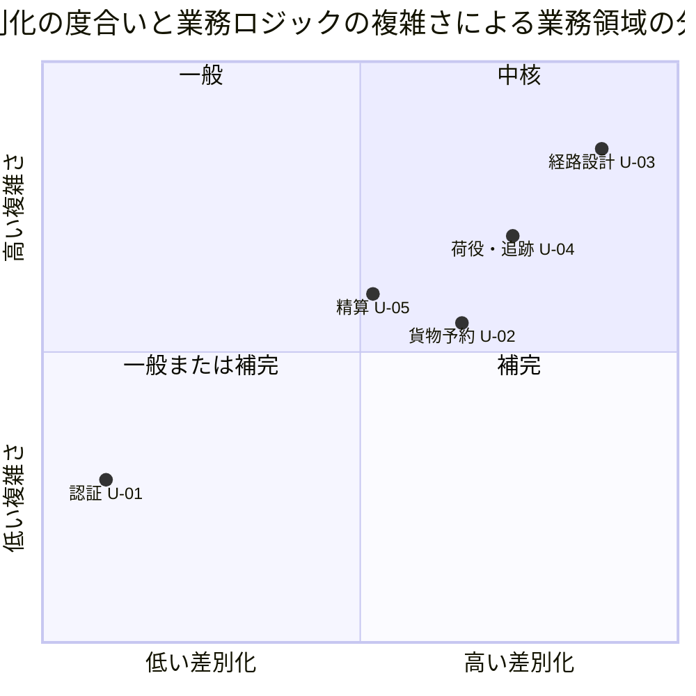

- 経路設計は、制約条件を満たす経路を算出する点が競争優位で、ロジックも最も複雑です
- 精算はビジネスアーキテクチャの能力マップでは「コア」ですが、差別化は他より低く、中核との境界に置きました。金額の正確さが要求の中心です
- 認証は汎用です。ドメインモデルは小さく保ちます（[第 9 章](#9-u-01-認証)）

### 2.2 コンテキストマップ

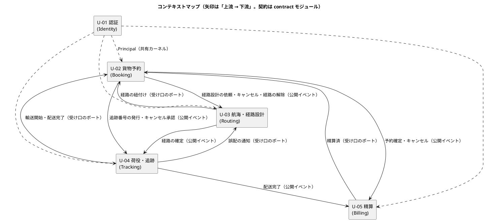

関係のパターン:

| 関係 | パターン | 内容 |
| :--- | :--- | :--- |
| 公開イベント（BK → RT・TR・BL、RT → TR、TR → BL） | 上流が公開言語（published language）を定義する | 上流の `contract` が型を持つ。下流は**腐敗防止層**で自分のモデルに写す。下流は上流の内部を参照しない |
| 受け口のポート（RT → BK、TR → BK・RT、BL → BK） | 下流が上流の定めた受け口を呼ぶ | 受け口は上流の `contract` が定義し、**冪等**（呼び出し元のイベント ID を受ける） |
| 認証との関係 | 共有カーネル | `Principal(userId, role)` だけを共有する |

> **発見**：[Unit 定義の依存 DAG](../requirements/units.md#依存-dag)は U-02 を根にした一方向ですが、ストーリーは**逆向きの結合**を要求します。予約状態の「輸送中」「配送完了」「精算済」（US16 AC-02、US23 AC-02）は U-04・U-05 の出来事で変わり、見積（US01）は U-03 の航海から概算を取り、キャンセル承認（US30）は U-04 の現在地を要ります。本書は、これを **contract モジュール経由の結合**として整理しました（モジュールの依存は非循環のまま）。詳細は[第 13 章](#13-他の設計書への影響)。

---

## 3. ユビキタス言語と英語名

日本語は[用語集](glossary.md)を正とします。英語名はコード上の識別子の案です（承認後に用語集へ列を足す）。

### 3.1 U-02 貨物予約（Booking）

| 日本語 | 英語名（案） | 種別 | 備考 |
| :--- | :--- | :--- | :--- |
| 荷主 | `Shipper` | エンティティ（集約ルート） | 永続化は CRUD（BE-10） |
| 荷主種別 | `ShipperType` | 値（`Individual`／`Corporate`） | 個人荷主・法人荷主 |
| 割引率 | `DiscountRate` | 値オブジェクト | 0〜30%（US03） |
| 見積 | `Quote` | 集約ルート | 見積番号 `QuoteNumber` |
| 貨物予約 | `Booking` | 集約ルート | 予約番号 `BookingNumber` |
| 貨物仕様 | `CargoSpec` | 値（代数的データ型） | 一般・危険物・冷凍・冷蔵 |
| 貨物種別 | `CargoKind` | 値（`General`／`Dangerous`／`TemperatureControlled`） | 共有カーネル |
| 危険物申告情報 | `HazardDeclaration` | 値オブジェクト | **項目は未確定（R-05）** |
| 温度管理条件 | `TemperatureCondition` | 値オブジェクト | 設定温度の範囲（AI の仮定） |
| 希望期限 | `Deadline` | 値オブジェクト（日付） | 「希望着日」と同義かは要確認 |
| 予約状態 | `BookingStatus` | 値（代数的データ型） | 8 状態 |
| 経路概算 | `RouteEstimate` | 値オブジェクト | 見積の経路候補 |
| キャンセル申請 | `CancellationRequest` | 値オブジェクト | 輸送中のみ |
| 陸揚げ地 | `LandingPort` | 値（`PortCode`） | 現在地の港または次の寄港地 |

### 3.2 U-03 航海・経路設計（Routing）

| 日本語 | 英語名（案） | 種別 | 備考 |
| :--- | :--- | :--- | :--- |
| 航海 | `Voyage` | 集約ルート | ID の元は航海番号 `VoyageNumber` |
| 運送会社 | `Carrier` | 値オブジェクト | 選択式。マスタの出所は要確認 |
| 寄港地（の通過） | `PortCall` | 値オブジェクト | 順序つき。出発港・到着港を含む |
| 港湾 | `Port` | 参照データ | `PortCode`（UN/LOCODE）で識別。取扱い貨物種別を持つ |
| 経路計画 | `RoutePlan` | 集約ルート | 1 回の経路設計の作業と、その結果の経路。**用語集に無い新語** |
| 経路 | `Route` | 値オブジェクト（`RoutePlan` の中） | 区間の並び |
| 経路区間 | `RouteLeg` | 値オブジェクト | 航海・乗る港・降りる港・日付 |
| 経路候補 | `RouteCandidate` | 値オブジェクト | 永続化しない |
| 経路条件 | `RouteSpecification` | 値オブジェクト | 出発地・目的地・期限・貨物種別・調整 |
| 制約条件 | `RouteConstraint` | 値（5 種） | 航海スケジュール・寄港地の接続・期限遵守・貨物種別対応・港湾制約 |
| 経路状態 | `RoutePlanStatus` | 値（代数的データ型） | 設計中・確定・紐付け済・誤配・置換済・中止 |

### 3.3 U-04 荷役・追跡（Tracking）

| 日本語 | 英語名（案） | 種別 | 備考 |
| :--- | :--- | :--- | :--- |
| 追跡情報 | `Tracking` | 集約ルート | ID は追跡番号 `TrackingNumber` |
| 追跡イベント | `TrackingEvent` | 値オブジェクト | 荷役・状態更新・例外・通関の種類を持つ |
| 荷役作業 | `HandlingWork` | 値オブジェクト | 種別 `HandlingKind`（`Receipt`／`Loading`／`Unloading`／`Pickup`） |
| 貨物状態 | `CargoStatus` | 値（代数的データ型） | 9 状態 |
| 位置 | `Position` | 値オブジェクト | 港にいる／航行中 |
| 予定経路 | `PlannedRoute` | 値オブジェクト | 経路の写し |
| 推定到着日 | `EstimatedArrivalDate` | 値オブジェクト | 予定経路の最終航海の到着日 |
| 例外 | `Incident` | エンティティ（`Tracking` の中） | 英語は `Exception` を避けた |
| 例外種別 | `IncidentKind` | 値（`Delay`／`Damage`／`Loss`／`Misrouting`／`CustomsHold`） | 5 種 |
| 通関申告 | `CustomsDeclaration` | エンティティ（`Tracking` の中） | 申告番号・申告日時 |
| 通関状態 | `CustomsStatus` | 値（`UnderReview`／`Cleared`／`Held`／`Rejected`） | 4 状態 |
| 荷受人確認 | `ConsigneeConfirmation` | 値オブジェクト | 署名または確認コード。方式は要確認 |

### 3.4 U-05 精算（Billing）

| 日本語 | 英語名（案） | 種別 | 備考 |
| :--- | :--- | :--- | :--- |
| 精算 | `Settlement` | 集約ルート | ID は予約 ID。輸送料金と精算書を含む |
| 輸送料金 | `Freight` | エンティティ（`Settlement` の中） | 算出済・確定 |
| 基本料金 | `BaseFee` | 値オブジェクト | **計算式は未定義** |
| 法人割引 | `Discount` | 値オブジェクト | 割引率の写しと割引額 |
| 料金調整 | `FeeAdjustment` | 値オブジェクト | 減額・補償費用 |
| 精算書 | `Invoice` | エンティティ（`Settlement` の中） | 請求番号 `InvoiceNumber` |
| 支払い期限 | `DueDate` | 値オブジェクト（日付） | 日数は未定義 |
| 金額 | `Money` | 値オブジェクト | **通貨・端数処理は未定義** |
| キャンセル料 | `CancellationCharge` | 値（`Settlement` の根拠の 1 種） | **料率は未定義** |
| 入金 | `Payment` | 値オブジェクト | 決済機関からの通知 |

### 3.5 U-01 認証（Identity）

| 日本語 | 英語名（案） | 種別 |
| :--- | :--- | :--- |
| 利用者 | `SystemUser` | エンティティ |
| ロール | `Role` | 値 |
| アカウントロック | `AccountLock` | 値オブジェクト |
| 監査ログ | `AuditLogEntry` | 値オブジェクト（追記専用） |

---

## 4. 共有カーネル

全 Unit が使う最小の値だけを置きます。業務ルールは置きません。

| 名前 | 内容と検証 | 備考 |
| :--- | :--- | :--- |
| `EntityId`（ULID） | 26 文字の ULID。集約の ID の基盤 | 参照実装の方式を採る |
| `DomainEventId` | イベントの識別子（ULID） | 重複排除の鍵 |
| `PortCode` | UN/LOCODE。国コード 2 文字（英大文字）＋地名コード 3 文字（英大文字または数字 2〜9）。形式だけを検証する | **実在するコードを使う（R-09）**。実在の確認は港湾マスタ（外部の事実） |
| `CargoKind` | 一般貨物・危険物・冷凍・冷蔵貨物 | 公開言語 |
| `TrackingNumber` | 推測困難な乱数部を持つ文字列。形式と桁数は R-02 の承認時に決める | 発行は U-02、ID として使うのは U-04 |
| `Principal` | 利用者 ID とロール | 認証済みの利用者情報 |
| `Clock` | 現在時刻の供給（ポート） | ドメインは呼ばない。引数で受ける |
| `BusinessDate` | 業務上の日付。どのタイムゾーンの日付かを型で区別する | BE-11（基準は要確認） |

**所有しないもの**：`DiscountRate`・`Money`・`Deadline` は各 Unit が持ちます。割引率は U-02 が登録し、U-05 は予約確定のイベントで受け取った写しを**自分の値**として持ちます（腐敗防止層）。

---

## 5. U-02 貨物予約

### 5.1 集約の一覧

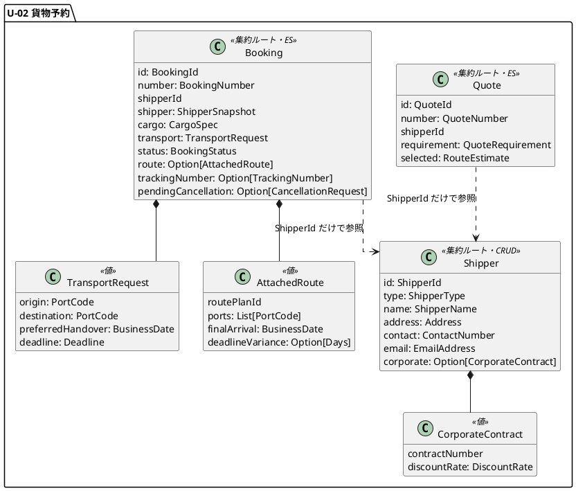

| 集約 | 永続化 | 理由 |
| :--- | :--- | :--- |
| `Shipper` | PostgreSQL の表（CRUD） | 個人情報の訂正・削除、監査要求が無い（BE-10） |
| `Quote` | イベント履歴式 | 見積番号の発行と保存だけで、作成後は変わらない（イベントは 1 種）。一貫性のため他と揃える |
| `Booking` | イベント履歴式 | 状態遷移と、キャンセルの履歴（US30 AC-09） |

### 5.2 `Shipper`（荷主）

不変条件：

- 氏名または社名・住所・連絡先・メールアドレスは空にできない（US02。未入力時の振る舞いは受入条件に無く、「必須」とするのは AI の仮定）
- 荷主種別が法人なら契約番号と割引率を**必ず持つ**。個人なら持たない（型で表す：`corporate: Option[CorporateContract]`）
- 割引率は 0%〜30%（境界を含む）。範囲外は登録できない（US03 AC-02・03）
- **メールアドレスの重複は「警告」であり一意制約ではない**：同じメールアドレスの荷主が既にいるとき、既存の荷主を示し、「既存の荷主を使う」か「登録を続ける」かを選ばせる（US02 AC-02）。「登録を続ける」を選べるため、重複した登録が成立する。一意制約にするかは**要確認**（[第 13 章](#13-他の設計書への影響)）

```scala
// 署名の案（実装は TDD で）
object Shipper:
  def register(
      id: ShipperId, name: ShipperName, address: Address, contact: ContactNumber,
      email: EmailAddress, kind: ShipperKind,        // Individual | Corporate(contractNumber, discountRate)
      duplicateOfEmail: Option[ShipperId], acknowledgedDuplicate: Boolean
  ): Either[ShipperError, Shipper]
// ShipperError: DuplicateEmail(existing: ShipperId) // 承認しないときだけ
```

重複の検出は、永続化の側（リポジトリ）が行い、結果を `duplicateOfEmail` で渡します（外部の事実）。

### 5.3 `Quote`（見積）

- 見積要件 `QuoteRequirement`：出発地・目的地・希望期限・貨物種別・重量・寸法
- 選んだ経路概算 `RouteEstimate`：経由港・所要日数・概算料金・航海番号（U-03 の問い合わせ結果。永続化するのは**選んだ 1 件**）
- 不変条件：経路概算が 1 件も無い見積は保存できない（UC01 4a の「経路なし」は保存せずに終了。AI の仮定）。出発地と目的地は異なる。重量は正
- 危険物の見積は危険物申告情報を求める（US01 AC-05）。項目は R-05 のため**確認まで実装しない**
- 概算料金は**見積の値**であり、U-05 の輸送料金とは別の値です。計算式が同じかは未定義（[第 13 章](#13-他の設計書への影響)）

### 5.4 `Booking`（貨物予約）

#### 状態

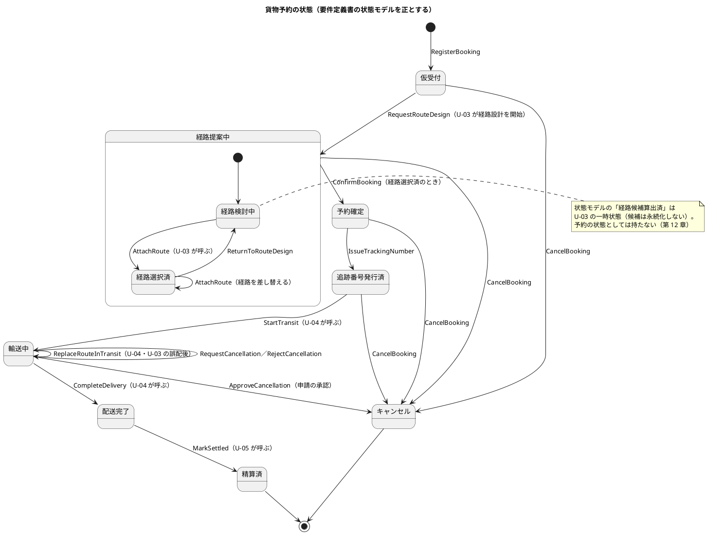

| 予約状態 | 型 | 持つ値 |
| :--- | :--- | :--- |
| 仮受付 | `Received` | 予約の内容 |
| 経路提案中 | `RouteProposal(route: Option[AttachedRoute])` | 経路検討中＝`None`、経路選択済＝`Some` |
| 予約確定 | `Confirmed(route)` | 紐付いた経路（必ず在る） |
| 追跡番号発行済 | `TrackingIssued(route, trackingNumber)` | |
| 輸送中 | `InTransit(route, trackingNumber, pendingCancellation)` | キャンセル申請（承認待ち）は**状態ではなく値**（US30 の AI の仮定） |
| 配送完了 | `Delivered(…)` | |
| 精算済 | `Settled(…)` | |
| キャンセル | `Cancelled(from, reason)` | キャンセル時の状態と理由（キャンセル料の根拠） |

#### 不変条件

| # | 不変条件 | 出典 |
| :--- | :--- | :--- |
| B1 | 状態遷移は上の図の遷移だけ。それ以外のコマンドは `InvalidTransition(from, command)` で拒む | 状態モデル |
| B2 | 予約情報の修正は**仮受付のあいだだけ** | US06 AC-03 |
| B3 | 経路設計の依頼は仮受付のときだけ | US06 AC-02 |
| B4 | 経路の紐付けは経路提案中のときだけ。経路の**目的地は予約の目的地と同じ**。出発地は予約の出発地と同じ（誤配後の差し替え `ReplaceRouteInTransit` を除く） | US11、US28 |
| B5 | 予約の確定は、**経路が紐付いている（経路選択済）**ときだけ | 状態モデル「UC09 経路情報紐付け完了後」 |
| B6 | 追跡番号の発行は予約確定のときだけ。**一度だけ**発行できる | US14 AC-02 |
| B7 | キャンセルには**理由が必須**。輸送開始前（仮受付・経路提案中・予約確定・追跡番号発行済）は即座にキャンセルされる | US13 AC-04、US30 AC-01・03、UC22 |
| B8 | 輸送中のキャンセルは**申請**（理由必須）。申請中の申請は 1 件だけ。承認では陸揚げ地を指定し、陸揚げ地は**与えられた候補（現在地の港・次の寄港地）のどちらか**。却下は理由必須で、予約は輸送中のまま | US30 AC-03〜06 |
| B9 | 配送完了以降はキャンセルできない | US30 AC-07 |
| B10 | キャンセル済みの予約に対する、状態を変える操作はすべて拒む。**ただし、キャンセル料の精算完了による `MarkSettled` は状態を変えずに成功として受理する**（提案。受理しないと待避先に回り続ける。Q18） | 終端状態 |
| B11 | 出発地と目的地は異なる。希望引渡日は希望期限以前。重量は正、個数は 1 以上 | AI の仮定（要確認） |
| B12 | 貨物仕様は型で守る：危険物なら申告情報、冷凍・冷蔵なら温度管理条件を**必ず持つ**（持てない組み合わせは作れない） | US05 AC-01・02 |

```scala
// 署名の案
enum CargoSpec:
  case General(common: CargoCommon)
  case Dangerous(common: CargoCommon, declaration: HazardDeclaration)         // 項目は R-05 の承認後
  case TemperatureControlled(common: CargoCommon, condition: TemperatureCondition)

trait Booking:
  def requestRouteDesign(at: Instant): Either[BookingError, (Booking, BookingEvent)]
  def attachRoute(route: AttachedRoute, source: DomainEventId): Either[BookingError, (Booking, BookingEvent)]
  def confirm(at: Instant): Either[BookingError, (Booking, BookingEvent)]
  def cancel(reason: Reason, at: Instant): Either[BookingError, (Booking, BookingEvent)]
  def approveCancellation(landing: PortCode, allowed: Set[PortCode], by: Principal, at: Instant)
      : Either[BookingError, (Booking, BookingEvent)]  // allowed は U-04 から集めた外部の事実
```

#### 受け口のポートの冪等性

U-03・U-04・U-05 が呼ぶ受け口（`AttachRoute`・`StartTransit`・`ReplaceRouteInTransit`・`CompleteDelivery`・`MarkSettled`）は、呼び出し元のイベント ID を受け取り、**同じ ID の再実行は成功として扱う**（結果は変えない）。

#### コマンドと拒否理由

| コマンド | ストーリー | 結果のイベント | 主な拒否理由（`BookingError`） |
| :--- | :--- | :--- | :--- |
| `RegisterBooking` | US04 AC-02、US05 | `BookingRegistered_V1` | 貨物仕様の不備、B11 |
| `CorrectBooking` | US06 AC-03 | `BookingCorrected_V1` | 仮受付以外（B2） |
| `RequestRouteDesign` | US06 AC-02 | `RouteDesignRequested_V1` | 仮受付以外（B3） |
| `AttachRoute` | US11 AC-02 | `RouteAttached_V1` | 経路提案中以外、目的地・出発地の不一致（B4） |
| `ReturnToRouteDesign` | US13 AC-03 | `RouteDetached_V1` | 経路選択済以外 |
| `ConfirmBooking` | US13 AC-02 | `BookingConfirmed_V1` | 経路選択済以外（B5） |
| `IssueTrackingNumber` | US14 | `TrackingNumberIssued_V1` | 予約確定以外、発行済み（B6） |
| `StartTransit` | US15（最初の荷役） | `TransitStarted_V1` | 追跡番号発行済以外 |
| `ReplaceRouteInTransit` | US28 AC-05 | `RouteReplacedInTransit_V1` | 輸送中以外 |
| `CompleteDelivery` | US16 AC-02 | `DeliveryCompleted_V1` | 輸送中以外 |
| `MarkSettled` | US23 AC-02 | `BookingSettled_V1` | 配送完了以外 |
| `CancelBooking` | US13 AC-04、US30 AC-01 | `BookingCancelled_V1` | 理由なし、輸送中・配送完了以降（B7・B9） |
| `RequestCancellation` | US30 AC-02〜04 | `CancellationRequested_V1` | 輸送中以外、理由なし、申請中が既にある（B8） |
| `ApproveCancellation` | US30 AC-05 | `CancellationApproved_V1` | 申請が無い、陸揚げ地が候補外（B8） |
| `RejectCancellation` | US30 AC-06 | `CancellationRejected_V1` | 申請が無い、理由なし |

`Quote`：`IssueQuote`（US01 AC-03）→ `QuoteIssued_V1`。拒否理由は、経路概算が無い・出発地と目的地が同じ・重量が正でない。`Shipper`：`RegisterShipper`（US02・US03）は CRUD でイベントを持たない。

### 5.5 ドメインサービス

| サービス | 内容 | 備考 |
| :--- | :--- | :--- |
| `QuoteConsistencyCheck` | 予約と見積を比べ、出発地・目的地・貨物種別・重量の**差異の一覧**を返す（US04 AC-04） | 差異があるとき止めるか警告かは**要確認**（AI の仮定：警告） |
| `BookingNumberIssuer`／`QuoteNumberIssuer`（ファクトリ） | 人が読む番号の発行（ポート） | 形式は未定義。ID（ULID）とは別 |
| `TrackingNumberGenerator`（ファクトリ） | 推測困難な追跡番号の生成（ポート） | 乱数源は外部 |

---

## 6. U-03 航海・経路設計

### 6.1 集約の一覧

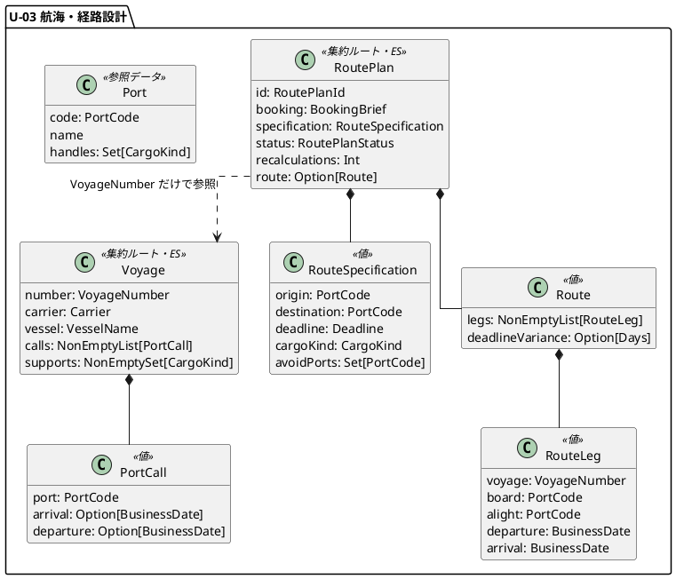

> **`RoutePlan`（経路計画）を新設した理由**：US10 の測定基準（再算出の発生率）と UC08 の最低保証（調整条件と再算出結果の記録）、経路設計の所要時間の測定は、**確定する前の作業**の記録を要ります。確定した経路だけでは足りません。経路候補は永続化しない一方、作業（調整・再算出・条件協議の依頼）と結果の経路を 1 つの集約で持ちます。

### 6.2 `Voyage`（航海）

| # | 不変条件 | 出典 |
| :--- | :--- | :--- |
| V1 | 航海番号は ID の元。同じ航海番号の 2 回目の登録は拒む | US24 AC-04 |
| V2 | 必須項目（航海番号・船名・運送会社・出発港・到着港・出発日・到着日・対応貨物種別）が揃う | US24 AC-02 |
| V3 | 出発日は到着日以前 | US24 AC-03 |
| V4 | 寄港地の列は 2 件以上（出発港と到着港）。順序つきで、日付は**前から後へ非減少**。出発港と到着港は異なる | US24、AI の仮定 |
| V5 | 対応貨物種別は 1 つ以上 | US07 AC-04 |
| V6 | すべての港は**港湾マスタに実在する**（外部の事実として与える） | R-09 |
| V7 | 更新（`Reschedule`）は登録済みの航海にだけ。同じ内容への更新は拒む（AI の仮定） | US25 |

- 日付の粒度が**日**のため、同じ日の乗り継ぎ（先の便の到着日 ＝ 次の便の出発日）が可能かは**要確認**です。モデルは「到着日 ≤ 出発日」で可能としています
- 寄港地での積み降ろしの可否（出発港・到着港以外で貨物を乗り降りさせてよいか）は要件に明示がありません。AI の仮定は**可**（経路区間は航海の部分区間）
- 更新が、すでに紐付いた経路に及ぶかは、US25 の AI の仮定で**自動では及ばない**

### 6.3 `RoutePlan`（経路計画）

#### 状態

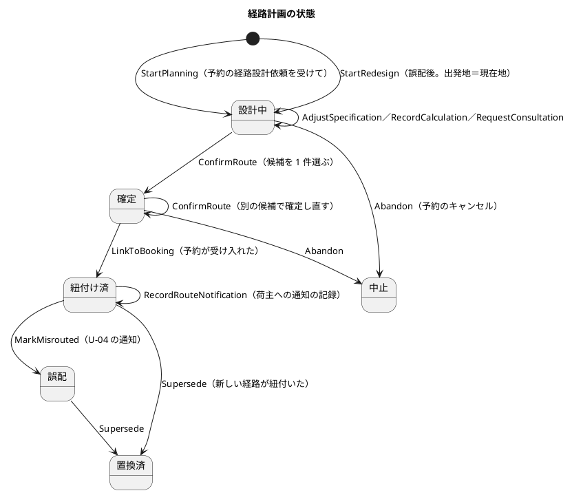

| # | 不変条件 | 出典 |
| :--- | :--- | :--- |
| R1 | 経路は**1 区間以上**。区間は連続する：前の区間の降りる港 ＝ 次の区間の乗る港 | 制約「寄港地の接続」 |
| R2 | 時間の接続：前の区間の到着日 ≤ 次の区間の出発日 | 制約「航海スケジュール」 |
| R3 | 経路の出発地・目的地は経路条件と同じ | US08 |
| R4 | **期限遵守**：最終到着日が経路条件の期限以内。ただし、誤配後の再設計で元の希望期限を超える場合は、超過日数 `deadlineVariance` を記録して確定できる | US08 AC-04、US28 AC-05 |
| R5 | 貨物種別対応：すべての区間の航海が経路条件の貨物種別に対応する | 制約「貨物種別対応」 |
| R6 | 港湾制約：出発地・目的地・経由港のすべての港が貨物種別を取り扱える | 制約「港湾制約」 |
| R7 | 確定は**同時に 1 件**。確定し直すと前の確定は取り消される | US09 の AI の仮定 |
| R8 | 紐付けは確定のあとだけ。紐付け後は予約の経路として扱われる | US11 |
| R9 | 調整は設計中のあいだだけ。調整は**再算出にだけ**使い、予約の内容は変えない | US10 の AI の仮定 |
| R10 | 制約条件は**上の 5 種だけ**。追加・変更は受入条件に書いてから実装する | R-04 |
| R11 | 荷主への経路通知は、**紐付け済**のときだけ。通知の内容（経由港・所要日数・到着予定日・料金概算）と送信の記録を残す。通知の送信そのもの（メール）は外部のポート | US12 |

R2・R4・R5・R6 は、航海と港湾の事実（外部の事実 `CatalogFacts`）を渡して検証します。R1・R3 は区間そのものから検証できます。

```scala
// 署名の案
trait RoutePlan:
  def adjust(adjustment: SpecAdjustment): Either[RoutePlanError, (RoutePlan, RoutePlanEvent)]
  def recordCalculation(found: Int): Either[RoutePlanError, (RoutePlan, RoutePlanEvent)]
  def requestConsultation(note: String): Either[RoutePlanError, (RoutePlan, RoutePlanEvent)]
  def confirm(route: Route, facts: CatalogFacts): Either[RoutePlanError, (RoutePlan, RoutePlanEvent)]
  def linkToBooking(): Either[RoutePlanError, (RoutePlan, RoutePlanEvent)]
  def markMisrouted(source: DomainEventId): Either[RoutePlanError, (RoutePlan, RoutePlanEvent)]
```

#### コマンドと拒否理由

| コマンド | ストーリー | イベント | 主な拒否理由 |
| :--- | :--- | :--- | :--- |
| `RegisterVoyage` | US24 | `VoyageRegistered_V1` | V1〜V6 |
| `RescheduleVoyage` | US25 | `VoyageRescheduled_V1` | 未登録、変更なし（V7） |
| `StartPlanning` | US06→US07 AC-01 | `RoutePlanStarted_V1`（元の予約の条件の写しを運ぶ。読み取りモデルが `RouteDesignRequested` に頼らずに行を作るため） | 同じ依頼で開始済み（冪等） |
| `AdjustSpecification` | US10 AC-01・02 | `SpecificationAdjusted_V1` | 設計中以外（R9）。期限の短縮など許さない調整 |
| `RecordCalculation` | US08、US10 | `RouteCalculated_V1` | 設計中以外 |
| `RequestConsultation` | US10 AC-03 | `ConsultationRequested_V1` | 設計中以外 |
| `ConfirmRoute` | US09 AC-02 | `RouteConfirmed_V1` | R1〜R6 |
| `LinkToBooking` | US11 | `RouteLinked_V1` | 確定以外（R8） |
| `RecordRouteNotification` | US12 | `RouteNotified_V1` | 紐付け済以外（R11） |
| `StartRedesign` | US28 AC-04 | `RoutePlanStarted_V1` | 前の経路が誤配でない |
| `MarkMisrouted` | US28 AC-02 | `RouteMisrouted_V1` | 紐付け済以外 |

経路候補の**検索**（US07）・**算出**（US08）は読み取りです。`RoutePlan` を変えません（算出した回数は `RecordCalculation` で記録します）。

### 6.4 ドメインサービス `RouteFinder`（経路候補を算出する）

純粋な関数です。入力は経路条件・航海の一覧（スナップショット）・港湾の事実、出力は `RouteCandidate` の列です。

- 制約条件は 6.3 の R1〜R6（5 種）**だけ**を実装し、1 つずつ段階的に加える（R-04。リリース計画 Bolt 5 は「乗り継ぎ無しの経路」から始める）
- 並び順：**乗り継ぎ無しの経路を先頭**、その次は所要日数の短い順（AI の仮定）。同じ所要日数の並びと、乗り継ぎ回数・費用の優先順位は**未定義（要確認）**
- 探索の打ち切り（乗り継ぎ回数の上限・候補数の上限）は非機能要件で決める（[NFR-P05・NF-08](non_functional.md)：時間の上限 30 秒と打ち切りの明示。探索の上限は人が決める）
- 費用は概算で、算出方法は未定義。`RouteCandidate.estimatedCost` は `Option[Money]`

### 6.5 コマンドを支えるポート

| ポート | 内容 |
| :--- | :--- |
| `VoyageCatalog`（読み取り） | 出発地・目的地・期間・貨物種別で航海を検索 |
| `PortCatalog`（参照データ） | 港湾マスタ。**維持するストーリーが無い**（[第 13 章](#13-他の設計書への影響)） |
| `BookingRoutePort`（U-02 の受け口） | `AttachRoute` を呼ぶ（腐敗防止層で自分のモデルに写す） |

---

## 7. U-04 荷役・追跡

### 7.1 集約の一覧

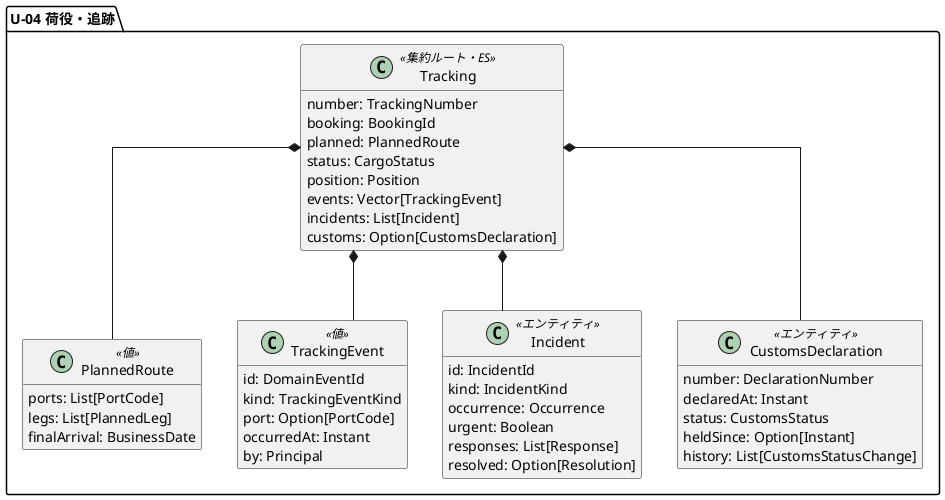

通関と例外を `Tracking` の中に置く理由は、**「通関済でなければ引取できない」（US29 AC-04）と「未解決の例外がある間は正常復帰できない」を、1 つの集約の不変条件**にするためです。履歴の長さは、1 件の貨物あたり数十件の見込みです。

### 7.2 貨物状態

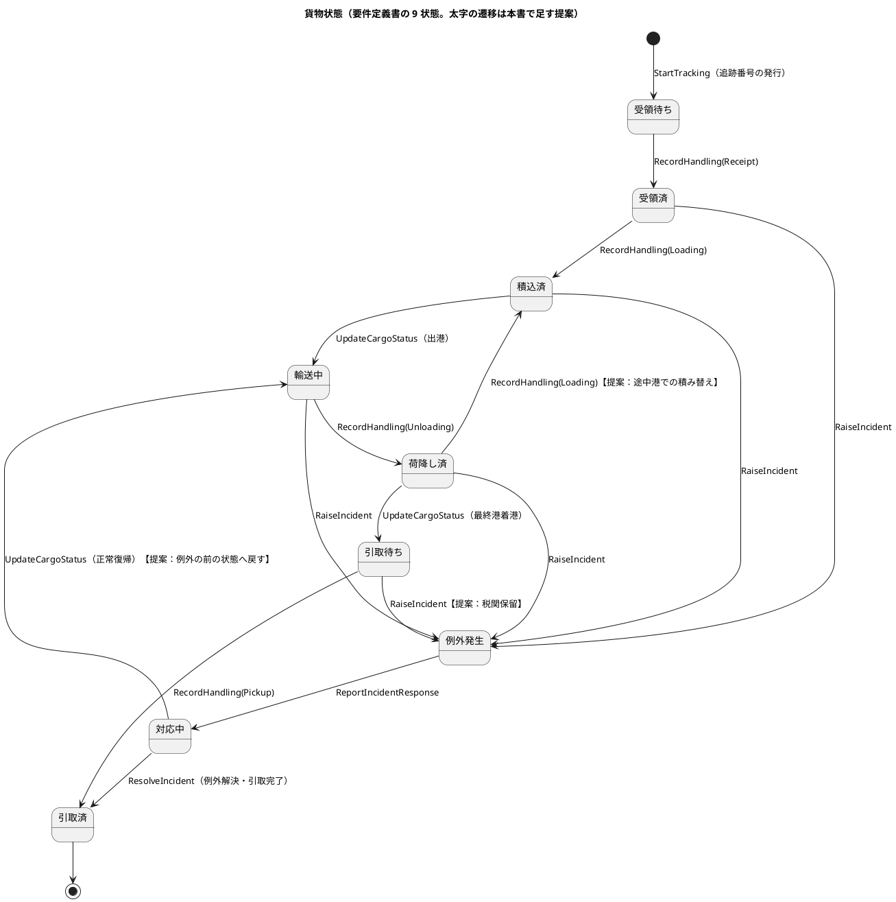

#### 状態を持つ値

`CargoStatus` は代数的データ型で、**例外発生・対応中は例外の前の状態を持ちます**（方針 D8）。

```scala
enum CargoStatus:
  case AwaitingReceipt, Received, Loaded, InTransit, Unloaded, AwaitingPickup, PickedUp
  case IncidentRaised(before: CargoStatus)      // 例外発生。例外の前の状態を保持する
  case IncidentInResponse(before: CargoStatus)  // 対応中
```

#### 不変条件

| # | 不変条件 | 出典 |
| :--- | :--- | :--- |
| T1 | 荷役作業の種別と現在の貨物状態が合わない記録は拒む（受領は受領待ちのとき、積込は受領済・荷降し済のとき、荷降しは輸送中のとき、引取は引取待ちのとき） | 状態モデル、US15 AC-02 |
| T2 | **引取は、通関状態が通関済で、荷受人確認があるときだけ**。通関済でなければ拒み、現在の通関状態を返す | US29 AC-04、US16 AC-01・03 |
| T3 | 引取を記録すると貨物状態は引取済になり、**配送完了のイベントを出す** | US16 AC-02 |
| T4 | 作業場所が**予定経路に含まれない**荷役作業は、警告に対する**承認がなければ記録しない**。承認されたときは、荷役の記録に加えて誤配を起票する | US15 AC-04、US28 AC-01・02 |
| T5 | 手動の状態更新も、状態モデルの遷移だけを許す（出港・最終港着港・正常復帰が主） | US17 の AI の仮定 |
| T6 | 例外の記録は、貨物状態が受領済・積込済・輸送中・荷降し済のときにできる（引取待ちは提案）。引き取り済みの貨物には記録しない | 状態モデル |
| T7 | 例外種別「紛失」は**緊急フラグ**を必ず持つ。他は持たない | US20 AC-02 |
| T8 | 例外発生・対応中のあいだは**未解決の例外が 1 件以上**ある。未解決の例外が残る間は、例外の前の状態へ戻れない | AI の仮定 |
| T9 | 解決した例外も**記録は残る**（削除しない）。料金調整の根拠として参照できる | US28 AC-06 |
| T10 | 通関申告は、荷降しが記録された貨物に 1 件だけ登録できる。登録時の状態は審査中 | US29 AC-01 |
| T11 | 通関状態の更新は**理由が必須**。更新ごとに履歴（日時・変更者・理由）を残す | US29 AC-02・03・09 |
| T12 | 通関状態の遷移：審査中 → 通関済・留置・不可。留置 → 通関済・不可（留置からの遷移は AI の仮定）。通関済・不可は終端 | US29 |
| T13 | 留置にすると、例外種別「税関保留」を**自動で起票**する | US29 AC-06 |
| T14 | 留置が **3 日を超えた**ら督促の対象（`CustomsHoldPolicy`）。判定は時刻を引数で受ける | US29 AC-07 |
| T15 | 追跡番号が存在しない貨物への記録は拒む（未作成の集約） | US15 AC-03 |
| T16 | 同じ荷役作業（種別・場所・日時）の記録を、再送で二重にしない | 冪等性 |

#### 例外の種別と記録できる状態

| 例外種別 | 状態モデルの注記が示す状態 | 備考 |
| :--- | :--- | :--- |
| 破損・紛失 | 受領済、輸送中、荷降し済 | |
| 遅延 | 積込済、輸送中、荷降し済 | |
| 誤配 | 荷役作業の記録の結果 | 自動起票 |
| 税関保留 | 荷降し済（、引取待ち） | 自動起票 |

状態モデルの注記は図の説明です。**種別ごとに状態を制限するか**（例：受領済での遅延を拒む）は要確認です。AI の仮定は**制限しない**（どの種別も、T6 の状態なら記録できる）。

### 7.3 コマンドと拒否理由

| コマンド | ストーリー | イベント | 主な拒否理由（`TrackingError`） |
| :--- | :--- | :--- | :--- |
| `StartTracking` | US14（反応） | `TrackingStarted_V1` | 開始済み（冪等） |
| `RecordHandling` | US15、US16、US28 AC-01・02 | `HandlingRecorded_V1`（誤配は加えて `IncidentRaised_V1`） | 未作成（T15）、状態と種別の不一致（T1）、通関未了・荷受人確認なし（T2）、予定外の場所で未承認（T4）、重複（T16） |
| `UpdateCargoStatus` | US17 | `CargoStatusUpdated_V1` | 許されない遷移（T5） |
| `RaiseIncident` | US19 AC-01、US20 AC-01・02 | `IncidentRaised_V1` | T6、緊急フラグの不整合（T7） |
| `ReportIncidentResponse` | US19 AC-02、US20 AC-03 | `IncidentResponseReported_V1` | 未解決の例外が無い |
| `ResolveIncident` | US28 AC-06 | `IncidentResolved_V1` | 未解決でない |
| `DeclareCustoms` | US29 AC-01 | `CustomsDeclared_V1` | 荷降し未記録、申告済み（T10） |
| `ChangeCustomsStatus` | US29 AC-02・03・05・06 | `CustomsStatusChanged_V1`（留置は加えて `IncidentRaised_V1`） | 理由なし、許されない遷移（T11・T12） |
| `ReplacePlannedRoute` | US28 AC-05（反応） | `PlannedRouteReplaced_V1` | |
| `ArrangeLanding` | US30 AC-05（反応） | `LandingArranged_V1` | 手配の中身は**未定義**（要確認） |
| `NoticeCustomsHoldOverdue` | US29 AC-07 | `CustomsHoldOverdueNoticed_V1` | 3 日を超えていない（T14）。時間をきっかけにする処理が起動する |

**読み取り**：追跡情報の照会（US18）は、読み取りモデルへの問い合わせです。集約を呼びません。公開の照会は個人情報を含まない専用の型で返します（バックエンド 8.2）。

### 7.4 ドメインサービス

| サービス | 内容 |
| :--- | :--- |
| `OffRoutePolicy` | 作業場所が予定経路の港に含まれるかを判定する |
| `CustomsHoldPolicy` | 留置の経過が閾値（3 日）を超えたかを判定する。「3 日」を暦日で数えるか 72 時間で数えるかは**要確認**（基準のタイムゾーンに依存） |
| `LandingCandidates` | 現在地の港と、予定経路の次の寄港地を返す（U-02 のキャンセル承認に渡す外部の事実） |

---

## 8. U-05 精算

### 8.1 集約

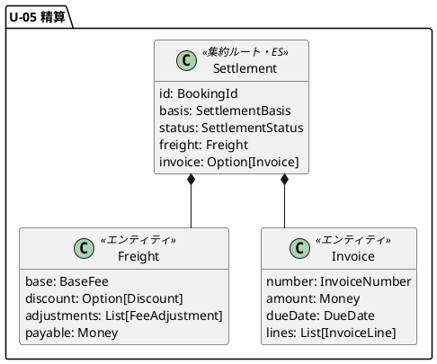

> **1 つの集約にした理由**：情報モデルは「輸送料金」と「精算実績」を別のエンティティにしていますが、予約と 1 対 1 で、ライフサイクルが直列（算出 → 確定 → 精算書の発行 → 入金）です。「確定した料金だけが精算書になる」「入金額は精算書の額と同じ」を 1 つの整合境界で守れます。用語集の「精算」の定義（輸送料金を確定し、支払いを記録する業務）とも合います。

`SettlementBasis` は、精算の根拠です：`Delivered`（配送完了した実績）または `Cancelled(stateAtCancel)`（キャンセル料）。

### 8.2 状態と不変条件

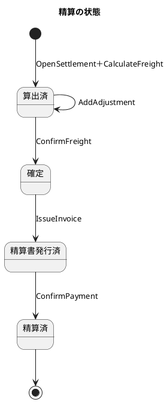

| # | 不変条件 | 出典 |
| :--- | :--- | :--- |
| S1 | 精算は予約 1 件に 1 つ（ID ＝ 予約 ID）。**配送完了した予約**（または、キャンセル料の根拠がある予約）にだけ開始できる | US21 AC-01 |
| S2 | 法人荷主だけに割引を適用する。**割引率は予約確定時の写し**（0%〜30%）。個人荷主には割引を適用しない | US22 AC-01・02 |
| S3 | 割引額 ＝ 基本料金 × 割引率。端数処理は**1 円未満切り捨て**（AI の仮定。通貨と最小単位は要確認） | US22 の AI の仮定 |
| S4 | 料金調整（減額・補償費用）は**例外がある予約**だけ、**確定の前だけ**入力できる | US21 AC-03 |
| S5 | 支払額（割引後の金額 ＋ 調整）は**負にならない** | AI の仮定 |
| S6 | 確定後の料金は変更できない | US21 AC-02 |
| S7 | 精算書は確定した料金からだけ発行する。精算書には割引率・基本料金・割引後の料金を載せる | US23 AC-01、US22 AC-03 |
| S8 | 入金は決済機関の通知で確認する。**入金額は精算書の額と一致**する（一致しない入金は拒み、記録する。AI の仮定） | US23 AC-02 |
| S9 | 同じ入金の通知の再送は、結果を変えない（入金の参照番号で冪等） | 冪等性 |
| S10 | 期限超過は**状態ではなく導出**（今日 > 支払い期限、かつ未入金）。通知は時間をきっかけにする処理が行う | US23 AC-03 |

> 期限超過を導出にするのは、状態として持つと「期限が過ぎた」という出来事（時間の経過）を誰かがコマンドにしなければならないためです。方針 D8 は**過去の状態の再導出**を戒めるもので、時間から導出できる述語とは別です。

### 8.3 コマンド、ドメインサービス

| コマンド | ストーリー | イベント | 主な拒否理由 |
| :--- | :--- | :--- | :--- |
| `OpenSettlement`＋`CalculateFreight` | US21 AC-01 | `SettlementOpened_V1`、`FreightCalculated_V1` | 開始済み、根拠が無い（S1） |
| `AddAdjustment` | US21 AC-03 | `AdjustmentAdded_V1` | 例外なし、確定済み（S4）、負になる（S5） |
| `ConfirmFreight` | US21 AC-02 | `FreightConfirmed_V1` | 算出済以外 |
| `IssueInvoice` | US23 AC-01 | `InvoiceIssued_V1` | 確定以外（S7） |
| `ConfirmPayment` | US23 AC-02 | `PaymentConfirmed_V1`（、公開イベント `SettlementCompleted`） | 精算書なし、額の不一致（S8） |

| サービス | 内容 |
| :--- | :--- |
| `FreightCalculator` | 輸送実績（経路・距離・重量・貨物種別・荷役実績）から基本料金を算出する純粋関数。**計算式は未定義**。受入条件に定義してから実装する（R-04 と同様の規律） |
| `DiscountPolicy` | 荷主種別と割引率から割引額を求める（S2・S3） |
| `CancellationChargePolicy` | キャンセル時の予約状態から料率を決める。**料率は未定義**（US30 AC-08） |

**「距離」**は用語集に無く、港湾間の距離表（参照データ）も要件にありません。出所は要確認です（[第 13 章](#13-他の設計書への影響)）。

---

## 9. U-01 認証

U-01 は**イベント履歴式にしません**（BE-01）。ロック回数の判定が即時に正確である必要があるためです。ドメインは小さな純粋関数にとどめます。

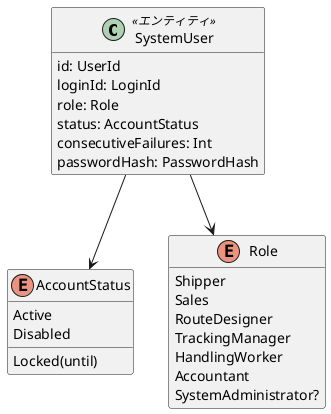

| # | 不変条件 | 出典 |
| :--- | :--- | :--- |
| I1 | 認証に連続 5 回失敗したらロックする。成功すると失敗回数は 0 に戻る（4 回失敗のあとの成功を含む） | US31 AC-01・02 |
| I2 | ロック中は正しいパスワードでも入れない。応答は**認証情報の誤りと同じ**（外から区別できない） | US31 AC-03 |
| I3 | ロックは、一定時間（30 分。AI の仮定）の経過、または管理者の解除で解ける | US31 AC-04 |
| I4 | 無効化されたアカウントは入れない。応答は管理者への問い合わせを案内する（I2 との方針の衝突は要確認） | US31 AC-05 |
| I5 | ロック・解除・無効化・ログイン試行（成功・失敗）を**監査ログに追記**する。削除しない | US26 AC-01・02、US31 AC-06 |
| I6 | パスワードの保存方式・セッション/トークンの方式は**ドメインの外**（BE-09）。ドメインは `PasswordHash` を不透明な値として扱う | R-02 |
| I7 | ログアウトは、セッションの破棄（方式の側）と、**ログアウト日時の監査ログへの追記**（ドメイン）からなる | US27 AC-01 |

`Role` の `SystemAdministrator` は、6 ロールに入っておらず**要確認**です。

```scala
// 署名の案（時刻は引数）
trait SystemUser:
  def authenticate(verified: Boolean, now: Instant, policy: LockoutPolicy)
      : (SystemUser, AuthenticationOutcome, List[AuditLogEntry])
// AuthenticationOutcome: Succeeded | Rejected(sameMessage) | Disabled
```

---

## 10. ドメインイベントと公開言語

### 10.1 イベントの命名と版

`<過去形の名前>_V<版>`。Protobuf の Envelope に型名・版・ペイロードを持ちます（[バックエンド 9.2](architecture_backend.md#92-イベントの版管理)）。全イベントは `DomainEventId`・集約 ID・発生時刻を持ちます。個人情報は載せません（D7）。

### 10.2 公開イベントと運ぶ値

他の Unit が購読するイベントです（`contract` モジュールに置く）。**消費側が必要とする値**を載せます（D5）。

| 公開イベント | 発行元 | 購読者 | 運ぶ値（消費側の必要から決めた） |
| :--- | :--- | :--- | :--- |
| `RouteDesignRequested_V1` | U-02 | U-03 | 予約 ID・予約番号、出発地・目的地・希望期限・貨物種別・貨物仕様の要約（US07 AC-01 が表示する項目） |
| `BookingConfirmed_V1` | U-02 | U-05 | 予約 ID、荷主 ID、**荷主種別・割引率の写し**、貨物種別・重量・寸法、確定した経路の要約 |
| `TrackingNumberIssued_V1` | U-02 | U-04 | 予約 ID、追跡番号、**予定経路（港の列、区間、最終到着日）**、貨物種別 |
| `BookingCancelled_V1`／`CancellationApproved_V1` | U-02 | U-04（陸揚げ）、U-05（キャンセル料）、U-03（中止） | 予約 ID、キャンセル時の予約状態、理由、（承認時は）陸揚げ地 |
| `RouteConfirmed_V1` | U-03 | U-04（再設計後の予定経路） | 経路計画 ID、予約 ID、区間の列、最終到着日、期限との差 |
| `RouteLinked_V1` | U-03 | — （U-02 は受け口の呼び出しで知る） | |
| `HandlingRecorded_V1`（最初の荷役） | U-04 | （U-04 の反応が U-02 の受け口を呼ぶ） | |
| `CargoDelivered_V1` | U-04 | U-05 | 予約 ID、追跡番号、引取の日時、**輸送実績**（区間、荷役作業の一覧）、**例外の有無と要約** |
| `SettlementCompleted_V1` | U-05 | （U-05 の反応が U-02 の受け口を呼ぶ） | 予約 ID |

> `BookingConfirmed_V1` が荷主種別と割引率の写しを運ぶので、U-05 は**予約確定時の値**を自分の前提情報として保持できます。バックエンド 7.2 の #6（割引率を、いつの時点の値で使うか）の既定になります（要確認）。

### 10.3 集約ごとの内部イベント

| 集約 | イベント（`_V1`） |
| :--- | :--- |
| `Quote` | `QuoteIssued` |
| `Booking` | `BookingRegistered`、`BookingCorrected`、`RouteDesignRequested`、`RouteAttached`、`RouteDetached`、`BookingConfirmed`、`TrackingNumberIssued`、`TransitStarted`、`RouteReplacedInTransit`、`DeliveryCompleted`、`BookingSettled`、`BookingCancelled`、`CancellationRequested`、`CancellationApproved`、`CancellationRejected` |
| `Voyage` | `VoyageRegistered`、`VoyageRescheduled` |
| `RoutePlan` | `RoutePlanStarted`、`SpecificationAdjusted`、`RouteCalculated`、`ConsultationRequested`、`RouteConfirmed`、`RouteLinked`、`RouteNotified`、`RouteMisrouted`、`RouteSuperseded`、`RoutePlanAbandoned` |
| `Tracking` | `TrackingStarted`、`HandlingRecorded`、`CargoStatusUpdated`、`IncidentRaised`、`IncidentResponseReported`、`IncidentResolved`、`CustomsDeclared`、`CustomsStatusChanged`、`CustomsHoldOverdueNoticed`、`PlannedRouteReplaced`、`LandingArranged`、`CargoDelivered` |
| `Settlement` | `SettlementOpened`、`FreightCalculated`、`AdjustmentAdded`、`FreightConfirmed`、`InvoiceIssued`、`PaymentConfirmed`、`SettlementCompleted` |

---

## 11. 値オブジェクトの検証規則

| 値オブジェクト | 検証（生成時） | 備考 |
| :--- | :--- | :--- |
| `DiscountRate` | 0%〜30%（境界を含む）。内部は基点（1% ＝ 100）の整数 | 負・30% 超は生成できない |
| `Money` | 金額（最小単位の整数）と通貨。同じ通貨どうしだけ足せる | **通貨は未定義**。端数処理は `RoundingPolicy` |
| `Weight` | 正の値と単位（kg） | 単位は仮 |
| `Dimensions` | 長さ・幅・高さ（cm）がすべて正 | 仮 |
| `Quantity` | 1 以上の整数 | |
| `Deadline`／`BusinessDate` | 日付。どのタイムゾーンの日付かを型で持つ。**時刻付きの到着との比較は、基準のタイムゾーンを引数に取る関数だけ** | BE-11。基準は要確認 |
| `PortCode` | UN/LOCODE の形式 | 実在の確認は外部の事実 |
| `VoyageNumber`・`BookingNumber`・`QuoteNumber`・`InvoiceNumber` | 空でない。形式は未定義 | 番号の形式は要確認 |
| `ShipperName`・`Address`・`ContactNumber` | 空でない。長さの上限は未定義 | 個人情報（イベントに載せない） |
| `EmailAddress` | メールアドレスの形式。正規化（小文字化）して比べる | 重複の検出に使う |
| `Reason` | 空でない（空白だけも不可） | キャンセル・却下・通関更新の理由 |
| `HazardDeclaration`・`TemperatureCondition` | **未確定**（R-05）。温度は下限 ≤ 上限 | 確認まで実装しない |

---

## 12. 状態モデルとの差分（R-06）

要件定義書の状態モデルに対し、本書が**足した・変えた・解釈した**点です。承認が要ります。

| # | 状態モデル | 本書 | 理由 |
| :--- | :--- | :--- | :--- |
| 1 | 予約の「経路候補算出済」 | **予約の状態としては持たない**（`RouteProposal` の内側は経路検討中・経路選択済の 2 つ） | 経路候補は永続化しない（U-03 の一時状態）。予約が U-03 の内部状態のたびに更新される結合を避ける |
| 2 | 予約の「輸送中」「配送完了」「精算済」 | `Booking` が持つが、遷移は U-04・U-05 が**受け口のポート**で起こす | 状態モデルを 1 つの集約に保ち、依存の向きも保てる |
| 3 | 輸送中の経路の差し替え（遷移なし） | 輸送中に `ReplaceRouteInTransit` を許す（状態は輸送中のまま） | 誤配後の再設計（US28 AC-04・05）が輸送中に起きる |
| 4 | 予約の「輸送中」への遷移：荷役作業開始 | **最初の荷役作業（受領）の記録**で輸送中にする | 貨物状態の「輸送中」は出港で、別の概念。予約の輸送開始は荷役の開始（要確認） |
| 5 | 貨物状態：荷降し済 → 引取待ちのみ | 荷降し済 → **積込済**を足す | 途中港での積み替え（複数の航海を乗り継ぐ経路）を表せない |
| 6 | 貨物状態：引取待ちからの例外発生なし | 引取待ち → **例外発生**を足す | 通関の留置（税関保留）は、最終港に着いた後に起きる |
| 7 | 貨物状態：対応中 → 輸送中（正常復帰） | **例外の前の状態へ**戻す | 荷降し済などで起きた例外が、輸送中へ戻ると状態が後退する |
| 8 | 貨物状態：例外発生・対応中 | 例外の前の状態を**状態の中に持つ** | 方針 D8 |
| 9 | 経路の状態（確定・誤配） | `RoutePlan` に 6 状態（設計中・確定・紐付け済・誤配・置換済・中止） | 経路に状態を持たせるかは US09・US28 の確認ポイント |
| 10 | キャンセル承認待ち | **予約の状態にしない**（輸送中の値として持つ） | US30 の AI の仮定 |
| 11 | 通関状態（4 状態）の遷移 | 審査中 → 通関済・留置・不可。留置 → 通関済・不可 | 留置からの遷移は要件に無い（要確認） |

---

## 13. 他の設計書への影響

ドメインモデルの設計で見つけた、他の設計書との食い違いと、更新の提案です。★は本書と同時に更新したものです。

| # | 発見 | 影響する文書 | 対応 |
| :--- | :--- | :--- | :--- |
| 1 | 予約状態の後半（輸送中・配送完了・精算済）を U-04・U-05 が変える。見積は U-03 の概算を使う。キャンセル承認は U-04 の現在地を使う。DAG の逆向きの結合がある | バックエンド 5.1・7.2・10（A2）、Unit 定義の DAG | ★バックエンド 7.2 に連携 #10〜#14 を追加。A2 の期待値を contract 経由の実際のグラフに直す。**Unit 定義の DAG の説明を直すかは人が決める** |
| 2 | 経路設計の依頼は、U-03 が U-02 に問い合わせるより、**U-02 の公開イベントで渡し、U-03 が写しを持つ**ほうが依存の向きが保てる | バックエンド 7.2 #1 | ★#1 をイベントに変更 |
| 3 | `U-05` が必要とする荷主種別・割引率は、U-04 でなく **U-02 の `BookingConfirmed`** から受ける（U-04 に請求の事情を運ばせない） | バックエンド 7.2 #6・#7 | ★#6 を変更 |
| 4 | 荷主のメールアドレスは「登録を続ける」を選べるため**一意制約にできない** | バックエンド 3.2・4.4、UI 設計 6.4 | ★「警告（承認すれば重複登録可）」に直した。一意制約にするかは要確認 |
| 5 | イベント名 `ItineraryConfirmed` は、オリジナルの Cargo Tracker の語（R-06・R-07） | バックエンド 7.2 #8 | ★`RouteConfirmed` に変更 |
| 6 | **港湾マスタ**（取扱い貨物種別を持つ）を維持するストーリー・画面が無い。UI は港湾を選択式にしている | ストーリー、UI 設計 | 要確認：初期データ（実在の UN/LOCODE の部分集合）をマイグレーションで投入し、MVP では維持画面を作らない案 |
| 7 | 運送会社の選択（US24）の出所（マスタ）が無い | ストーリー、UI 設計 | 要確認：港湾と同じ扱い |
| 8 | 経路の確定（U-03）と予約への紐付け（U-02）の途中失敗で「確定済みだが未紐付け」の経路が残る | UI 設計（作業入口） | 経路設計者の作業入口に「紐付け未完了の経路」を足す提案。UI 設計の承認時に判断 |
| 9 | **距離**の出所（港湾間の距離表）が無い。基本料金の計算式も無い | US21、用語集 | 要確認。計算式を受入条件に定義してから U-05 を実装する |
| 10 | 概算料金（見積）と輸送料金（精算）の計算式が同じか | US01、US21 | 要確認。同じなら、純粋な計算を contract で共有する案と、別物として持つ案がある |
| 11 | 用語集に無い新語：経路計画（`RoutePlan`）、精算の根拠、荷役作業の種別の英語名など | 用語集 | 承認後に追加 |
| 12 | 時間をきっかけにする処理（留置 3 日超の督促、支払い期限超過の通知）の置き場 | バックエンド、インフラ | スケジュール起動の処理が読み取りモデルを走査し、コマンドを送る案。バックエンドで方式を決める |

---

## 14. 未決事項と AI の仮定

### 14.1 人に確認する点

| # | 論点 | 影響 |
| :--- | :--- | :--- |
| Q1 | 第 12 章の差分 1〜11（特に 1・4・5・6・7） | 状態モデル、`Booking`・`Tracking` |
| Q2 | 荷主のメールアドレスの重複を、警告にとどめるか一意制約にするか（登録を続ける選択をなくすか） | `Shipper`、US02 AC-02 |
| Q3 | 予約の輸送開始は**最初の荷役作業（受領）**でよいか | `StartTransit` |
| Q4 | 荷降し済 → 積込済（積み替え）と、引取待ち → 例外発生を足してよいか | `CargoStatus` |
| Q5 | 正常復帰を、例外の前の状態へ戻す形にしてよいか | `CargoStatus` |
| Q6 | 例外種別ごとに、記録できる状態を制限するか | T6 |
| Q7 | 引取に通関が要らない貨物（国内輸送など）があるか | T2 |
| Q8 | 経路候補の並び順（乗り継ぎ回数・費用・所要日数の優先順位）、同日の乗り継ぎの可否、寄港地での積み降ろしの可否 | `RouteFinder`、R2 |
| Q9 | 通貨・最小単位・端数処理、基本料金の計算式、キャンセル料率、距離の出所 | `Money`、`FreightCalculator` |
| Q10 | 料金調整の「補償費用」は、請求額を減らすか増やすか | S4・S5 |
| Q11 | 入金額が精算書と一致しない場合（分割払い・過不足）の扱い | S8 |
| Q12 | 留置の「3 日」を暦日で数えるか 72 時間で数えるか、基準のタイムゾーン | T14、BE-11 |
| Q13 | キャンセル承認後の「荷降しの手配」の中身（`LandingArranged`） | U-04 |
| Q14 | 危険物申告情報・温度管理条件の項目（R-05）。確認まで実装しない | `CargoSpec` |
| Q15 | システム管理者ロールを置くか | `Role` |
| Q16 | 荷受人確認（署名・確認コード）の方式 | `ConsigneeConfirmation` |
| Q17 | 荷主が経路の変更を希望して予約が経路提案中へ戻る（`RouteDetached`）とき、紐付け済の `RoutePlan` をどう扱うか（`Supersede` で置換して新しい計画を開始するか、設計中へ戻す遷移を足すか）。現在の状態図に該当する遷移が無い | `RoutePlan`、連携 #17 |
| Q18 | キャンセル済みの予約への `MarkSettled`（キャンセル料の精算完了）を、状態を変えずに成功として受理してよいか（B10 の例外） | `Booking`、連携 #11・#16 |

### 14.2 AI の仮定

- 業務領域の分類の座標（2.1）は見積りで、人が補正する
- 集約の境界（通関と例外を `Tracking` に含める、精算を 1 つの集約にする、見積を 1 イベントの集約にする）は、整合の単位から決めた提案
- 英語名は用語集の日本語から作った案で、参照実装とオリジナルの Cargo Tracker の名前を避けた
- 日付は暦日（`BusinessDate`）、到着や荷役は `Instant`。基準のタイムゾーンは未決
- 作業日時は現在時刻以前（未来の記録を拒む）。ただしこの検査は入力の検証であり、集約の不変条件にするかは決めていない
- ロックの時間は 30 分、割引の端数は 1 円未満切り捨て（いずれも各ストーリーの AI の仮定のまま）

### 14.3 次の設計活動

1. 承認ゲート：Q1〜Q7 のうち U-02 の Bolt 1 に関わるもの（Q2）と、状態モデルの差分（第 12 章）
2. データモデル設計（`analyzing-data-model`）：Unit ごとの読み取りモデルと、荷主・認証・冪等性キー・港湾マスタの表
3. テスト戦略（`analyzing-test-strategy`）：不変条件 B1〜B12・V1〜V7・R1〜R10・T1〜T16・S1〜S10・I1〜I6 を、テストの一覧に落とす
4. `developing-backend`：Bolt 1（`Shipper`・`Booking` の登録）から、不変条件ごとに Red から始める
