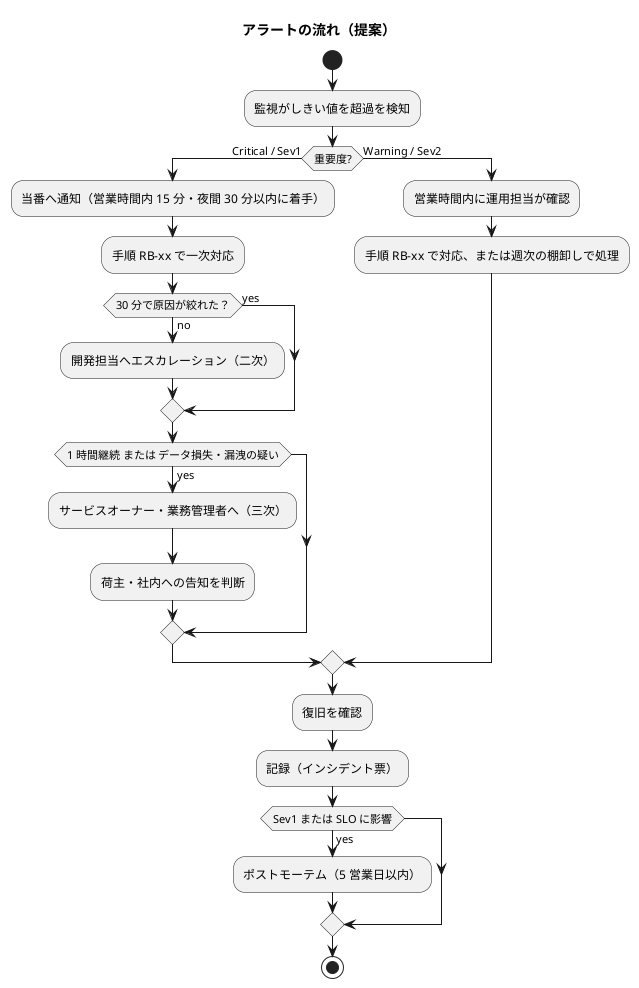
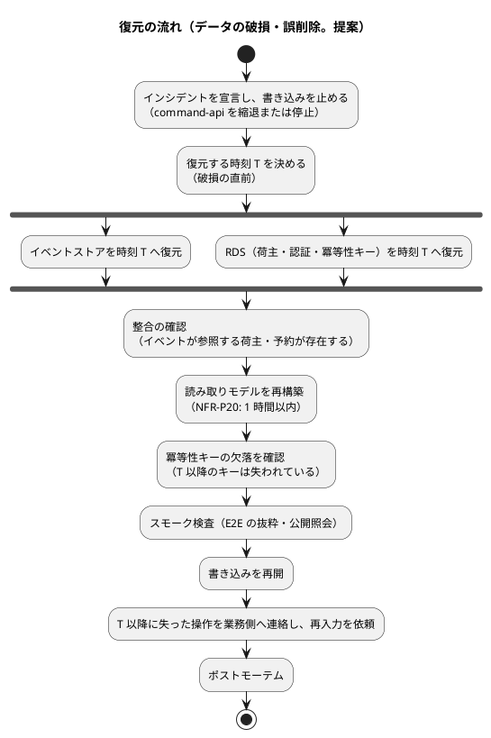
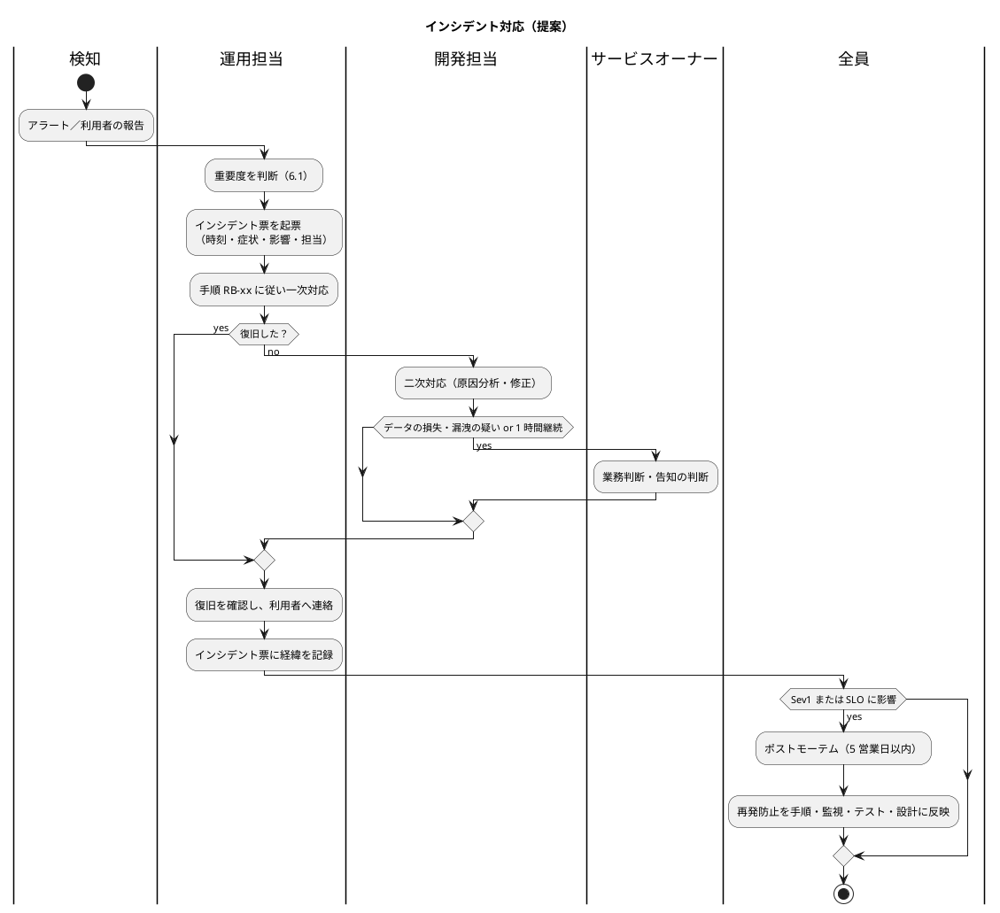
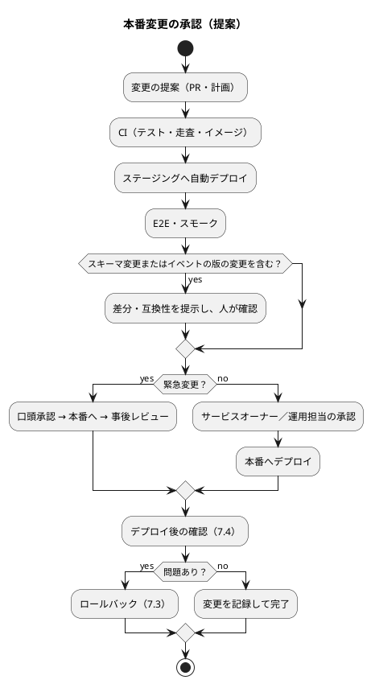

# 運用要件定義：国際貨物輸送管理システム

[非機能要件定義](non_functional.md)の SLO・RPO/RTO・アラートと、[インフラストラクチャアーキテクチャ](architecture_infrastructure.md)の構成を受けて、**作った後にどう維持するか**を定義します。体制、定常運用、監視、バックアップと復元、障害対応、変更管理、セキュリティ運用が対象です。

- 入力: [非機能要件定義](non_functional.md)、[インフラストラクチャ](architecture_infrastructure.md)、[バックエンド](architecture_backend.md)、[テスト戦略](test_strategy.md)、[技術スタック](tech_stack.md)、[リスク台帳](../requirements/risk_register.md)、[リリース計画](../development/release_plan.md)、[運用ドキュメントの入口](../operation/index.md)、[運用要件定義ガイド](../reference/運用要件定義ガイド.md)
- **本書は「運用の要件」であり、手順書ではありません**。手順書（コマンドを含む具体的な手順）は `docs/operation/` に、運用タスク（Gulp）として別途作ります（[第 10 章](#10-運用タスクと手順書)）
- **本書の判断はすべて「提案」です**。デプロイ設定・環境変数・本番環境に関わる判断は確認必須で、承認前に環境操作へ進みません（R-10）。数値は非機能要件定義の仮置きに従い、**事業側との合意前に SLA として扱いません**
- ケーススタディのため、**運用組織は実在しません**。体制は想定として置き、実際の運用に移すときに差し替えます（要確認）
- 環境変数と接続情報（`.env`、`.env.vault`、SSH 接続先）の値は AI が読み書きしません。環境操作は運用手順書の定義済みタスク経由で行い、独自の一時スクリプトを作りません（R-10、`CLAUDE.md`）

---

## 1. 読み方

### 1.1 状態の区分

| 状態 | 意味 |
| :--- | :--- |
| **確定** | 既存の要件・リスク台帳・承認済みの文書にある |
| **提案** | 本書が根拠を示して置いた要件。合意前の叩き台 |
| **要確認** | 人の判断（体制・業務・契約・法令）に依存し、本書では決められない |

### 1.2 要件 ID

`OPR-` + 分類（F フロー、M 監視、B バックアップ、I 障害対応、C 変更管理、S セキュリティ運用、K 容量・ライフサイクル、R 運用開始）+ 連番。

### 1.3 運用の原則（提案）

| # | 原則 | 理由 |
| :---: | :--- | :--- |
| P1 | **自動化できるものは自動化し、人は判断に使う** | 手作業が多いほど人的ミスが増える。定常作業は IaC と運用タスクに落とす |
| P2 | **手順は書くだけでなく、回して確かめる**（復元・ロールバック・フェイルオーバー） | 書いただけの手順は、障害時に初めて壊れていると分かる |
| P3 | **鳴るアラートは、対応する人と手順を持つ** | 手順の無いアラートは、アラート疲れを生む |
| P4 | **本番の変更は、差分を見て、人が承認する** | 確認必須の操作（R-03、R-10） |
| P5 | **戻せない変更は、戻せる形に分ける**（イベントは戻せない） | イベントソーシングの運用上の制約（インフラ 4.3） |
| P6 | **障害は責める対象ではなく、学ぶ対象** | ポストモーテムで仕組みを直す |

---

## 2. 運用体制と役割

### 2.1 役割

| 役割 | 責務 | 想定する担い手（ケーススタディの想定） |
| :--- | :--- | :--- |
| **サービスオーナー** | SLO の合意、優先順位、本番変更の最終承認、障害時の業務判断 | プロダクトオーナー |
| **運用担当** | 監視の確認、アラートの一次対応、定常運用、バックアップ・復元の実施、手順書の保守 | 運用・インフラ担当 |
| **開発担当** | 二次対応（アプリケーションの不具合）、修正、ポストモーテムの技術分析 | 開発チーム（AI ＋ 人のモブ） |
| **業務管理者** | 業務側の判断（荷主への連絡、手作業での代替、キャンセル・補償の判断） | 追跡管理者の上長（「管理職」。US20） |
| **システム管理者** | アカウントのロック解除・無効化（US31 AC-04）、ロールの付与 | ロールとして未定義（[フロントエンド 1.1](architecture_frontend.md)の要確認） |
| **セキュリティ担当** | 脆弱性・不審なアクセスの判断、秘密情報のローテーション | 運用担当が兼務、または別 |

- AI（Claude Code）は、**計画・差分の提示・手順の実行補助**を担います。本番への適用、承認、接続情報の取り扱いは人が行います（R-10、確認必須）
- 「システム管理者」は 6 ロールに入っていません。**7 つ目のロールとして定義するか**を要確認とします（UI 設計・BE-09 と共通）

### 2.2 対応時間帯（OP-01）

追跡照会は 24 時間 365 日（NFR-A01）ですが、**夜間に人が待機する体制があるかは分かりません**。体制によって取れる SLO が変わるため、選択肢を示して人が決めます。

| 案 | 内容 | 長所 | 短所 |
| :--- | :--- | :--- | :--- |
| A: 営業時間内のみ | 人の対応は平日日中。夜間・休日は**自動復旧と記録のみ** | 人の負担が小さい | 夜間に自動復旧できない障害が起きると、翌営業日まで止まる。公開照会 99.9%（月 43 分）は守れない可能性が高い |
| **B: 営業時間内＋夜間の当番（ベストエフォート）（推奨）** | 夜間・休日は Sev1 のみ当番に通知。**着手まで 30 分以内を目標**とし、営業時間内は 15 分以内（[非機能要件 7.2](non_functional.md#72-アラート)） | 公開照会の SLO に近づける。補償や手当は別に決める | 当番を決める必要がある |
| C: 24 時間の常時対応 | 交代制で常時 15 分以内に着手 | SLO を最も守れる | 規模（年 12,000 件）に対して過剰。費用が大きい |

**推奨は B**。ただし**ケーススタディでは当番を想定するだけ**で、実際の運用に移すときに体制を確定します（要確認）。

### 2.3 連絡先とエスカレーション

| 段階 | 宛先 | 条件 |
| :--- | :--- | :--- |
| 一次 | 運用担当（当番） | アラートの自動通知 |
| 二次 | 開発担当 | 一次で **30 分**以内に原因が絞れない、または不具合の修正が要る |
| 三次 | サービスオーナー・業務管理者 | Sev1 が **1 時間**続く、データの損失・漏洩の疑い、荷主への告知が要る |
| セキュリティ | セキュリティ担当 | 不審なアクセス・漏洩の疑い（重要度に関わらず即時） |

- 連絡先の一覧は**運用手順書**に置き、**四半期ごとに更新を確認**する（OPR-S05）。連絡先の値（電話・メール）は本書に書かない
- 通知の手段（メール・チャット・電話）は、外部サービスの導入にあたるため承認が要る（OP-02）

---

## 3. 定常運用（運用フロー）

自動化を前提にします。「自動」は CI・IaC・スケジュールされたタスクで動くもの、「手動」は人が判断・確認するものです。タスク名は[第 10 章](#10-運用タスクと手順書)の案です。

### 3.1 日次

| ID | 作業 | 自動／手動 | 担当 | 根拠 |
| :--- | :--- | :--- | :--- | :--- |
| OPR-F01 | ヘルスチェック・合成監視（公開照会を 1 分間隔で）。失敗は即時アラート | **自動** | — | NFR-A01 |
| OPR-F02 | ダッシュボードの確認（始業時）：反映遅延、待避先の件数、5xx 率、認証失敗、バックアップの成否 | 手動（5 分） | 運用担当 | NFR-M04 |
| OPR-F03 | **待避したイベントの確認**：件数が 0 でなければ原因を調べ、再処理するか判断する | 手動 | 運用担当 | NFR-A13（Sev2） |
| OPR-F04 | バックアップの**成否の確認**（自動取得は自動、結果の確認は通知で） | 自動＋通知 | — | NFR-A05 |
| OPR-F05 | 通関の留置 3 日超過、支払い期限超過の警告が通知されているか（アプリの機能。運用では**通知が届いていること**を確認） | 自動＋確認 | 業務側 | NFR-P21、US29・US23 |

### 3.2 週次

| ID | 作業 | 自動／手動 | 担当 | 根拠 |
| :--- | :--- | :--- | :--- | :--- |
| OPR-F10 | **アラートの棚卸**：前週のアラートを振り返り、無視されたもの・誤報・重複を整理して閾値と手順を直す | 手動（30 分） | 運用担当 | P3、アラート疲れの防止 |
| OPR-F11 | Sev3 の確認（回数制限への到達、容量の傾向、脆弱性の新規検出） | 手動 | 運用担当・セキュリティ担当 | 非機能要件 7.2 |
| OPR-F12 | 依存・イメージの**脆弱性走査の結果**を確認し、重大は 7 日、高は 30 日以内に対処を計画 | 自動＋手動 | セキュリティ担当 | NFR-S40 |
| OPR-F13 | 公開照会への**不審なアクセス**の傾向（形式不正の番号の多発、特定 IP からの大量照会） | 手動 | セキュリティ担当 | NFR-S31 |

### 3.3 月次

| ID | 作業 | 自動／手動 | 担当 | 根拠 |
| :--- | :--- | :--- | :--- | :--- |
| OPR-F20 | **SLO の達成確認**（公開照会 99.9%、業務 99.5%、反映遅延）とエラーバジェットの消化。未達ならポストモーテムに準じて原因と対策 | 手動 | 運用担当・サービスオーナー | NFR-A01・A02 |
| OPR-F21 | **容量とコストのレビュー**（[第 9 章](#9-容量コストライフサイクル)） | 手動 | 運用担当 | NFR-E05 |
| OPR-F22 | **監査ログのレビュー**：認証失敗・ロックの傾向、管理者操作（ロック解除・無効化）の妥当性 | 手動 | セキュリティ担当 | NFR-S10、US31 AC-06 |
| OPR-F23 | OS・ベースイメージ・依存の**更新の取り込み**（セキュリティパッチを含む）。ステージングで確認してから本番 | 自動（更新の検知）＋手動（承認） | 運用担当 | NFR-M14、インフラ 4.3 |
| OPR-F24 | イベントストアの**月次エクスポート**の成否と、読み出せることの確認 | 自動＋手動 | 運用担当 | NFR-D01 |

### 3.4 四半期

| ID | 作業 | 自動／手動 | 担当 | 根拠 |
| :--- | :--- | :--- | :--- | :--- |
| OPR-F30 | **復元訓練**：バックアップからの復元（イベントストア→読み取りモデルの再構築）。所要時間を RTO と比べる | 手動（ステージング） | 運用担当 | NFR-A05・A08、検査 I6 |
| OPR-F31 | **フェイルオーバーとタスク障害の訓練**（AZ の切り替え、タスクの強制終了）。反映遅延と SLO への影響を測る | 手動（ステージング） | 運用担当 | NFR-A06・A07 |
| OPR-F32 | **ロールバック手順の実行訓練**（前のイメージへ戻す、旧版が新版のイベントを読めること） | 手動（ステージング） | 運用担当・開発担当 | 検査 I5、NFR-A16 |
| OPR-F33 | **アカウントと権限の棚卸**（退職者・異動者の残存、ロールの妥当性） | 手動 | システム管理者 | OPR-S01 |
| OPR-F34 | **連絡先とエスカレーションの更新確認**、当番の見直し | 手動 | サービスオーナー | OPR-S05 |
| OPR-F35 | 手順書の**版の確認**（手順どおりに実行して差異が無いか） | 手動 | 運用担当 | P2 |

### 3.5 年次

| ID | 作業 | 担当 | 根拠 |
| :--- | :--- | :--- | :--- |
| OPR-F40 | **サポート期限の確認と更新計画**（Scala・JDK・PostgreSQL・Node など。Node 22 は 2027-04-30） | 開発担当 | 技術スタック 6・7 |
| OPR-F41 | **秘密情報・鍵のローテーション**（自動化されていないもの）。侵害時は即時 | セキュリティ担当 | OPR-S04 |
| OPR-F42 | **セキュリティ検証**（ASVS レベル 2 の再確認、公開エンドポイントの検証） | セキュリティ担当 | NFR-S41 |
| OPR-F43 | **データ保持の見直し**（期限を過ぎたログ・待避イベントの削除、アーカイブの確認、法令・社内規程の変更） | 運用担当・サービスオーナー | NFR-D |
| OPR-F44 | **DR の水準の見直し**（RPO/RTO が事業に合っているか。パイロットライトへ上げる必要があるか） | サービスオーナー | IF-06、NF-06 |
| OPR-F45 | 運用要件・SLO・体制の**レビューと改善**（PDCA） | サービスオーナー | ガイド |

---

## 4. 監視設計

### 4.1 サービスレベルの測り方（SLI → SLO）

非機能要件の SLO を、**何を数えて測るか**に落とします。エラーバジェットは、SLO を超えて許される失敗の量です。

| SLO（NFR） | SLI（測る値） | 測る場所 | 月間のエラーバジェット |
| :--- | :--- | :--- | :--- |
| 公開照会の可用性 99.9%（NFR-A01） | 合成監視の成功率（1 分間隔）。または ALB の「5xx 以外の比率」 | 外形の合成監視＋ ALB | 約 43 分の失敗 |
| 業務の可用性 99.5%（NFR-A02） | ALB の「5xx 以外の比率」、ヘルスチェック | ALB | 約 3.6 時間 |
| 反映遅延 p95 5 s／p99 15 s（NFR-P10） | アプリが出す指標（イベントの発生時刻 → 反映時刻の差） | 読み取りモデルの更新処理 | p99 が目標を超えた時間の割合 |
| 応答時間（NFR-P01〜P07） | アプリの p95・p99 | アプリ | — |

- **エラーバジェットの使い方**：月の消化が **50%** に達したら、新機能のリリースより信頼性の改善を優先するかをサービスオーナーが判断する（提案）
- **除外**：計画停止（ゼロが目標）、外部システム（通知・決済）の障害、利用者側の回線。除外の扱いは SLA にする前に合意する（NF-03）

### 4.2 監視項目と閾値

閾値は非機能要件 7.2 を出発点にします。**Warning は営業時間内に見る**もの、**Critical は呼び出すもの**です。値は**仮**で、運用開始後の実測で調整します（OPR-F10）。

| ID | 対象 | 指標 | Warning | Critical | 通知 | 手順 |
| :--- | :--- | :--- | :--- | :--- | :--- | :--- |
| OPR-M01 | 公開照会 | 合成監視の失敗 | 2 回連続 | **3 回連続**（3 分） | Critical: 当番 | RB-01 |
| OPR-M02 | 公開照会 | 5xx 率 | — | **> 5%**（1 分） | 当番 | RB-01 |
| OPR-M03 | 業務 API | 5xx 率 | **> 1%**（5 分） | **> 5%**（1 分） | Warning: 運用担当 | RB-02 |
| OPR-M04 | 業務 API | p95 応答 | 目標の **80%** 超（NFR-E05） | 目標の 2 倍（5 分） | 運用担当 | RB-02 |
| OPR-M05 | ヘルスチェック | 連続失敗 | — | **タスクあたり 3 回** | 当番 | RB-02 |
| OPR-M06 | イベントストア | 書き込みの失敗 | **1 件以上** | **継続（5 分）** | 当番 | RB-04 |
| OPR-M07 | 反映遅延 | p99 | **> 15 s**（5 分継続） | **> 60 s**（5 分継続） | 運用担当／当番 | RB-03 |
| OPR-M08 | 購読の停滞 | 古さ（IteratorAge・キュー滞留） | **> 60 s** | **> 5 分** | 運用担当／当番 | RB-03 |
| OPR-M09 | 待避したイベント | 件数 | **> 0** | **急増（10 分で 10 件以上）** | 運用担当／当番 | RB-05 |
| OPR-M10 | RDS | CPU・接続数・空き容量・レプリカ遅延 | 使用率 **60%**（1 週間続く） | **85%** | 運用担当／当番 | RB-06 |
| OPR-M11 | バックアップ | 取得の失敗、最終取得からの経過 | **失敗 1 回** | **24 時間取得なし** | 運用担当 | RB-07 |
| OPR-M12 | 認証 | 失敗率、ロックの件数 | 平常の **3 倍**（1 時間） | **10 倍**（10 分）または 同一 IP の大量失敗 | セキュリティ担当 | RB-09 |
| OPR-M13 | 公開照会 | 回数制限への到達 | **急増** | — | セキュリティ担当 | RB-09 |
| OPR-M14 | 外部連携 | 通知・決済の送信失敗率 | **> 10%**（15 分） | **全件失敗（10 分）** | 運用担当 | RB-08 |
| OPR-M15 | 業務エラー | 状態遷移違反・認可違反の件数 | 平常の **3 倍** | — | 運用担当・開発担当 | RB-10 |
| OPR-M16 | 証明書・秘密情報 | 有効期限までの日数 | **30 日** | **7 日** | 運用担当 | RB-11 |
| OPR-M17 | 同時書き込み | 連番の衝突・永続化の失敗の件数（NFR-A17 の結論後） | **> 0** | 継続 | 開発担当 | RB-12 |

### 4.3 ビジネス監視

業務の指標を運用で見ます（[リリース計画](../development/release_plan.md)の測定基準）。**運用の健全さではなく、価値が届いているか**を見る指標です。

| ビジネス目標 | 指標 | 出所 | 見る頻度 |
| :--- | :--- | :--- | :--- |
| 2 リアルタイム貨物追跡 | 荷役作業から追跡情報への反映時間（= 反映遅延） | アプリの指標 | 常時（ダッシュボード）、月次 |
| 3 輸送状況通知の自動化 | 荷主からの問い合わせ件数 | 業務側の記録（本システム外） | 月次 |
| 5 例外対応の迅速化 | 例外の発生から荷主への通知までの時間 | 追跡イベントと通知の記録 | 月次 |
| 4 最適ルート自動設計 | 経路設計 1 件の所要時間、再算出（US10）の発生率 | 経路計画の履歴 | 月次 |
| 1 予約業務の効率化 | 見積作成から予約確定までのリードタイム、入力回数 | 予約の履歴 | 月次 |
| 6 精算業務の正確化 | 精算の誤り（再発行・訂正）、配送完了から精算済までのリードタイム | 精算の履歴 | 月次 |
| （U-01） | 不正ログインの検知件数、ロックの発生件数 | 監査ログ | 月次 |

- 目標値はビジネス目標に数値が無いため**未定**（リリース計画と同じ）。傾向を見る指標から始める
- **問い合わせ件数**は本システムの外にある。取得の方法を業務側と決める（要確認）

### 4.4 アラートの設計規則（アラート疲れを防ぐ）

| # | 規則 |
| :--- | :--- |
| A1 | **呼び出す（Critical）のは、利用者に影響が出ている／すぐ出るもの**だけ。それ以外は営業時間内に見る |
| A2 | **すべてのアラートに手順（RB-xx）と担当を付ける**。手順の無いアラートは作らない（検査 O1） |
| A3 | 症状（利用者の影響）を先に、原因（CPU など）は補助にする。同じ事象で複数のアラートが鳴るなら**重複を抑止**する |
| A4 | 一時的な揺れで鳴らさない。**継続時間**（1〜5 分）を条件に入れる |
| A5 | ヘルスチェックのログ・指標は、通常の API の指標に混ぜない（過負荷の誤判定を防ぐ） |
| A6 | アラートを**週次で棚卸し**、無視されたものは閾値を直すか、消す（OPR-F10） |
| A7 | **鳴ることを確かめる**：新しいアラートは、わざと条件を満たして通知が届くことを確認する（検査 O6） |

### 4.5 ダッシュボード

| ダッシュボード | 見る人 | 内容 |
| :--- | :--- | :--- |
| 概況 | 運用担当（始業時） | SLO の消化、5xx 率、応答時間、反映遅延、待避先、バックアップ |
| 追跡（U-04） | 運用担当・業務側 | 反映遅延、購読の停滞、公開照会の要求数・制限到達、通知の成否 |
| データ | 運用担当 | RDS の使用率、Journal の容量、イベント数の増加、再構築の所要時間（直近の実測） |
| 認証・セキュリティ | セキュリティ担当 | ログイン失敗・ロック、管理者操作、回数制限、脆弱性の件数 |

### 4.6 エスカレーションの流れ

---

## 5. バックアップと復元の設計

非機能要件の **RPO 15 分／RTO 4 時間**（NFR-A05）と保持（NFR-D）を満たす方式です。方式は「バックアップ＆リストア」から始めます（IF-06）。

### 5.1 方式とスケジュール

| ID | 対象 | 方式 | 頻度・粒度 | 保持（提案） | RPO | 検証 |
| :--- | :--- | :--- | :--- | :--- | :--- | :--- |
| OPR-B01 | **イベントストア**（唯一の真実） | ポイントインタイム復旧（継続）＋**月次のエクスポート**（読める形で別の保管先へ）。削除保護 | 継続（秒〜分）／月次 | PITR は提供される最大期間（**着手時に確認**）。エクスポートは 7 年（NFR-D01） | **15 分以内** | 四半期の復元訓練、月次のエクスポートの読み出し確認 |
| OPR-B02 | RDS（荷主・認証・冪等性キー・監査ログ・読み取りモデル） | 自動バックアップ（日次のスナップショット＋トランザクションログの継続）。重要な変更の前に**手動スナップショット** | 日次＋継続 | **14 日**（NFR-D05）。手動スナップショットは変更後 30 日で削除 | **15 分以内** | 四半期の復元訓練 |
| OPR-B03 | 設定・IaC・手順書 | Git | コミットごと | 無期限 | 0 | PR のレビュー |
| OPR-B04 | 秘密情報（Secrets Manager） | 値は**バックアップしない**（再発行できる設計）。保管先の定義（名前・構造）は IaC | — | — | — | 再発行の手順（OPR-S04） |
| OPR-B05 | 読み取りモデル | **バックアップは任意**（イベントから再構築できる） | — | RDS に従う | 0（再構築） | 再構築の所要時間を測る（検査 I6） |

- 「フル／差分／増分」の組み合わせは、**マネージドサービスの機能**（PITR、スナップショット＋ログ）に任せる。自分でフル・差分・増分を組まない
- バックアップの**保存先は別のアカウント／別の領域**に置くことを検討する（誤削除・侵害時に同時に失わないため）。要確認（NF-06）
- **削除保護**：イベントストアと RDS の削除は、IaC の変更でも承認なしに実行できないようにする

### 5.2 復元の基本手順（要件）

詳細な手順は運用手順書に書きます。ここでは**満たすべき順序と確認**を定めます。

| ID | 要件（提案） | 根拠 |
| :--- | :--- | :--- |
| OPR-B10 | **イベントストアと RDS は同じ時刻 T に揃えて復元する**。別々の時刻に復元すると、イベントが参照する荷主や予約が存在しない、または認証の状態が食い違う | 二つのデータストアに分かれているため（データモデル 2）。T の揃え方は手順書に書く |
| OPR-B11 | 復元後、**整合の確認**を行う：イベントが参照する荷主が存在する、読み取りモデルの版がイベントの版と一致する | 整合を確かめる運用タスク（`readmodel:verify` 案） |
| OPR-B12 | **T 以降に失われた操作**（イベント、冪等性キー、監査ログ）を特定し、業務側に連絡する。冪等性キーを失うと、クライアントの再送が**二重に登録される**可能性がある。復元直後の一定期間は再送に注意する | NFR-D02 |
| OPR-B13 | 復元の**所要時間を記録**し、RTO（4 時間）と比べる。超えた場合は原因を調べ、再構築の並列化・スナップショットの導入を検討する | NFR-A05・P20 |
| OPR-B14 | **復元訓練は四半期ごと**にステージングで行い、結果（所要時間・問題点）を記録して手順書を直す | P2、OPR-F30 |
| OPR-B15 | 復元を実行できるのは**承認を得た運用担当**のみ。本番での復元は確認必須の操作で、計画と差分を提示してから行う | R-10、確認必須 |

> 復元のうち、「**誤って削除した**」場合は T の前に戻すと正常な操作も失います。部分的な修正（補償するイベントを足す）で足りるかを先に検討します。イベントソーシングでは、**消すより打ち消す**のが基本です（要確認：業務ルール）。

---

## 6. 障害対応設計

### 6.1 重要度の定義

非機能要件 7.2 の Sev1〜3 に、**業務への影響**の観点を足します。

| 重要度 | 定義 | 例 | 着手 | 通知 |
| :--- | :--- | :--- | :--- | :--- |
| **Sev1** | 利用者の業務が止まっている、またはデータの損失・漏洩の疑い | 公開照会が落ちている、イベントを書けない、荷役の記録ができない、認証できない | 営業時間内 **15 分**・夜間 **30 分** | 当番へ呼び出し。1 時間継続でサービスオーナーへ |
| **Sev2** | 一部の機能が劣化、放置すると Sev1 | 反映遅延の悪化、待避先に積み上がる、外部連携の失敗 | 営業時間内 | 運用担当へ |
| **Sev3** | 影響は無いが傾向を見る | 回数制限への到達、容量の傾向 | 週次 | 週次の確認 |

### 6.2 障害パターンと手順（ランブックの一覧）

障害の都度ゼロから考えないよう、**想定される障害ごとに手順（RB）を事前に書きます**。手順の本文は運用手順書（`docs/operation/`）に置き、ここでは**検知・影響・一次対応の方針・復旧目標**を定めます。

| RB | 障害パターン | 検知 | 影響 | 一次対応の方針 | 復旧目標 |
| :--- | :--- | :--- | :--- | :--- | :--- |
| RB-01 | **公開照会が応答しない／5xx** | OPR-M01・M02 | 荷主・荷受人が追跡できない（ビジネス目標 2） | 原因が業務側の過負荷か、公開側かを切り分ける。公開パスは別ターゲットグループなので**業務側を止めても公開は動く**。直近のデプロイならロールバック（RB-13）。回数制限の誤設定を確認 | NFR-A07：1 分（タスク障害）、AZ 障害は 5 分 |
| RB-02 | **業務 API のタスク障害／過負荷** | OPR-M03〜M05 | 営業・経路・追跡・経理の操作が遅い／できない | タスクの再起動（自動）、台数の増加、直近の変更の確認。ヘルスチェックが落ちて再起動を繰り返していないか（NFR-A14） | 1 分（再起動）、5 分（AZ） |
| RB-03 | **反映遅延の悪化／購読の停滞** | OPR-M07・M08 | 画面で更新が見えない、荷主への通知が遅れる（ビジネス目標 2・5） | 停滞の場所を特定（event-processor の失敗／ Streams の滞留／ DB の遅さ）。再起動、スケール、待避先の確認（RB-05）。**イベントは失われていない**（イベントストアに残る）ことを確認して利用者へ知らせる | 反映遅延が目標内に戻る（NFR-P10） |
| RB-04 | **イベントストアに書き込めない** | OPR-M06 | **コマンドが全て失敗**（予約・荷役が止まる）。データの損失はないが業務が止まる | 認可（IAM）・スロットリング・サービス障害を切り分ける。書き込みの再試行は**冪等性キー**で二重にならない。業務側へ代替手段（紙の記録、後で入力）を案内（6.4） | 30 分（サービス側障害は復旧を待つ） |
| RB-05 | **待避先にイベントが溜まる** | OPR-M09 | 読み取りモデルに反映されないイベントがある（追跡情報の欠け） | 原因を特定（イベントの版の不一致、読み取りモデルの制約違反、バグ）。**修正をデプロイしてから再処理**（`events:dlq:redrive`）。再処理は冪等なので安全 | 営業時間内に処理 |
| RB-06 | **RDS の障害／フェイルオーバー／容量** | OPR-M10 | 認証・荷主・読み取りモデルが使えない | Multi-AZ の自動切り替えを待ち、アプリの接続の再確立を確認。容量はスケールアップ。**読み取りモデルが壊れたら再構築**（RB-14） | 5 分（AZ）、1 時間（再構築、NFR-A08） |
| RB-07 | **バックアップの失敗** | OPR-M11 | 今は影響なし。**復旧できる範囲が狭まる** | 原因を調べて再取得。**24 時間取得なしは Critical** | 24 時間以内に取得 |
| RB-08 | **外部（通知・決済）の失敗** | OPR-M14 | 通知が届かない、入金が確認できない | **業務の状態は巻き込まない**（NFR-A12）。失敗を記録し、再試行。長引くなら業務側に手作業での連絡を依頼（荷主への電話・メール）。外部の復旧後に未送信を再処理 | 外部の復旧に依存（本システムの SLO 外） |
| RB-09 | **不審なアクセス／総当たり／アカウント侵害の疑い** | OPR-M12・M13 | 漏洩・不正操作の恐れ | セキュリティ担当へ即時。該当 IP のブロック（WAF）、アカウントのロック、セッションの失効。監査ログの確認。**漏洩の疑いはサービスオーナーに即時エスカレーション** | 影響範囲の特定が最優先 |
| RB-10 | **業務エラーの急増**（状態遷移違反・認可違反） | OPR-M15 | 不具合または不正の兆候 | 直近のデプロイとの関係を確認。特定の利用者・操作に集中しているか。開発担当へ | 営業時間内 |
| RB-11 | **証明書・秘密情報の期限切れ間近** | OPR-M16 | 期限切れで通信が止まる | 更新（自動更新の失敗なら手動）。秘密情報のローテーション（OPR-S04） | 期限前 |
| RB-12 | **同一集約への同時書き込みの衝突** | OPR-M17 | 一部のコマンドが失敗、アクターの停止 | NFR-A17 の PoC の結論に従う。当面は発生件数の記録と開発担当への通知 | PoC の後に確定 |
| RB-13 | **デプロイ後の不具合（ロールバック）** | デプロイ後の確認（7.4）、OPR-M03・M07 | 直前の変更による劣化 | **前のイメージへロールバック**（7.3）。イベントの版を確認（新版が出したイベントを旧版が読めるか）。読めないなら**前進の修正**（forward-fix） | 15 分以内に判断 |
| RB-14 | **データの破損・誤削除（復元）** | 利用者の報告、整合性の検査 | 業務データの誤り | **まず書き込みを止めて被害を止める**。復元（5.2）か、補償するイベントを足す修正かを判断 | RTO 4 時間（NFR-A05） |
| RB-15 | **マイグレーションの失敗** | デプロイ中の失敗 | スキーマが中途半端 | 適用前の手動スナップショットから復元するか、前方修正。**追加→切り替え→削除**の分割で、失敗の影響を小さくする（NFR-M20） | 1 時間 |

### 6.3 インシデント対応の流れ

- **インシデント票**の項目：検知時刻、重要度、症状、影響範囲、対応の経緯（時刻つき）、原因、復旧時刻、再発防止。保管場所は要確認（リポジトリの `docs/` か、課題管理か）
- **ポストモーテム**は個人を責めない。**監視・手順・テスト・設計のどこで防げたか**を問い、修正をガードレールに反映する（CLAUDE.md の「修正はガードレールにする」）

### 6.4 縮退運転と業務継続

システムが使えないときも業務は止まりません。**どう続けるか**を事前に決めます（要確認：業務側と合意）。

| 状況 | 縮退の方針（提案） | 備考 |
| :--- | :--- | :--- |
| 公開照会が落ちた | 荷主・荷受人からの問い合わせを**電話・メールで受け、追跡管理者が業務画面で確認して回答**。公開ページに「障害のお知らせ」を静的に表示（CloudFront の静的ページ） | 公開側が落ちても業務画面は別 |
| 読み取りモデルが古い | 公開照会は**古い値で応答**し、「最終更新時刻」を表示する（再構築中も止めない）か、停止するかを決める | NFR-A08 の要確認 |
| 書き込みができない（RB-04） | 荷役作業員は**紙またはメモで記録**し、復旧後に入力する。作業日時は入力できるため（US15）、後から正しい時刻で記録できる | 冪等性キーで二重にならない |
| 外部の通知が止まった | 追跡管理者が**手作業で荷主に連絡**。復旧後に未送信を再処理 | RB-08 |
| 認証が止まった | **業務を止める**（認証を迂回しない）。復旧を優先 | セキュリティ優先（NFR-S） |

### 6.5 利用者への告知

| 相手 | 手段（案） | 内容 |
| :--- | :--- | :--- |
| 社内の利用者 | チャット／メール（OP-02 で決定） | 障害の症状、影響範囲、見込み、代替手段 |
| 荷主・荷受人 | 公開ページの静的なお知らせ、必要なら業務側の個別連絡 | 追跡が一時的に見られないこと、復旧見込み |
| 外部（規制当局など） | 個人情報の漏洩が疑われる場合の報告義務は**法令の確認が要る** | サービスオーナーと法務の判断（要確認） |

---

## 7. 変更管理設計

### 7.1 変更の分類と承認

| 分類 | 例 | 承認 | 手順 |
| :--- | :--- | :--- | :--- |
| **標準（アプリケーション）** | 機能追加・不具合修正のデプロイ | ステージングは自動。**本番は承認つきの手動起動**（差分：イメージの版、IaC の差分、マイグレーション） | CI → ステージング → E2E → 承認 → 本番 |
| **スキーマ変更**（R-03） | Flyway のマイグレーション | **人が差分を確認**してから適用。手動スナップショットを取る | 追加 → 切り替え → 削除に分ける |
| **イベントの版の変更** | 新しい版のイベントを出す | **読む側を先に**デプロイし、書く側を後から（インフラ 4.3） | 旧版が読めることを検査（検査 I5） |
| **インフラ（IaC）** | 構成・サイズ・ネットワーク | IaC の**差分（plan）を提示**して承認（IF-02） | PR のレビュー → 承認 → 適用 |
| **設定・環境変数・秘密情報**（R-10） | 接続先・タイムアウト・鍵 | 確認必須。**値は AI が読まない**。手順書のタスクで | 承認 → タスクで適用 → 確認 |
| **緊急変更**（hotfix） | Sev1 の復旧のための変更 | サービスオーナー（または代理）の**口頭承認＋事後の記録**。承認の遅れで復旧を止めない | 最小の修正 → 速い検査 → デプロイ → **事後レビュー（5 営業日以内）** |
| **運用の標準作業** | 台数の増減、再構築、待避先の再処理 | 手順書に定義済みなら**事前承認済み**。記録は残す | 運用タスクで実行 |

### 7.2 リリース手順（要件）

| ID | 要件（提案） | 根拠 |
| :--- | :--- | :--- |
| OPR-C01 | **デプロイは CI/CD で自動化**し、人が手で本番に入って変更しない。本番の起動は承認つきの手動トリガー | 確認必須、インフラ 6.3 |
| OPR-C02 | **ローリング更新**。計画停止はゼロを目標（NFR-A04）。ALB から切り離してから停止（detach-wait） | インフラ 4.3 |
| OPR-C03 | イメージは**ダイジェストで指定**し、デプロイ後に**実行中のイメージが意図した版**であることを確認する（同じタグの作り直しで古いままにならない） | 検査 I8 |
| OPR-C04 | **変更の窓**：荷役の記録が少ない時間帯を選ぶ。**金曜の夕方・長期休暇の前・月末の精算締めの前後は避ける**（要確認：業務側の繁忙期）。緊急変更は例外 | 事故の影響を小さくする |
| OPR-C05 | **変更の凍結**：業務の重要な時期（決算・精算の締め・大型の入港）は、緊急以外の本番変更を凍結する。期間は業務側と合意（要確認） | 同上 |
| OPR-C06 | **リリースノート**を残す（何を変えたか、マイグレーション・イベントの版・設定の有無、ロールバック方法）。ADR・設計書の更新を伴う | CLAUDE.md、NFR-M13 |
| OPR-C07 | **1 回の変更は小さく**する（小さなリリース）。スキーマ変更とアプリ変更を同じデプロイに混ぜない（追加→切り替え→削除） | NFR-M20 |

### 7.3 ロールバック手順（要件）

**ロールバックの手順が無いリリースは許可しません。** 変更の種類ごとに戻し方を決め、**ステージングで実行して確かめます**（OPR-F32）。

| 変更 | 戻し方 | 条件・注意 | 確認 |
| :--- | :--- | :--- | :--- |
| アプリケーション（コンテナイメージ） | **前のイメージ（ダイジェスト）へ戻して再デプロイ** | 新しい版が出したイベントを旧版が読めること（検査 I5） | ヘルスチェック、スモーク、反映遅延 |
| イベントの版 | **戻せない**（イベントは追記専用）。旧版が読める状態を保つ。読めないときは**前進の修正（forward-fix）** | 読む側を先にデプロイしていれば、書く側だけを戻せる | 往復テスト（旧版） |
| スキーマ（Flyway） | **前方互換の分割**：追加は戻さなくてよい。切り替えを戻す。削除は**十分な期間を置いてから**（戻せないため） | 適用前に手動スナップショット。適用済みのマイグレーションは書き換えない | 空の DB／前の版の DB の両方で通る（検査 I7） |
| インフラ（IaC） | **前のコミットの状態へ適用**。差分（plan）を確認してから | データストアの削除を伴う変更は戻せない。削除保護 | 構成の差分が無いこと |
| 設定・環境変数 | 前の値へ戻す（手順書のタスク）。**値は人が扱う** | R-10 | 起動と接続 |
| 読み取りモデル | **再構築**（`readmodel:rebuild`） | イベントから作り直せる。所要時間は NFR-P20 | 版の一致（OPR-B11） |

- **判断の基準**：デプロイ後 **15 分**以内に SLO の悪化・エラー率の上昇が見られたら、原因の調査より先にロールバックを検討する（提案）
- ロールバックも**変更**であり記録を残す。ロールバックできなかったときの代替（前進の修正）を先に決めておく

### 7.4 デプロイ後の確認

| 確認 | 内容 | 時間 |
| :--- | :--- | :--- |
| ヘルス | 全タスクがレディ。実行中のイメージが意図した版（OPR-C03） | 即時 |
| スモーク | 公開照会、ログイン、主要な一覧が開く | 5 分 |
| 業務シナリオ | E2E の抜粋（更新直後に一覧で見える） | 10 分 |
| 指標 | 5xx 率、応答時間、**反映遅延**、待避先の件数が悪化していない | 30 分 |
| 判断 | 問題なければ完了を記録。問題があればロールバック | 30 分後 |

---

## 8. セキュリティ運用

| ID | 要件（提案） | 担当 | 根拠 |
| :--- | :--- | :--- | :--- |
| OPR-S01 | **アカウントのライフサイクル**：入社・異動・退職の連絡を受けて、**退職者は 1 営業日以内に無効化**（US31）。異動者はロールを見直す。四半期にアカウントを棚卸し（OPR-F33） | システム管理者 | NFR-S10・S11 |
| OPR-S02 | **管理者の操作**（ロック解除・無効化・ロール付与）は**理由つきで記録**し、月次でレビュー（OPR-F22）。**誰が誰に何をしたか**を追える | システム管理者・セキュリティ担当 | US31 AC-06 |
| OPR-S03 | **脆弱性の対応期限**：重大 7 日、高 30 日（NFR-S40）。期限を超える場合は例外を記録し、サービスオーナーが承認 | セキュリティ担当 | NFR-S40 |
| OPR-S04 | **秘密情報・鍵のローテーション**：自動化できるもの（Secrets Manager の回転）は**90 日**を目安にする。侵害の疑いは**即時**。回転でアプリが落ちないこと（二つの鍵の並行期間）を確かめる | セキュリティ担当 | R-10。期間は仮 |
| OPR-S05 | **連絡先の最新化**（四半期）と、インシデント時の連絡の訓練 | サービスオーナー | OPR-F34 |
| OPR-S06 | **最小権限の維持**：本番の操作権限を持つ人を絞る。**本番への SSH／DB 接続は手順書のタスク経由**で、操作の記録が残る。共有アカウントを使わない | 運用担当 | インフラ 5.3・5.4、R-10 |
| OPR-S07 | **本番の操作ログ**（CloudTrail 等）を有効にし、保持・不変にする | 運用担当 | インフラ 5.4 |
| OPR-S08 | **セキュリティインシデントの手順**（RB-09）：封じ込め（ブロック・ロック・失効）→ 調査（ログ）→ 影響範囲の特定 → 通知の判断 → 再発防止 | セキュリティ担当 | — |
| OPR-S09 | **AI（Claude Code）の扱い**：`.env`・`.env.vault`・接続情報の値を読まない・書かない。環境操作は定義済みタスクだけ。独自の一時スクリプトを運用の置き場に置かない | 全員 | R-10、CLAUDE.md |

---

## 9. 容量・コスト・ライフサイクル

| ID | 要件（提案） | 頻度 | 根拠 |
| :--- | :--- | :--- | :--- |
| OPR-K01 | **容量のレビュー**：RDS の使用率、Journal の容量、イベント数の増加、ログ量、再構築の所要時間。**使用率 60% が 1 週間続いたら拡張を検討**（NFR-E05） | 月次 | NFR-E05 |
| OPR-K02 | **コストのレビュー**：環境別（開発・ステージング・本番）の費用。ステージングは夜間・休日に停止またはサイズを下げる。予算の閾値は要確認 | 月次 | インフラ 9 |
| OPR-K03 | **再構築時間の追跡**：イベント数が増えると再構築が遅くなる。**RTO の 4 時間に収まらなくなる前**（目安：所要時間が RTO の 50%）にスナップショット・並列化を導入する | 四半期（復元訓練時） | NFR-P20 |
| OPR-K04 | **データの保持と削除**：期限を過ぎたログ・待避したイベント・冪等性キーを削除（自動）。イベントストアは削除しない。法令・社内規程の変更を反映 | 年次 | NFR-D |
| OPR-K05 | **サポート期限の管理**：技術スタックの EOL を一覧にし、**6 か月前**に更新を計画（NFR-M14）。例：Node 22 の EOL は 2027-04-30 | 年次 | 技術スタック 6・7 |
| OPR-K06 | **依存・イメージの更新**：月次で取り込み、ステージングで確認（OPR-F23） | 月次 | NFR-M14 |
| OPR-K07 | **廃止の手順**：システムを終了するときのデータの引き渡し・保管・削除（個人情報）。ケーススタディでは範囲外 | — | 要確認 |

---

## 10. 運用タスクと手順書

運用は**手順書に定義済みのタスク**で行います（R-10、`CLAUDE.md`）。手順書に無い操作が必要なら、まず既存のタスクを探し、無ければ `operating-script` で**正式なタスクとして足して**手順書にも書きます。

### 10.1 運用タスク（案）

[インフラ 7.3](architecture_infrastructure.md#73-運用タスク案)のタスクに、本書で必要になったものを足します。名前は案です。

| 目的 | タスク（案） | 使う場面 | 承認 |
| :--- | :--- | :--- | :--- |
| ローカル環境の起動・停止 | `dev:up`・`dev:down` | 開発 | 不要 |
| マイグレーションの確認・適用 | `db:migrate:info`・`db:migrate` | 7.1 スキーマ変更 | **適用は必須**（R-03） |
| 読み取りモデルの再構築 | `readmodel:rebuild` | RB-06・RB-14 | 本番は必須 |
| 読み取りモデルの整合の確認 | `readmodel:verify` | OPR-B11 | 不要 |
| 待避先の確認・再処理 | `events:dlq:list`・`events:dlq:redrive` | RB-05 | 再処理は運用担当 |
| バックアップの取得・一覧・検証 | `backup:run`・`backup:list`・`backup:verify` | OPR-B01〜B02 | 手動取得は運用担当 |
| 復元 | `backup:restore`（ステージング／本番） | 5.2 | **本番は必須** |
| デプロイ・ロールバック | `deploy:stage`・`deploy:prod`・`deploy:rollback` | 7 | **本番は必須** |
| ヘルス・実行中の版の確認 | `ops:status` | 7.4、OPR-C03 | 不要 |
| E2E の実行 | `e2e:run` | 7.4 | 不要 |

- 環境操作（DB 接続・クエリ・バックアップ・デプロイ・プロビジョニング）は**これらのタスク経由のみ**。踏み台の IP・鍵・認証情報・ポートの解決はタスクが持つ
- 使い捨ての調査用スクリプトはスクラッチパッドに置いて作業後に消す。運用スクリプトの置き場（`ops/scripts/`）に置かない

### 10.2 手順書とランブック（`docs/operation/`）

| 文書 | 内容 | 状況 | 作成の時期 |
| :--- | :--- | :--- | :--- |
| アプリケーション開発環境セットアップ手順書 | ローカル環境 | 未作成 | Bolt 1 の前 |
| 開発環境セットアップ手順書 | 開発環境（置く場合） | 未作成 | IF-01 の決定後 |
| AWS ステージング環境セットアップ手順書 | ステージング | 未作成 | ステージング構築時 |
| AWS プロダクション環境セットアップ手順書 | 本番 | 未作成 | MVP リリースの前 |
| 運用コマンドリファレンス | 10.1 のタスク | 未作成 | タスクを足すごとに |
| ランブック RB-01〜RB-15 | 6.2 の障害ごとの手順 | 未作成 | **MVP リリースの前に RB-01〜RB-05・RB-13・RB-14**、以降は機能の追加に合わせる |
| バックアップ・復元手順書 | 5 章 | 未作成 | ステージング構築時（初回の訓練まで） |
| リリース・ロールバック手順書 | 7 章 | 未作成 | ステージング構築時 |
| 連絡先・当番表 | 2.3 | 未作成（値は本書に書かない） | 体制の確定時 |

- 手順書は**テンプレート**（`docs/template/`）を元にし、コードと同時に更新する。四半期に手順どおりに実行して差異を確かめる（OPR-F35）

---

## 11. 運用開始の条件

「作った」だけでは本番に出しません。各リリースの前に、運用の準備ができていることを確かめます（ゲート）。

| ID | 条件 | MVP リリース前 | フェーズ 2 前 | 正式リリース前 |
| :--- | :--- | :---: | :---: | :---: |
| OPR-R01 | 監視とアラートが設定され、**実際に鳴って通知が届く**ことを確認した（A7） | ○ | ○ | ○ |
| OPR-R02 | 全アラートに手順（RB）と担当が付いている | ○（対象分） | ○ | ○ |
| OPR-R03 | バックアップが取得され、**復元訓練を 1 回完了**し、所要時間を記録した | ○ | — | ○（再訓練） |
| OPR-R04 | **ロールバックをステージングで実行**して確かめた | ○ | — | — |
| OPR-R05 | 読み取りモデルの**再構築を実行**し、所要時間を NFR-P20 と比べた（検査 I6） | ○ | — | ○ |
| OPR-R06 | 連絡先と当番（体制）が確定し、**インシデント対応の机上訓練**を行った | ○ | — | — |
| OPR-R07 | 本番のデプロイ設定・環境変数・秘密情報が**承認され**、IaC から作られている（IF-01〜IF-05） | ○ | — | — |
| OPR-R08 | 公開照会の防御（WAF・回数制限・別ターゲットグループ）が働くことを**負荷で確認**した（検査 I3・I4） | ○ | — | — |
| OPR-R09 | 手順書（セットアップ・復元・リリース・ロールバック・主要な RB）が揃い、**手順どおりに実行できた** | ○ | ○（追加分） | ○ |
| OPR-R10 | 同時書き込みの PoC（NFR-A17）の結論が反映されている | ○ | — | — |
| OPR-R11 | SLO・体制・データの保持について、事業側（サービスオーナー）の**合意**がある | ○ | — | — |
| OPR-R12 | 利用者（社内）に**使い方と障害時の連絡先**を伝えた（マニュアル：`creating-manual`） | ○ | ○ | ○ |

---

## 12. 運用の適合性の検査

ADR に書いた規則と同様に、運用の規則も**同じ変更で検査に落とします**。落とさなければ守られません。

| # | 規則 | 検査 |
| :--- | :--- | :--- |
| O1 | すべてのアラートが手順（RB）と担当を持つ | アラート定義から RB への参照を検査（参照が無いアラートは失敗） |
| O2 | 復元訓練が四半期ごとに行われ、記録が残る | 記録の日付を検査（期限を過ぎたら警告） |
| O3 | ロールバック手順がステージングで実行されている | リリースごとに、ロールバックの実行記録を確認 |
| O4 | 本番の変更に承認の記録がある | デプロイの記録に承認者があること（承認なしは起動できない） |
| O5 | 環境操作が定義済みタスクだけで行われている | 運用スクリプトの置き場に、手順書に載っていないタスクがない |
| O6 | アラートが実際に鳴る | 新規・変更したアラートに、通知の到達テストの記録がある |
| O7 | SLO の月次レビューが行われている | レビューの記録（議事・数値）を確認 |
| O8 | 連絡先・当番表が最新 | 最終更新日を検査（四半期を過ぎたら警告） |
| O9 | 手順書のタスクが実在する | 手順書に載ったタスク名が、運用スクリプトに存在する |
| O10 | 本番のバックアップが読める | エクスポートの読み出し確認の記録 |

> 「一覧に無いものを通す」検査にしません。手順書に載っていないタスク・RB の無いアラート・記録の無い訓練は**失敗**にします。

---

## 13. 設計判断の一覧（ADR 候補）

承認は人が行います。

| ID | 判断 | 推奨 | 主な代替 | 関連 | 決定期限 |
| :--- | :--- | :--- | :--- | :--- | :--- |
| OP-01 | **運用体制と対応時間帯**（2.2） | 営業時間内＋夜間の当番（ベストエフォート）。ケーススタディでは想定 | 営業時間内のみ／24 時間常時 | NF-03、NFR-A01 | MVP リリースの前 |
| OP-02 | **監視・通知の道具**（CloudWatch ＋合成監視、通知の手段） | AWS の標準（CloudWatch、合成監視、SNS）から始める。通知の外部サービス（メール以外）は承認が要る | 外部の監視 SaaS | IF-01、R-01（外部サービス） | ステージング構築の前 |
| OP-03 | **インシデントの記録と保管場所** | リポジトリの `docs/`（ポストモーテム）＋課題管理 | 外部の課題管理のみ | — | MVP リリースの前 |
| OP-04 | **変更の窓と凍結期間**（OPR-C04・C05） | 荷役の少ない時間帯、金曜夕・月末の精算前後を避ける。業務側と合意 | 窓を置かない | NF-01（運用時間帯） | MVP リリースの前 |
| OP-05 | **復元の方式**（整合した時刻 T、別アカウントの保管） | 5.2 の流れ。保管先は別アカウントを検討 | 同一アカウント | IF-06、NF-06 | ステージング構築の前 |
| OP-06 | **縮退運転と告知**（6.4・6.5） | 公開ページの静的なお知らせ、紙での代替記録 | 縮退なし | NFR-A08 | MVP リリースの前 |
| OP-07 | **アラートとエラーバジェットの運用規則**（4.1・4.4） | エラーバジェット 50% 消化で優先順位を判断 | 規則なし | NF-03 | MVP リリースの前 |
| OP-08 | **システム管理者ロールの定義**（2.1） | 7 つ目のロールとして定義（ロック解除・無効化） | 運用担当が DB を直接操作（**非推奨**） | BE-09、FE | Bolt 2 の前 |

> OP-02・OP-05・OP-08 は、デプロイ設定・認証・本番環境に関わるため確認必須です。

---

## 14. 未決事項と AI の仮定

### 14.1 人に確認する点

- **運用体制**（OP-01）：運用担当・当番・開発担当の実在、夜間対応の可否、手当
- **サービスオーナー**と、本番変更の承認者
- **システム管理者**を 7 つ目のロールとして定義するか（OP-08）
- **変更の窓・凍結期間**：荷役の繁忙時間帯、精算の締め日（OP-04）
- **通知の手段**：メールのみか、チャット等の外部サービスを使うか（OP-02、承認）
- **荷主への告知**：障害時の連絡の方法、規制当局への報告義務の有無（個人情報の漏洩時）
- **紙での代替記録**：荷役の現場で可能か（OP-06）
- **ビジネス監視の出所**：荷主の問い合わせ件数を誰が・どう集めるか
- **バックアップの保管先**：別アカウントを使えるか（OP-05）
- **インシデントの記録場所**（OP-03）

### 14.2 AI の仮定

- 本書の閾値・期間・頻度は、非機能要件の仮置きに従う**仮**の値で、運用開始後の実測で調整する
- 運用組織は想定（ケーススタディ）。実際の体制では役割の名前・人数・責務が変わる
- 標準的なマネージドサービスの機能（PITR、Multi-AZ、スナップショット、Secrets Manager の回転）を前提にした。**提供される保持期間や粒度は着手時に確認**する
- 時刻は日本標準時（JST）を業務の基準とした（BE-11 の要確認）
- 外部システム（通知・決済・税関）の運用上の約束（SLA、連絡先）は不明で、本書に含めない（R-01）
- 運用タスクの名前は案。命名と挙動は `operating-script` で決める

### 14.3 次の設計活動

1. 承認後：**ADR の作成**（`creating-adr`）。BE・FE・IF・TS・TST・NF・OP の各候補
2. **環境構築**（`operating-setup`）：ローカル環境から、承認を得て段階的に（手順書：アプリケーション開発環境セットアップ手順書）
3. **運用スクリプト**（`operating-script`）：10.1 のタスクのうちローカル分から
4. **ウォーキングスケルトン（Bolt 1）の計画**：反映遅延の実測（NFR-P10）と同時書き込みの PoC（NFR-A17）、最初のアラートとダッシュボードの 1 本を含める
5. 設計の整合の確認（`validating-design`）：ここまでの設計書の横断的な矛盾（BE-12 と NFR-A17 の逆流、Unit 定義の依存 DAG と 7.2 の差など）を洗う
