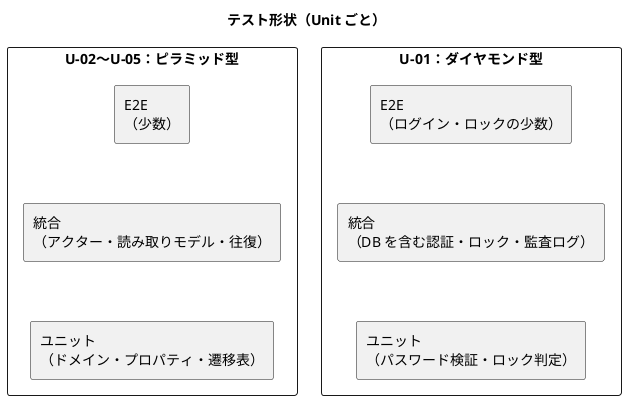
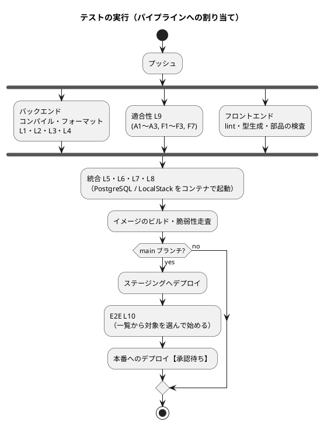

# テスト戦略：国際貨物輸送管理システム

[バックエンドアーキテクチャ](architecture_backend.md)（CQRS/イベントソーシング）、[フロントエンドアーキテクチャ](architecture_frontend.md)、[ドメインモデル](domain-model.md)、[データモデル](data-model.md)、[技術スタック](tech_stack.md)、[インフラストラクチャ](architecture_infrastructure.md)に合わせて、何を・どの層で・どの道具で確かめるかを決めます。

- 入力: [要件定義書](../requirements/requirements_definition.md)、[システムユースケース](../requirements/system_usecase.md)、[ユーザーストーリー](../requirements/user_story.md)（US01〜US31、受入条件 AC 120 件）、[Unit 定義](../requirements/units.md)、[リスク台帳](../requirements/risk_register.md)、[リリース計画](../development/release_plan.md)、[テスト戦略ガイド](../reference/テスト戦略ガイド.md)
- **本書の判断はすべて「提案」です**。テストツールの追加は外部ライブラリの導入にあたり、承認が要ります（R-01）。ADR 候補は[第 14 章](#14-設計判断の一覧adr-候補)
- 数値の目標（反映時間・算出時間・同時接続数）は、[非機能要件定義](non_functional.md)に仮置きの提案があります（合意前）。「非機能要件定義で決める」と書いた箇所は、合意された後にこの文書へ戻して埋めます
- 水準（Minimal／Standard／Comprehensive）は[リリース計画](../development/release_plan.md#unit-のエントロピー評価とテスト戦略)で Unit ごとに決まっています。**本番機能は Standard 未満にしません**。本書はその水準を具体的な技法に落とします

---

## 1. 設計の前提

### 1.1 テスト戦略を左右する要件

| 要件・設計 | 出典 | テスト戦略への影響 |
| :--- | :--- | :--- |
| ドメインが純粋関数で、`Either[Error, (新状態, イベント)]` を返す | バックエンド 4.1 | 業務ルールの大半を Pekko も DB も無しで速く検査できる。ユニットテストに投資する |
| 状態モデルが貨物予約 8 状態・貨物状態 9 状態、遷移以外を許さない | 要件定義書、ドメイン D1・B1・T1 | 状態 × コマンドの全組み合わせを表から生成して検査できる |
| 例外・通関・キャンセルの履歴が残り、料金調整の根拠になる | US28 AC-06、US29 AC-09、US30 AC-09 | 履歴が「残ること」と「消えないこと」を検査する |
| 金額と端数処理 | U-05 NFR | 境界値と性質（プロパティ）で網羅する |
| 経路算出が制約条件 5 つをすべて満たす | U-03 NFR、R-04 | 制約の漏れを検出するテストを、制約を 1 つ足すごとに足す |
| 書き込みの結果が読み取りに遅れて現れる（結果整合） | バックエンド 6.4 | 画面から踏む検査で、更新直後の一覧に対象が見えることを確かめる |
| 5 つの Unit が契約（`contract`）でつながる。連携は 17 本 | バックエンド 7.2 | 連携の数だけ往復テストを置く（検査 A9） |
| 公開の追跡照会は認証なし | US18、R-02 | 推測・過負荷・個人情報の漏れを攻撃者の視点で検査する |
| 認証・認可、スキーマ変更、外部連携は確認必須 | リスク台帳 R-01〜R-03 | 該当ステップで止まり、テストの内容も人が承認する |
| 外部システムの仕様が不明 | R-01 | ポートとスタブ、契約テストで先行する。スタブを本物より甘くしない |
| 本プロジェクトは AI が TDD で生成し、人が全行を理解して承認する | CLAUDE.md、AI-DLC | テストは「契約」であり「次のコンテキスト」。AI が書いたテストを人が読める粒度と名前にする |

### 1.2 この文書が決めないこと

- ストーリーの受入条件そのもの（ユーザーストーリーが正）。**判定できない受入条件**は[第 11.3 節](#113-判定できない受入条件)に挙げ、解消するまで実装もテストも始めません
- 負荷・性能の数値（非機能要件定義）
- CI の具体的な YAML（運用フェーズの `operating-cicd`）

---

## 2. テスト形状の選択

### 2.1 判断

[テスト戦略ガイド](../reference/テスト戦略ガイド.md)の対応表に、バックエンド設計の選択結果を当てはめます。

| Unit | アーキテクチャ（バックエンド 3.1） | ガイドの対応 | テスト形状 |
| :--- | :--- | :--- | :--- |
| U-02 貨物予約 | イベント履歴式ドメインモデル + CQRS | イベント履歴式・ドメインモデル → ピラミッド型 | **ピラミッド型** |
| U-03 航海・経路設計 | 同上（BE-01 に代替案） | 同上 | **ピラミッド型** |
| U-04 荷役・追跡 | 同上 | 同上 | **ピラミッド型** |
| U-05 精算 | 同上 | 同上 | **ピラミッド型** |
| U-01 認証 | レイヤード 3 層 + トランザクションスクリプト | ガイドでは逆ピラミッド型の適用対象だが、認証は**ロック回数など即時に正確**でなければならず、DB を介した振る舞いが中心 | **ダイヤモンド型**（統合を厚く）。E2E は少数に絞る |
| フロントエンド | SPA、サーバー状態はキャッシュ層 | — | **部品・フックの検査 + 画面から踏む E2E の少数精鋭**（[第 9 章](#9-フロントエンドのテスト)） |

U-01 を逆ピラミッド型にしないのは、ガイドが逆ピラミッド型を単純な CRUD に適用するのに対し、認証は R-02 の確認必須で**セキュリティの誤りが業務データの漏洩に直結**する Unit だからです。E2E の比率を増やさず、DB を含む統合で判別します（水準は Comprehensive）。

### 2.2 全体の形

| レベル | 比率（目安） | 内容 |
| :--- | :---: | :--- |
| ユニット（ドメイン・ユースケース・値オブジェクト・プロパティ） | 約 70% | 純粋なドメインの検査。速い |
| 統合（アクター、読み取りモデル、マイグレーション、Unit 間往復、GraphQL） | 約 25% | PostgreSQL（と LocalStack）の実物を使う |
| E2E（画面から踏む） | 約 5% | 一覧から対象を選んで始める少数の業務シナリオ |

比率は**目安であって目標ではありません**。ガイドのピラミッド型は 80:15:5 ですが、本プロジェクトは Unit 間の往復テスト（17 本）とイベントの往復テストが統合側に加わるため、統合をやや厚くしています。ウォーキングスケルトン（Bolt 1）の実測で見直します（TST-01）。



---

## 3. テストレベルの定義

重複する検証は実行時間と保守の負担を増やすだけです。**1 つの振る舞いは、それを最も安く判別できる層で 1 回検査し**、上の層は「つながっていること」だけを確かめます。

| # | レベル | 対象 | 使うもの | 外部依存 | 速度の目安 | 守る振る舞い |
| :--- | :--- | :--- | :--- | :--- | :--- | :--- |
| L1 | ドメイン単体 | 集約・値オブジェクト・ドメインサービス（`domain`） | ScalaTest | 無し（Pekko・DB・時計に依存しない） | ミリ秒 | 不変条件、状態遷移、計算、業務エラー |
| L2 | プロパティ | `RouteFinder`、金額計算、値オブジェクトの検証、状態遷移 | ScalaCheck | 無し | 秒 | 「どんな入力でも成り立つ性質」 |
| L3 | ユースケース | `use-case`（認可・冪等性・外部の事実の収集） | ScalaTest。出力ポートは手書きのフェイク | フェイク | ミリ秒〜秒 | 認可が入力検証より先、冪等性キー、ポートの呼び方 |
| L4 | アクター | 集約アクター、イベントシリアライザ（`command-adapter`） | pekko-actor-testkit-typed、pekko-persistence-testkit（インメモリの Journal） | インメモリ | 秒 | 永続化→返信の順、復元、イベントの往復と旧版 |
| L5 | 統合（DB） | 読み取りモデル、DAO、マイグレーション、冪等性キーの表 | ScalaTest + Testcontainers（PostgreSQL） | PostgreSQL の実物 | 秒〜数十秒 | SQL、制約、投影の冪等、マイグレーション |
| L6 | 統合（配信） | イベントストア→購読→読み取りモデル | Testcontainers（BE-03 が A なら LocalStack を加える） | 実物 | 数十秒 | 配信、再配信での冪等、順序の逆転 |
| L7 | 契約・往復 | Unit をまたぐ連携 17 本、外部ポートのスタブ | L5・L6 の上に構成 | 実物 | 数十秒 | 提供側のコマンド → 購読側の読み取りモデルに結果が現れる（検査 A9） |
| L8 | API | GraphQL（Mutation・Query・公開スキーマ） | ScalaTest + 実行中のアプリ | 実物 | 数十秒 | 業務エラーのコード、公開項目の固定、認可 |
| L9 | 適合性 | モジュール依存・import・イベント一覧（A1〜A9、F1〜F9） | sbt `dependsOn`、ArchUnit、ESLint | 無し | 秒 | 構造の規則 |
| L10 | E2E | 画面から踏む業務シナリオ | Playwright | ステージング相当の全体 | 分 | つながって動くこと、ロール別の到達性 |

- **L1 が主役**です。業務ルール（B・V・R・T・S・I の不変条件）は L1 で判別し、上の層で同じ条件を重ねて検査しません
- **L3 は Pekko を起動しません**。use-case が出力ポートを持つ設計（バックエンド 5.2）の目的がここにあります
- **L5 は PostgreSQL の実物だけで行います**。メモリ上の別 DB で代用しません（PostgreSQL 固有の型・制約・スキーマをデータモデルが使うため。TST-05）
- **L7 は連携の数だけ**置きます。1 つの Unit の内側で完結する検査は、購読側に届いていなくても緑になるためです

---

## 4. Unit 別の水準と技法

リリース計画の水準を、本書で次のように具体化します。

| 水準 | 意味 | 適用する技法 |
| :--- | :--- | :--- |
| **Standard** | 受入条件のすべてを判別し、異常系と境界値を押さえる | L1・L3・L4・L5・L8・L10（受入条件ごと）。状態 × コマンドの表。イベントの往復テスト。ロール × 操作の表 |
| **Comprehensive** | Standard に加え、性質で網羅し、守りが働くことを壊して確かめる | Standard + L2（プロパティ）+ **変異の確認**（[7.4](#74-守りを壊して確かめる)）+ 追加の異常系（攻撃者の視点・運用の視点）+ 監査証跡の検査 |

| Unit | 水準 | 重点 | 特記すべきテスト |
| :--- | :--- | :--- | :--- |
| U-01 認証 | **Comprehensive** | 認証失敗 5 回でロック（I1）、同一メッセージ、監査ログ、パスワード保存、セッションの破棄 | 方式が ADR で決まった後に具体化（BE-09）。**攻撃者の視点**：ユーザー列挙、総当たり、ロック中の正しいパスワード、戻る操作 |
| U-02 貨物予約 | **Standard** | 状態遷移（B1）、予約番号・追跡番号、キャンセル（承認・却下・料）、荷主の重複警告 | 状態 × コマンドの全組み合わせ。US30 の申請・承認・却下の履歴 |
| U-03 航海・経路設計 | **Comprehensive** | 制約条件 5 つ（R-04）、UN/LOCODE（R-09）、乗り継ぎ（R1）、航海番号の重複（V1） | `RouteFinder` のプロパティ。制約を 1 つ足すたびに、その制約を破る入力を拒むテストを足す |
| U-04 荷役・追跡 | **Standard** | 荷役種別と状態の整合（T1）、通関が引取の前提、例外の履歴、公開照会 | 反映時間の計測点（L6）。公開スキーマの項目の固定（A7）。存在しない番号と形式不正で同じ応答 |
| U-05 精算 | **Comprehensive** | 基本料金・割引・端数の計算（S1〜）、精算書、入金確認、二重請求の防止 | 金額のプロパティ（単調性・範囲・端数）。計算式が受入条件に定義されるまで実装しない（US21 AC-01） |

### 4.1 Unit ごとの重点の根拠

- **U-03 と U-05 が Comprehensive**なのは、誤りが業務上の損失に直結する（経路の誤りと金額の誤り）うえ、仕様が未確定の部分が多く、AI が推測で埋めやすいからです（R-04・U-05 の意図 HIGH）。例の検査だけでは「例が通る別の実装」を見逃すため、性質で網羅します
- **U-01 が Comprehensive**なのは、認証・認可がリスク HIGH（R-02）で、緑のテストと壊れ方の設計が別物だからです。守りは「入れたこと」でなく**「働くこと」**を検査します
- **U-02 と U-04 は Standard** です。ただし U-04 の公開照会（認証なし）だけは、U-01 に準じて攻撃者の視点の検査を加えます

---

## 5. カバレッジと数値目標

数値は**出発点の提案**で、ウォーキングスケルトン（Bolt 1）で実測してから確定します（TST-03）。カバレッジは「テストが足りているか」の十分条件ではなく、「触れていない場所」を見つける道具として使います。

### 5.1 カバレッジ目標（提案）

| 対象 | 行 | 分岐 | 根拠 |
| :--- | :---: | :---: | :--- |
| `domain`（全 Unit） | 90% 以上 | 85% 以上 | ガイドの目標。純粋で速く、投資効果が高い |
| `use-case` | 85% 以上 | 80% 以上 | ガイドの目標 |
| `command-adapter`・`query-adapter` | 70% 以上 | — | ガイドの目標。配線は L5〜L8 で確かめる |
| 全体 | 80% 以上 | — | ガイドの目標 |
| フロントエンド（`features/`） | 80% 以上 | — | ガイドに合わせた仮置き（要確認） |

- 閾値を下回ったらビルドを失敗にする（下げる方向のみ。閾値は**上げる一方**にして、緩めるには ADR を要する）
- **カバレッジの計測ツールは未確定**です。Scala 3 での対応状況を着手時に確認します（技術スタック 2.5。TST-03）
- 生成された DAO・Protobuf の生成コードは計測の対象外にする

### 5.2 変異テスト（Comprehensive の Unit のみ）

`domain` の守りが「通るテストがある」だけでなく「壊すと落ちる」ことを確かめるため、**Comprehensive の Unit（U-01・U-03・U-05）の `domain` に限って**変異テストを検討します。

- ツールは未選定です（Scala 向けの候補は着手時に確認。外部ツールの導入は承認が要る）。ガイドの目標値（変異を検出する割合 75%）を仮の出発点にします
- 導入しない場合の代替は、[7.4 の「守りを壊して確かめる」](#74-守りを壊して確かめる)を人手の規律として回す方法です
- **決定は Bolt 5（U-03 の経路算出）の前**。最初の Comprehensive の適用場所だからです（TST-04）

### 5.3 実行時間の目標（提案）

| 区分 | 目標 | 備考 |
| :--- | :---: | :--- |
| L1〜L4・L9（ユニット相当） | 1 分以内 | 開発者が TDD で手元で回す速さ。ガイドは 30 秒だが、Scala のコンパイルを含むため仮置き |
| L5〜L8（統合） | 5 分以内 | Testcontainers の起動を含む |
| L10（E2E） | 10 分以内 | ステージングで実行 |
| パイプライン全体 | 20 分以内 | 要確認 |

実測が目標を超えたら、検査を減らすのではなく**層を見直します**（重複する検査を下の層へ移す）。

---

## 6. 技法

### 6.1 ドメインの検査（L1）

集約の検査は、**「過去のイベント列を与え、コマンドを実行し、返るイベントまたは業務エラーを確かめる」**形に統一します。

```scala
// 形（疑似コード。命名・DSL は技術スタックの確定後に決める）
"予約確定" should "経路が紐付いた経路提案中の予約を確定できる" in {
  Given(events = bookingReceived, handedOver, routeBound)
    .When(ConfirmBooking(by = salesRep))
    .ThenEvents(BookingConfirmed(...))   // US13-AC02 に対応するテスト（確定が成功するケース）
}
"B1: 経路選択済でなければ予約の確定を拒む" in {   // 業務規則は B 番号で命名する
  Given(events = bookingReceived)
    .When(ConfirmBooking(by = salesRep))
    .ThenRejected(InvalidTransition(from = Received, command = "ConfirmBooking"))
}
```

- 状態を直接組み立てず、**イベント列から状態を作る**。状態の組み立てが本番の復元経路と同じになる
- 業務エラーは例外ではなく sealed な型で返るため、型で期待を書く
- **状態 × コマンドの全組み合わせ**は、ドメインモデルの遷移表から生成して検査する（[6.2](#62-状態遷移の網羅)）

### 6.2 状態遷移の網羅

貨物予約（8 状態）と貨物状態（9 状態）（受領待ち〜引取済・例外発生・対応中）は、**許される遷移だけ**を許します（D1）。

- 遷移表（状態 × コマンド → 次の状態または拒否）を**1 つのデータ**として持ち、そこから検査を生成する。許す遷移は成功を、表に無い組み合わせはすべて `InvalidTransition` を確かめる
- 表に載っていない状態やコマンドは**失敗にする**（載せ忘れが素通りしない。検査 A5 と同じ考え方）
- 状態モデルとの差分 11 件（[ドメインモデル 第 12 章](domain-model.md#12-状態モデルとの差分r-06)）は、差分ごとに遷移の検査を持つ。要件定義書の状態モデルを正とし、足した遷移は差分として明示されたものだけを許す（R-06）

### 6.3 プロパティテスト（L2）

| 対象 | 性質（例） | Unit |
| :--- | :--- | :--- |
| `RouteFinder` | 返る経路はすべて、区間が連続し（R1）、期限内に到着し、貨物種別に対応した航海だけを使い、港湾制約を満たす | U-03 |
| `RouteFinder` | 直行の経路があれば最優先候補になる。候補は推奨順に並ぶ（順序の基準は要確認） | U-03 |
| `RouteFinder` | 制約を緩めると候補は減らない（期限を延ばす、など） | U-03 |
| 基本料金 | 重量・距離が増えれば料金は減らない（計算式の確定後）。端数処理は常に 1 つの規則で決まる | U-05 |
| 法人割引 | 割引後の金額は 0 以上、基本料金以下。割引率 0〜30% の外は登録できない（US03 AC-03） | U-05 |
| UN/LOCODE | 実在する形式（国 2 文字 + 場所 3 文字）だけを受け付ける。標準の外は拒む | 共有 |
| 認証 | 失敗回数は 0 以上。5 回目でロックされ、成功で 0 に戻る | U-01 |

- **性質は例で補う**。例（境界値）で入口を固定し、性質で穴を探す
- ランダムな入力で港湾コードを作るときも、**実在する UN/LOCODE を使う**（R-09）

### 6.4 イベントと読み取りモデル（L4・L5・L6）

| 検査 | 内容 | 規則 |
| :--- | :--- | :--- |
| 往復 | 公開イベントをシリアライズ→デシリアライズして一致する | A5 |
| 旧版 | 固定した旧版のバイト列を読める | 9.2（バックエンド） |
| 一覧 | イベントの一覧から検査を生成し、載っていないイベントを失敗にする | A5 |
| 冪等な更新 | 同じイベントを 2 回、順序を入れ替えて流しても結果が同じ。追記専用の行（追跡イベントの履歴）が増えない | A6 |
| 再構築 | 読み取りモデルを捨て、イベントから作り直して同じになる | 6.2（バックエンド） |
| 載せ忘れ | 購読側が必要とする項目をイベントが運んでいる（読み取りモデルの列を並べて確かめる） | 6.2 |
| 反映時間 | イベントの発生時刻と反映時刻の差を測る点がある | 9.4（バックエンド）、R-08 |

### 6.5 結果整合（L8・L10）

コマンドが成功しても読み取りは遅れます（バックエンド 6.4）。

- L8：Mutation の応答の版を使い、Query が「その版以上になるまで」待つ検査（**同じ集約の読み取り**に限る）。上限を過ぎたときは「反映待ち」を返す
- **L6・L7（購読側・別の集約）の待ち方**：版は使えない。待つ条件は「**購読側に、元のイベント ID（causation）を持つ行が現れるまで**」とし、上限は NFR-P10 の p99（15 s）に揃える。時間切れのときは、**待避先の件数と購読の位置（オフセット）を出力**して原因を指す（時間切れだけを報告しない）
- **否定の検査**（二重に作られない・届かない）は時間待ちにしない。重複や不要なイベントを流した後に**目印のイベント（フェンス）を流し、その処理完了を待ってから**件数を確かめる。時間待ちだと、遅いだけで届いていない場合に偽の緑になる
- 順序逆転の検査（A6）は、バックエンド 6.2 の「版が飛んだら保留」と対で書く。期待値は「**後着で欠けが埋まった後に、順に適用される**」
- L10：**更新直後に一覧を開き、対象の行が見える**ことを画面から確かめる（F8）。識別子を握って API を叩かない

### 6.6 時刻と業務日付（BE-11）

- 現在時刻は `Clock` ポートから取る。テストは固定した `Clock` を差し込む。**「今日」を決めるのもテストの `Clock`** で、JVM の既定の時計を使わない
- 期限（日付）と到着（時刻付き）の比較は、**期限当日の時刻付き到着**を必ず入れる（日付と時刻付きを素朴に比べる境界の誤りを検出する）
- 業務タイムゾーンの基準が決まったら、その基準と異なる時刻帯（UTC）でも一度回す（F9）
- E2E の日時は共有のヘルパで作る。`toISOString()` を直接使わない

### 6.7 認可とロール

- ロール × 操作の表を 1 つ持ち、**全組み合わせを生成**して検査する（A8。画面の F5・F6 も同じ表から）
- 認可は入力検証より先。**権限の無いロールが不正な入力を送ったとき、入力の仕様でなく認可のエラーが返る**ことを確かめる
- 画面での出し分けは利便性で、権限の根拠はバックエンド。**画面で隠したボタンの操作を直接送って**、バックエンドが拒むことを確かめる

### 6.8 公開の追跡照会

| 検査 | 内容 | 規則 |
| :--- | :--- | :--- |
| 項目の固定 | 公開スキーマの項目一覧を固定し、増えたら失敗 | A7 |
| 個人情報 | 応答に荷主の氏名・住所・連絡先が無い | 8.2（バックエンド） |
| 同一の応答 | 存在しない番号と形式不正の番号で、応答が変わらない | US18 AC-03 |
| 回数制限 | 制限を超えると拒まれ、**ヘルスチェックは制限の対象外** | R-02 |
| 深さ・複雑さ | 深いクエリ・イントロスペクションが拒まれる | 8.2 |
| バンドル | 公開の入口が認証の仕組みと業務画面のコードを含まない | F7 |

### 6.9 マイグレーション（R-03）

- 空の PostgreSQL に全マイグレーションを数値順に適用できる
- **直前の版のスキーマにデータを入れたまま**、次の版を適用できる（既存行が読めなくなる不変条件の追加を検出する）
- 適用済みのマイグレーションを書き換えていない（チェックサムの検査）
- Unit ごとのスキーマをまたぐ外部キーが無い（`reference` への参照を除く）
- 適用前の差分は人が確認する。テストは「適用できること」を保証し、差分の妥当性は人が見る

### 6.10 外部ポート（R-01）

| 外部 | ポート | テスト |
| :--- | :--- | :--- |
| 通知 | `NotificationPort` | スタブが送信内容を記録し、**通知を伴うイベントごとに送信内容を確かめる**。送信の失敗が業務の状態を巻き込まないこと、失敗が記録されること |
| 決済機関 | `PaymentPort` | スタブ。入金確認をポート越しの通知として受け、**入金を二重に受けても精算が 1 回で完結する**こと |
| 港湾管理 | `PortFacilityPort` | 未使用（使う場面が出たら定義） |
| 税関 | なし | 手入力のため、ポートのテストは無い（UC21 の判断は ADR が未記録。BE-13） |

- スタブは**本物より甘くしない**。型が違う値を通すスタブは、本物が断る入力を通してしまう（F4）
- 実在サービスの API 仕様を想定したテストを書かない。仕様が決まったら契約テストを足す

---

## 7. AI-DLC と TDD の進め方

### 7.1 TDD の三原則は変えない

1. 失敗するテストを書くまで、本番コードを書かない
2. コンパイルが通らない、または失敗する範囲を超えてテストを書かない
3. 失敗しているテストを通す以上に本番コードを書かない

AI が回し、人が承認ゲートで検証します。**テストが先に失敗することを確認した記録**（Red の出力）を、Bolt の計画の各ステップに残します。

### 7.2 テストは「契約」として読める形にする

- 受入条件に対応するテストは、テスト名に**ストーリーと受入条件の番号**を含める（例：`US13-AC02 …`）。業務規則の検査（遷移の拒否など）は `B1`・`T1` のように**ドメインモデルの不変条件の番号**で命名し、AC 番号を付けない（付けると突き合わせが未検査の AC を「対応済み」と数える）。人が受入条件との対応を読める
- 1 テスト 1 振る舞い。Given/When/Then を分ける
- AI が書いたテストは、人が**全行を理解**してから承認する（ゲート）。分からないテストは受け入れない
- テストが緑でも、**テスト自体が正しい理由で緑か**を疑う（定義だけ書いて何も検査しないテスト、スタブが引数を捨てて組み立てを検査しないテストなど）

### 7.3 ゲート密度

リリース計画に従います。

| Unit | 既定のゲート | 下げる条件 |
| :--- | :--- | :--- |
| U-02・U-04（Standard、エントロピーに HIGH 無し） | 各サイクルで人が読む | Bolt 1 の変更依頼が少なければ「Green 完了時のみ」に下げる |
| U-01・U-03・U-05（Comprehensive、リスク HIGH） | 下げない。確認必須の操作（認証・スキーマ変更・外部連携）を含むステップで必ず停止 | — |

### 7.4 守りを壊して確かめる

**テストが緑であることは、守りが働いていることを意味しません。** 次の守りは、**壊して赤になる**ことを確かめます。

| 守り | 壊し方 | 赤になるべきテスト |
| :--- | :--- | :--- |
| 状態遷移の拒否（B1・T1） | 遷移表に許さない遷移を足す | 遷移の表の検査 |
| 通関済でなければ引取を拒む（US29 AC-04） | 条件を外す | 引取の拒否の検査 |
| 認可がユースケースの入口にある | 入口の検査を外す | 全組み合わせの検査（A8） |
| 冪等性キー | 検査を外して再送する | 二重登録の検査 |
| 読み取りモデルの冪等 | 重複を弾く条件を外す | 同じイベントを 2 回流す検査（A6） |
| 公開スキーマの項目の固定 | 項目を 1 つ足す | A7 |
| 経路の制約条件 | 制約を 1 つ外す | その制約を破る入力を拒む検査（R-04） |
| 金額の端数処理 | 切り捨てを四捨五入に変える | 端数の境界値 |

- **規律として回す**：Comprehensive の Unit の Bolt では、上の表の守りのうち、その Bolt が触れるものを**守りごとに 1 件**、壊して赤を確認した記録をステップに残す
- **記録の形**：(1) 壊した守り（表の行）、(2) 壊した差分（**本番コードだけ**を変え、テストファイルは変えていないことを示す）、(3) 赤になったテストと出力、(4) 元に戻した後の緑の出力。AI がテストの側を壊して赤にする誤りを防ぐため
- 変異テストのツールを導入した場合は、この確認を自動化する（TST-04）
- 「〜しない」と書いたコメントや設計の文は、書いただけで守れていない。**書いた保証は赤で固定する**

---

## 8. Unit 間の往復テスト（検査 A9）

バックエンド 7.2 の連携 17 本のそれぞれに、**提供側のコマンド → 購読側（または呼び出し先）の読み取りモデルに結果が現れる**往復テストを置きます。1 つの Unit の内側で完結する検査は緑のまま、配信が届いていないことがあるためです。

| # | 連携（提供 → 消費） | 方式 | 往復テストが確かめること | 最初に必要な Bolt |
| :--- | :--- | :--- | :--- | :---: |
| 1 | U-02 → U-03 | イベント `RouteDesignRequested` | 予約情報の引き渡しで、U-03 に経路計画が開始され、予約の要約が写される | 4 |
| 2 | U-03 → U-02 | 受け口のポート（経路の紐付け） | 経路の紐付けで予約に経路が現れる。**失敗時**（経路は確定したが紐付けに失敗）の扱い | 6 |
| 3 | U-02 → U-04 | イベント `TrackingNumberIssued` | 追跡番号の発行で、U-04 に追跡情報が「受領待ち」で現れる | 8 |
| 4 | U-02 → U-04 | イベント `CancellationApproved` | 承認で U-04 に荷降しの手配が現れる | 17 |
| 5 | U-02 → U-05 | イベント（同上） | キャンセル料の算定依頼が U-05 に届く | 17 |
| 6 | U-02 → U-05 | イベント `BookingConfirmed` | 荷主種別・割引率が U-05 に写される | 18 |
| 7 | U-04 → U-05 | イベント `CargoDelivered` | 配送完了で U-05 の料金算出の対象になる | 18 |
| 8 | U-03 → U-04 | イベント `RouteConfirmed` | 経路の変更が U-04 の予定経路に反映される | 16 |
| 9 | U-04 → U-03 | 画面での合成 | 現在地を出発地として再設計が開始できる（画面の E2E） | 16 |
| 10 | U-04 → U-02 | 受け口のポート（輸送開始・配送完了） | 荷役の記録で予約状態が輸送中・配送完了になる。**呼び出し元のイベント ID で冪等** | 10 |
| 11 | U-05 → U-02 | 受け口のポート（精算済） | 精算で予約状態が精算済になる | 20 |
| 12 | U-04 → U-03 | 受け口のポート（経路の誤配） | 誤配の起票で経路が誤配になる | 16 |
| 13 | U-02 → U-03 | 問い合わせ（経路概算） | 見積が U-03 の概算を取得できる。読み取り専用 | 9 |
| 14 | U-02 → U-04 | 問い合わせ（現在地の港・次の寄港地） | 陸揚げ地候補が取得できる。読み取り専用 | 17 |
| 15 | U-03 → U-02 | 受け口のポート（輸送中の経路の差し替え） | 再設計の確定で予約の経路が差し替わる。呼び出し元のイベント ID で冪等 | 16 |
| 16 | U-02 → U-03 | イベント `BookingCancelled`／`CancellationApproved` | キャンセルで U-03 の経路計画が中止になる。**キャンセル料の精算完了後の `MarkSettled`（#11）が拒まれ続けない**こと | 7 |
| 17 | U-02 → U-03 | イベント `RouteDetached` | 荷主の経路変更の希望で U-03 の経路計画が扱われる（遷移はドメインモデル Q17 の確認後） | 7 |

- 連携の一覧（バックエンド 7.2）から検査を生成し、**一覧に無い連携は失敗**、**一覧にあって往復テストが無い連携も失敗**にする（A2 と A9）
- 反応は冪等であること（同じイベントを 2 回受けても結果が同じ）、順序に依存しないこと、失敗時に待避されることを、連携ごとに確かめる（バックエンド 7.3）
- U-01 は他の Unit に `Principal`（利用者 ID・ロール）だけを渡す。各 Unit の L3 で `Principal` のフェイクを使い、**U-01 の実装に依存せず**進められる

---

## 9. フロントエンドのテスト

| レベル | 対象 | 道具（技術スタック 3） | 守ること |
| :--- | :--- | :--- | :--- |
| 部品・フック | `components/`、各 feature の `hooks/` | Vitest + Testing Library | 表示、入力、状態の出し分け。サーバー状態は MSW で差し替える |
| 型・スキーマ | GraphQL ドキュメント | graphql-codegen | スキーマの差分があればビルドが失敗（F3） |
| モック | MSW の応答 | スキーマで検証 | **バックエンドより甘いモックにしない**（F4） |
| 静的解析 | import の規則 | ESLint | feature 同士の import 禁止（F1）、画面から GraphQL を直接呼ばない（F2） |
| E2E | 業務シナリオ | Playwright | 一覧から対象を選んで始める。ロール別の到達性（F5・F6）。反映待ち（F8） |
| アクセシビリティ | 主要な画面 | axe-core | 色だけで状態を伝えない（UI 設計 P の規則） |

### 9.1 E2E の進め方

- **識別子を握って API を叩く検査にしない**。一覧から対象を選んで始める。一覧から辿れない欠陥を踏むため
- E2E は**業務シナリオ単位**で少数に絞る（下表）。受入条件ごとに E2E を書かない

| シナリオ | 通る Unit | 起点 | Bolt の目安 |
| :--- | :--- | :--- | :--- |
| 荷主登録 → 予約登録（仮受付） | U-02 | 営業担当者のホーム | 1（ウォーキングスケルトン） |
| 予約 → 引き渡し → 経路確定・紐付け → 予約確定 → 追跡番号発行 | U-02・U-03 | 営業担当者・経路設計者のホーム | 7 |
| 追跡番号の発行 → ログイン無しの照会 | U-02・U-04 | 公開の入口 | 8 |
| 荷役の記録 → 追跡情報の反映 → 引取（通関済） | U-04 | 荷役作業員のホーム（モバイル幅） | 10〜15 |
| 誤配の検知 → 経路の再設計 | U-04・U-03 | 追跡管理者・経路設計者のホーム | 16 |
| 配送完了 → 料金算出 → 精算 | U-05 | 経理担当者のホーム | 20 |
| ログイン → ロック → 解除 | U-01 | ログイン画面 | 2・11 |

- ロール別の**入口からの到達性**（ログイン直後のホームから担当の作業へ 2 操作以内、F5）は、ロール × 画面の表から生成する
- 荷役作業員の E2E は**モバイル幅**で行う（UI 設計 P6）

---

## 10. テストデータ

| 方針 | 内容 |
| :--- | :--- |
| 架空の値 | 荷主・会社・船名・航海番号は架空でよい（リスク台帳）。ただし**港湾・都市のコードは実在する UN/LOCODE**（R-09）。出典を `reference` の初期データに示す |
| 作り方 | **Object Mother + ビルダー**。既定は妥当な値、検査したい項目だけを上書きする。ドメインの値オブジェクトを通して作り、**不正な状態を作れない**ようにする |
| 識別子 | ULID（集約）と業務番号（予約番号・追跡番号）を**本番と同じ採番の経路**で作る。テストだけの採番は、本番の採番との衝突や形式の違いを隠す |
| 時刻 | 固定した `Clock`。E2E は共有ヘルパ |
| 共有 DB | **自分が作った行だけを数え、名指しする**。全体の件数を数える検査は、別の変更で赤くなり原因を指さない |
| 分離 | 統合テストは Testcontainers の使い捨ての DB。テストごとにスキーマを初期化するか、独自の識別子で名前空間を分ける |
| 個人情報 | 実在の人物のデータを使わない |
| 失敗する条件 | 時間や期限で作らず、**構造で作る**（共有環境に溜まったデータでたまたま成功しない） |

---

## 11. 受入条件とのトレーサビリティ

### 11.1 対応のとり方

- ストーリーの受入条件（Given/When/Then、`AC-01`〜）は人と AI の契約です。**1 つの受入条件に 1 つ以上のテスト**を対応させ、テスト名にストーリーと AC の番号を含める（`US13-AC02`）
- 受入条件の番号から、どのレベルで検査するかを下表で決める。同じ振る舞いを複数の層で重ねない
- 対応の確認は**自動で行う**：ユーザーストーリーの AC 一覧と、テスト名の AC 番号を突き合わせ、**テストの無い AC を一覧にする**スクリプトを置く（Bolt 1 の計画に含める。TST-06）。書いただけで定義のない受け入れは何も検査しない

### 11.2 ストーリー別の対応

| US | Unit | AC 数 | 主なレベル | 備考 |
| :--- | :--- | ---: | :--- | :--- |
| US01 輸送見積を作成する | U-02 | 5 | L1・L3・**L7（連携 13）**・L8、E2E は予約と合わせる | AC-05 は R-05 の項目確認後 |
| US02 荷主を登録する | U-02 | 2 | L1・L5・L8・**E2E（Bolt 1）** | メール重複は警告（一意制約にしない。要確認） |
| US03 法人荷主を登録する | U-02 | 4 | L1・L2（範囲）・L8 | 境界値 0%・30% と範囲外 |
| US04 貨物予約を登録する | U-02 | 4 | L1・L3・L5・L8・**E2E（Bolt 1）** | AC-04 は判定不能（[11.3](#113-判定できない受入条件)） |
| US05 危険物・冷凍・冷蔵 | U-02 | 3 | L1・L8 | AC-03 は U-03 の絞り込みで、L7 で確認。項目は R-05 の確認後 |
| US06 予約情報の引き渡し | U-02 | 3 | L1・L3・L7（連携 1）・L8 | 通知の二重送信が無いこと |
| US07 航海スケジュールを検索する | U-03 | 5 | L1・L2・L5・L8 | UN/LOCODE は実在の値 |
| US08 経路候補を算出する | U-03 | 4 | **L1・L2（性質）**・L8 | 制約を 1 つずつ足す。推奨順の基準は要確認 |
| US09 経路を選択・確定する | U-03 | 3 | L1・L4・L8 | 同時に 1 件だけ確定 |
| US10 経路条件を調整して再算出する | U-03 | 3 | L1・L2・L8 | 予約の内容を変えないこと |
| US11 経路情報を予約に紐付ける | U-03 | 2 | L3・L7（連携 2）・L8 | 失敗時の扱い |
| US12 確定経路を荷主に通知する | U-03 | 2 | L3・L8（通知スタブ） | 送信の記録が残ること |
| US13 予約を確定する | U-02 | 4 | **L1（遷移表）**・L3・L7・L8 | AC-04 は US30 と統合の候補 |
| US14 追跡番号を発行する | U-02 | 3 | L1・L3・L7（連携 3）・L8 | 追跡番号の重複・推測困難 |
| US15 荷役作業を記録する | U-04 | 4 | L1・L4・L5・L6・**L7（連携 10。輸送開始）**・L8 | 反映時間の計測点 |
| US16 引取作業を記録する | U-04 | 4 | L1・L7（連携 7・10）・L8 | 通関済でなければ拒む |
| US17 貨物状態を手動更新する | U-04 | 3 | L1（遷移表）・L5・L8 | AC-03 は判定不能 |
| US18 追跡情報を照会する | U-04 | 3 | L5・L8（公開）・**E2E（Bolt 8）** | 6.8 の検査を加える |
| US19 遅延例外を処理する | U-04 | 2 | L1・L4・L8 | 履歴が残る |
| US20 破損・紛失例外を処理する | U-04 | 3 | L1・L3・L8 | 緊急フラグ、エスカレーション通知 |
| US21 輸送料金を算出する | U-05 | 3 | **L1・L2（金額）**・L8 | AC-01 は計算式の定義後（判定不能） |
| US22 法人割引を適用する | U-05 | 3 | L1・L2・**L7（連携 6。荷主種別・割引率の写し）**・L8 | 端数処理を一意に |
| US23 精算を処理する | U-05 | 3 | L1・L3・L7（連携 11）・L8 | 入金の二重受領 |
| US24 航海スケジュールを新規登録する | U-03 | 5 | L1・L5・L8・**E2E（Bolt 3）** | 航海番号の重複 |
| US25 既存航海スケジュールを更新する | U-03 | 4 | L1・L8 | 差分の表示、キャンセルで不変 |
| US26 システムにログインする | U-01 | 4 | L3・L5・L8・**E2E（Bolt 2）** | 方式の ADR 後に具体化 |
| US27 システムからログアウトする | U-01 | 2 | L5・L8・E2E | 戻る操作 |
| US28 誤配を検知して経路を再設計する | U-04 | 6 | L1・L7（連携 8・9・12）・**E2E（Bolt 16）** | 警告 → 起票 → 再設計 |
| US29 通関申告を登録・管理する | U-04 | 9 | L1・L4・L5・L8・E2E | 3 日超過の警告は `Clock` で |
| US30 輸送中の予約キャンセルを承認する | U-02 | 9 | **L1（遷移表）**・L3・L7（連携 4・5・14）・L8 | AC-08 は料率の定義後 |
| US31 認証失敗が続いたアカウントを保護する | U-01 | 6 | **L1・L2**・L5・L8 | 攻撃者の視点（I1〜I7） |
| **合計** | | **120** | | |

### 11.3 判定できない受入条件

次は Given/When/Then で**一意に判定できない**ため、解消するまで実装もテストも始めません（リスク台帳の「要確認」の扱い）。テストを書くために AI が仕様を推測しません。

| 受入条件 | 理由 | 解消する前に止める Bolt |
| :--- | :--- | :--- |
| US04 AC-04 | 見積との「整合性」の中身（どの項目を比べ、差異で止めるか警告か）が未定義 | 9 |
| US08 AC-02（推奨順） | 推奨順の基準が未定義。費用の算出方法も未定義 | 5 |
| US17 AC-03 | 「通知すべき種類」が未定義 | 8 |
| US21 AC-01 | 基本料金の計算式が未定義 | 18 |
| US22（端数） | 割引後の端数処理の AI の仮定（切り捨て）の確認 | 19 |
| US30 AC-08 | キャンセル料の料率が未定義 | 17 |
| US05（項目） | 危険物申告情報・温度管理条件の項目が要件に無い（R-05） | 13 |
| US26・US27・US31 | 認証方式（R-02）、ロック解除までの時間 | 2 |
| US31 AC-05 | 無効化アカウントに管理者への問い合わせを案内すると、AC-03・NFR-S02 の「状態を知らせない」と衝突する（ドメインモデル I4、バックエンド 8.1 で BE-09 に委ねた論点） | 2 |
| US29 AC-07 | 留置「3 日超」を暦日で数えるか 72 時間か、基準のタイムゾーンが未定（ドメインモデル T14・Q12）。境界値のテストが書けない | 15 |
| US01 AC-01・02（US09 AC-01、US12 AC-01 の「費用」「料金概算」も） | 概算料金の算出方法が未定義（US21 AC-01 と同じ性質） | 9 |
| US19・US20 AC-01 | 「輸送中の貨物」が貨物状態のどれを指すか、例外種別ごとに記録できる状態が未定（ドメインモデル T6・Q6） | 12 |
| US20 AC-02 | 「管理職」のロールが未定義 | 12 |
| US21 AC-03 | 補償費用が請求額を減らすか増やすかが未定（ドメインモデル Q10） | 18 |
| US23 AC-03 | 支払い期限の日数が未定。期限当日を超過に含めるかも未定 | 20 |
| US13 AC-01・02 | Given の「荷主が経路を承認した」を表す事実がシステム内に無い（UI 設計のレビュー指摘 H10 の確認後に確定） | 7 |
| US17 AC-02 | 任意の状態への手動更新と、遷移表（T1）の関係が未定 | 8 |
| US08 AC-01 | 同日の乗り継ぎを認めるかが未定（ドメインモデル Q8）。プロパティ「区間が連続」（R1・R2）が確定しない | 5 |
| US03 AC-02・03 | 割引率の刻み（整数か小数第 1 位か）が未定。境界値の ±1 が決まらない | 13 |

- AI の仮定が付いた受入条件（`（AI の仮定）` の印のあるもの）は、人の確認が済むまで**テストも仮のもの**として扱う。確認の結果で受入条件が変わったら、テストを受入条件に合わせて直す

---

## 12. 適合性の検査の割り当て

バックエンド第 10 章・フロントエンド第 8 章・インフラ（検査 I1〜I8）・運用（検査 O1〜O10）の規則を、レベルと CI の段階に割り当てます。

| 検査 | 規則 | レベル | 実行のタイミング | 最初の Bolt |
| :--- | :--- | :--- | :--- | :---: |
| A1 | 別の Unit の内側を参照しない | L9（sbt `dependsOn`・ArchUnit） | コンパイル、プッシュ | 1 |
| A2 | 依存が連携の一覧と一致し循環しない | L9 | プッシュ | 1 |
| A3 | `domain` が Pekko・Slick・GraphQL・ZIO を import しない | L9 | プッシュ | 1 |
| A4 | 不変条件を GraphQL の検証だけに置かない | L8（画面から不正な遷移・値を送る） | 統合 | 1 |
| A5 | 公開イベントに往復と旧版のテスト | L4 | プッシュ | 1 |
| A6 | 購読側の更新が冪等 | L6 | 統合 | 1 |
| A7 | 公開エンドポイントが公開項目だけ | L8 | 統合 | 8 |
| A8 | ロールごとの操作が許可表どおり | L3・L8 | 統合 | 2 |
| A9 | Unit 間連携が届く | L7 | 統合 | 連携ごと（第 8 章） |
| F1〜F2 | feature の import、GraphQL の直接呼び出し | L9（ESLint） | プッシュ | 1 |
| F3 | GraphQL の型がスキーマと一致 | L9（codegen の差分） | プッシュ | 1 |
| F4 | モックが甘くない | 部品の検査 | プッシュ | 1 |
| F5〜F6 | 到達性、403 | L10 | ステージング | 2 |
| F7 | 公開のバンドル | L9 | プッシュ | 8 |
| F8 | 更新直後に一覧で見える | L10 | ステージング | 1 |
| F9 | 日時が業務タイムゾーンで安定 | L10 | ステージング + UTC で 1 回 | 1 |
| I1 | 接続情報・鍵がリポジトリ・イメージに無い | 秘密情報の走査（CI） | プッシュ | 1 |
| I2・I3 | ステージングと本番が同じ IaC／公開パスが別ターゲットグループ | IaC の差分・検査 | ステージング構築時 | ステージング構築 |
| I4 | ヘルスチェックが制限の対象外 | L10（過負荷の状態で 200） | ステージング | 8 |
| I5 | 新しい版のイベントを旧版が読める | L4（旧版のイメージで読む） | プッシュ、デプロイ前 | 最初のイベント版の変更 |
| I6 | 読み取りモデルを再構築できる | ステージングで実行して所要時間を記録 | 四半期、ステージング構築後 | ステージング構築 |
| I7 | マイグレーションが前の版の DB でも通る | L5 | 統合 | 1 |
| I8 | 同じタグの作り直しで実環境が新しい定義 | デプロイ後の実行中イメージの確認 | デプロイ | ステージング構築 |
| O1〜O10 | 運用の規則（アラートと手順、訓練の記録、承認の記録など。[運用要件 12](operation.md#12-運用の適合性の検査)） | 記録・定義の検査 | 常時、四半期 | MVP リリース前 |

- **「通す」検査にしない**。一覧に無い項目・イベント・ロール・連携は失敗にする
- 自作の検査は、**実コードの形のフィクスチャ**で検査する。最小の違反例だけで緑にすると、実コードの違反を見逃す

---

## 13. CI との連携と運用

[インフラ設計 6.1](architecture_infrastructure.md#61-パイプライン提案)のパイプラインに、レベルを次のように割り当てます。



| 規則 | 内容 |
| :--- | :--- |
| 全体で通す | `sbt test` を**モジュールを絞らず全体で**通す。絞った実行だけで緑にしない（依存の規則の検査は全体で働く）。ローカルの品質ゲートも CI と同じコマンドで回す |
| 失敗の扱い | どの段階も失敗したらその先へ進まず、**失敗の段階が分かる通知**にする。赤は 1 つの意味にする（例：導入の失敗と検出を同じ赤にしない） |
| たまに落ちるテスト | 再実行で通ることを理由に進めない。**2 回目に見たら原因を追う**。待つのではなく、状態が整うまでの条件を明示する |
| 時間で守らない | 経過時間のアサートは、脆弱な実装に戻しても緑になる。**分岐の結果**（どの検査で落ちたか）で判定する |
| 配線 | 検査が走っていること自体を確かめる。入力を宣言しない設定読み取りの検査は、キャッシュで走らず、壊しても緑になる。シナリオ数・テスト数の下限で確かめる |
| 依存とイメージ | 依存ライブラリとイメージの脆弱性走査を CI に入れる（インフラ I） |
| 秘密情報 | 接続情報・鍵はリポジトリにもテストにも置かない。環境変数の値を AI は読まない（R-10） |
| ブランチ保護 | main へのマージは、必須の段階が緑のときだけ |

---

## 14. 設計判断の一覧（ADR 候補）

承認は人が行います。

| ID | 判断 | 推奨 | 主な代替 | 関連 | 決定期限 |
| :--- | :--- | :--- | :--- | :--- | :--- |
| TST-01 | テスト形状 | U-02〜U-05 をピラミッド型、U-01 をダイヤモンド型。比率は目安で、Bolt 1 の実測で見直す | 全体を統合重視（ダイヤモンド型） | BE-01 | Bolt 1 の前 |
| TST-02 | Unit 別の水準の具体化 | 第 4 章（Standard／Comprehensive の技法を固定） | 全 Unit を Comprehensive | リリース計画 | Bolt 1 の前 |
| TST-03 | カバレッジ目標と計測ツール | 第 5.1 節の目標。閾値は上げる一方。ツールは Scala 3 の対応を確認してから | 目標を置かず、実測を見て決める | TS-07 | Bolt 1 の計画（計測ツール）、Bolt 1 完了後（閾値） |
| TST-04 | 変異テストの導入 | Comprehensive の Unit の `domain` に限る。ツールが無ければ 7.4 の規律で代替 | 導入しない | R-01（外部ツール） | Bolt 5 の前 |
| TST-05 | 統合テストの DB | PostgreSQL の実物（Testcontainers）。メモリ上の別 DB は使わない | メモリ上の DB（高速だが方言差で偽の緑になる） | TS-07、IF-01 | Bolt 1 の前 |
| TST-06 | 受入条件の対応を自動で検査 | AC 番号を含むテスト名と、ストーリーの AC 一覧の突き合わせスクリプト | 手作業の表のみ | CLAUDE.md（成果物は契約） | Bolt 1 の計画 |
| TST-07 | E2E の範囲とツール | Playwright。業務シナリオ単位で少数。一覧から対象を選んで始める | 受入条件ごとに E2E | FE-01、TS-08 | Bolt 1 の前 |
| TST-08 | 性能・負荷テスト | 対象と閾値は[非機能要件定義](non_functional.md)（NFR-P01〜P13、設計ピークの 2 倍。仮置き）。ツールの選定は別途（外部ツールの導入は承認が要る） | — | R-08、非機能要件 | ツール: U-04 Bolt 10 の前。ウォーキングスケルトンでは反映遅延の実測のみ |

> 本書の全項目が「提案」です。TST-01〜03・05〜07 は、ウォーキングスケルトン（Bolt 1）の計画前に承認が要ります。

---

## 15. 未決事項と AI の仮定

### 15.1 人に確認する点

- テスト形状（TST-01）。特に U-01 をダイヤモンド型にすることと、全体の比率
- カバレッジの閾値（TST-03）。ガイドの値（ドメイン 90%、全体 80%）を出発点にしてよいか
- 変異テストを導入するか、手作業の規律で代替するか（TST-04）。ツールの導入は承認が要る
- 実行時間の目標（5.3）。パイプライン全体 20 分以内でよいか
- [11.3](#113-判定できない受入条件)の受入条件の確認。どれから先に解消するか（Bolt の順に従うのが自然）
- E2E をステージングで回すか、PR ごとに一時環境で回すか（運用要件定義と合わせて）
- 荷役作業員のモバイル端末の種類と、E2E で再現する画面幅
- 性能・負荷テストの目標値（非機能要件定義）

### 15.2 AI の仮定

- 比率（70/25/5）・カバレッジ・実行時間の数値は**仮置き**で、Bolt 1 の実測で確定する
- テストの道具（ScalaTest・ScalaCheck・Testcontainers・ArchUnit・Playwright など）は[技術スタック](tech_stack.md)の提案に従う。承認が済むまで確定でない
- 受入条件 120 件の数は、ユーザーストーリーの `**AC-nn**` の出現数に一致する
- 遷移表・ロール × 操作の表は、ドメインモデルとの整合を前提に、Bolt の中で作る
- 外部システムの実仕様が決まるまで、契約テストの中身は定義しない

### 15.3 次の設計活動

1. 運用要件（`analyzing-operation`）：E2E の実行環境、通知の送信先、ランブック
2. 非機能要件（[non_functional.md](non_functional.md)）の数値を 5.3・6.8 に反映する（合意後）
3. 承認後：ADR の作成（`creating-adr`）。BE・FE・IF・TS・TST・NF の各候補
4. 承認後：ウォーキングスケルトン（Bolt 1）の計画を `bolt_plan-1.md` に書く（TDD の最初の Red を含む）
