# UI 設計：国際貨物輸送管理システム

[フロントエンドアーキテクチャ](architecture_frontend.md)が決めた構造（SPA、`features/` の Unit 対応、ロール別ナビゲーション、結果整合への対応、公開照会の分離）の上に載る、画面・遷移・操作を設計します。

- 入力: [ユーザーストーリー](../requirements/user_story.md)、[システムユースケース](../requirements/system_usecase.md)、[要件定義書](../requirements/requirements_definition.md)（状態モデル）、[Unit 定義](../requirements/units.md)、[リリース計画](../development/release_plan.md)、[バックエンドアーキテクチャ](architecture_backend.md)、[フロントエンドアーキテクチャ](architecture_frontend.md)、[用語集](glossary.md)
- 設計の方法は [UI 設計ガイド](../reference/UI設計ガイド.md)（オブジェクト指向 UI）に従います。画面遷移は PlantUML のステートチャート図、画面イメージは salt 図で書きます
- **画面の ID（SC-xx）は本書で採番した仮の識別子**です。ストーリーの受入条件（AC）を満たす画面を過不足なく置くことが目的で、レイアウトの細部（余白・色・文言）は実装の Bolt で詰めます
- 用語は[用語集](glossary.md)を正とします。画面の文言に、用語集が退けた語（ルート、経由地、見積り など）を使いません
- 承認前に実装へ進みません。本書にも AI の仮定と要確認を残してあります（[第 11 章](#11-未決事項と-ai-の仮定)）

---

## 1. 設計の方針

| # | 方針 | 理由 |
| :--- | :--- | :--- |
| P1 | **オブジェクトを中心**に画面を作る。メニューは「予約」「航海」「貨物追跡」のようなオブジェクト名で並べ、操作は一覧と詳細の中のボタンにする | ロールごとに業務は違うが、扱うモノは共通。UI 設計ガイドの原則 |
| P2 | 各ロールに**作業入口**（ホームの件数とリンク）を置く。件数や警告は、必ず対象の絞り込み済み一覧へのリンクを持つ | 気づいても、そこから行けなければ仕事が進まない |
| P3 | 状態によって出す操作を変える。出し分けの根拠は画面で再判定せず、読み取りモデルが返す「実行できる操作」の項目を使う | 集約の述語と画面の判定がずれると、押せるのに失敗するボタンが生まれる |
| P4 | 書き込み直後の画面は、反映の遅れ（結果整合）を前提にする。成功後に自分が作ったものが一覧に見える | バックエンド 6.4、フロントエンド 3.2 |
| P5 | 取り返しのつかない操作と、業務上の警告の承認は、確認を挟む。取り消す側（キャンセル・却下）には余計な確認を置かない | 誤操作を防ぎ、必要な判断は流れを止めない |
| P6 | 荷役作業員の画面はモバイルファーストで、最小の入力で完結する。他のロールは PC を主とし、モバイルでも崩れない | 要件定義書（モバイル対応の荷役作業記録） |
| P7 | 画面は**権限の根拠ではない**。隠すのは利便性のためで、直接 URL でも操作でも、拒否はバックエンドが行う | フロントエンド 5.1 |
| P8 | 公開の追跡照会は、業務画面と枠・コード・エンドポイントを分ける | フロントエンド 5.3 |

---

## 2. オブジェクトの設計

UI 設計ガイドの 4 原則（オブジェクトの特定・関係・アクション・属性）で整理します。ドメインモデル設計で名前が変わりうるため、ここでは画面に出る単位で書きます。

### 2.1 オブジェクトと関係

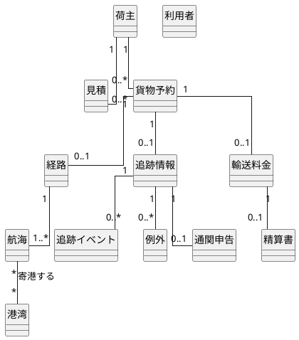

### 2.2 アクションと主な属性

| オブジェクト | 画面での主な属性（表示の優先順） | ドメイン固有のアクション | 一覧（コレクション）の絞り込み |
| :--- | :--- | :--- | :--- |
| 荷主 | 氏名または社名、荷主種別、メールアドレス、連絡先、住所、（法人）契約番号・割引率 | 登録 | 名前、メールアドレス、荷主種別 |
| 見積 | 見積番号、荷主、出発地→目的地、希望期限、貨物種別・重量、経路の概算候補（経由港・所要日数・概算料金・航海番号） | 作成、保存 | 荷主、見積番号 |
| 貨物予約 | 予約番号、予約状態、荷主、出発地→目的地、希望期限、貨物種別・貨物仕様、経路、追跡番号、履歴 | 登録、経路設計を依頼、予約を確定、経路の再設計に戻す、追跡番号を発行、キャンセル（申請・承認・却下） | 予約状態、荷主、予約番号、追跡番号 |
| 航海 | 航海番号、運送会社、船名、出発港→到着港、出発日・到着日、寄港地（順序つき）、対応貨物種別 | 登録、更新（差分確認） | 出発地、目的地、出発期間、貨物種別 |
| 経路 | 経由港、所要日数、費用、航海番号、経路の状態（確定）、希望期限との差 | 候補を算出、条件を調整、確定、予約に紐付け、荷主に通知 | （予約に紐づく） |
| 追跡情報 | 追跡番号、貨物状態、現在位置（港湾名）、推定到着日、通関状態、追跡イベント履歴 | 状態を更新、荷役作業を記録、例外を記録 | 貨物状態、例外の有無、通関状態 |
| 例外 | 例外種別、発生状況（場所・日時・理由）、緊急フラグ、対応内容、解決の有無 | 記録、対応を報告、解決 | 例外種別、解決の有無 |
| 通関申告 | 申告番号、申告日時、通関状態、留置日数、変更履歴（日時・変更者・理由） | 登録、状態を更新 | 追跡番号、貨物（予約番号）、通関状態 |
| 輸送料金 | 輸送実績、基本料金、割引率・割引後の金額、料金調整、状態（算出済・確定） | 算出、調整、確定 | 予約番号 |
| 精算書 | 請求番号、請求金額、支払い期限、精算状態、割引の内訳 | 発行、入金確認の反映 | 精算状態、期限超過 |
| 利用者 | 利用者 ID、ロール、状態（有効・ロック・無効） | ログイン、ログアウト、ロック解除、無効化 | ロール、状態 |

属性の優先順位は、一覧の列の並びと詳細の見出しの順に使います。編集してよい属性の範囲は、各ストーリーの受入条件で決まります（例：予約は仮受付のあいだ修正できる、US06 AC-03）。

---

## 3. 画面一覧

### 3.1 凡例

- **Bolt**: [リリース計画](../development/release_plan.md)で、その画面を初めて必要とする Bolt。ウォーキングスケルトン（Bolt 1）の画面は**太字**
- **型**: 一覧（コレクション）／詳細（シングル）／フォーム／確認／ダイアログ
- **端末**: PC／モバイル（モバイルファースト）／両方
- **feature**: [フロントエンド 3.1](architecture_frontend.md#31-配置とフォルダ構成)のフォルダ。複数の feature にまたがる画面は `pages/` で合成する

### 3.2 認証・共通（U-01）

| ID | 画面 | 型 | 端末 | ロール | ストーリー | Bolt | feature |
| :--- | :--- | :--- | :--- | :--- | :--- | :--- | :--- |
| SC-01 | ログイン | フォーム | 両方 | 認証前 | US26, US31 | 2 | auth |
| SC-02 | ホーム（ロール別の作業入口） | 一覧（件数とリンク） | 両方 | ログイン済み全員 | US26 AC-01 | 2 | auth + 各 feature の件数 |
| SC-03 | 権限がありません（403） | 確認 | 両方 | ログイン済み全員 | US26 AC-04 | 2 | auth |
| SC-04 | アカウント管理（ロック解除・無効化） | 一覧＋ダイアログ | PC | システム管理者 | US31 AC-04 | 11 | auth |

ログアウト（US27）は専用の画面を持たず、全画面の共通ヘッダーの操作とする。実行するとセッションを破棄し、SC-01 に戻る。

### 3.3 公開の追跡照会

| ID | 画面 | 型 | 端末 | ロール | ストーリー | Bolt | feature |
| :--- | :--- | :--- | :--- | :--- | :--- | :--- | :--- |
| SC-10 | 追跡番号の入力 | フォーム | 両方 | 誰でも（認証不要） | US18 | 8 | public-tracking |
| SC-11 | 追跡結果 | 詳細 | 両方 | 誰でも（認証不要） | US18 AC-01〜03、US29（通関の遅れを表示） | 8 | public-tracking |

### 3.4 貨物予約（U-02）

| ID | 画面 | 型 | 端末 | ロール | ストーリー | Bolt | feature |
| :--- | :--- | :--- | :--- | :--- | :--- | :--- | :--- |
| SC-20 | 荷主一覧・検索 | 一覧 | PC | 営業 | US02 AC-02 | **1** | booking |
| SC-21 | 荷主登録（個人・法人） | フォーム | PC | 営業 | US02, US03 | **1**（法人は 13） | booking |
| SC-22 | 荷主詳細 | 詳細 | PC | 営業 | US02 AC-02 | **1** | booking |
| SC-23 | 見積作成 | フォーム＋結果 | PC | 営業 | US01 | 9 | booking（経路の概算は routing の問い合わせ） |
| SC-24 | 見積一覧・詳細 | 一覧＋詳細 | PC | 営業 | US01 AC-03、US04 AC-04 | 9 | booking |
| SC-25 | 予約一覧 | 一覧 | PC | 営業・経路設計者・追跡管理者 | US06, US13, US14（作業入口） | **1** | booking |
| SC-26 | 予約登録 | フォーム | PC | 営業 | US04, US05 | **1**（危険物・冷凍は 13） | booking |
| SC-27 | 予約詳細 | 詳細 | PC | 営業・経路設計者・追跡管理者 | US06, US13, US14, US28 AC-03、US30 AC-02・09 | **1**（操作は Bolt ごとに増える） | pages で booking + routing + tracking を合成 |
| SC-28 | 予約情報の確認・引き渡し | フォーム＋確認 | PC | 営業 | US06 | 4 | booking |
| SC-29 | キャンセル申請 | ダイアログ | PC | 営業 | US13 AC-04、US30 AC-01〜03・07 | 7（輸送中の申請は 17） | booking |
| SC-30 | キャンセル承認待ち一覧 | 一覧 | PC | 追跡管理者 | US30 AC-04 | 17 | booking |
| SC-31 | キャンセル承認・却下 | 詳細＋フォーム | PC | 追跡管理者 | US30 AC-05・06 | 17 | booking（現在地・次の寄港地は tracking の読み取りを pages で合成） |

### 3.5 航海スケジュール・経路設計（U-03）

| ID | 画面 | 型 | 端末 | ロール | ストーリー | Bolt | feature |
| :--- | :--- | :--- | :--- | :--- | :--- | :--- | :--- |
| SC-40 | 航海一覧・検索 | 一覧 | PC | 経路設計者 | US07 AC-02〜05、US24 AC-05 | 3 | routing |
| SC-41 | 航海登録 | フォーム | PC | 経路設計者 | US24 | 3 | routing |
| SC-42 | 航海詳細・編集 | 詳細＋フォーム | PC | 経路設計者 | US25 AC-01 | 14 | routing |
| SC-43 | 更新内容の差分確認 | 確認 | PC | 経路設計者 | US25 AC-02〜04 | 14 | routing |
| SC-44 | 経路設計（予約情報・検索条件・経路候補） | 詳細＋一覧 | PC | 経路設計者 | US07 AC-01、US08, US09 AC-01〜03、US28 AC-04（出発地＝現在地で開く） | 5, 6 | pages で booking（予約情報の問い合わせ）+ routing |
| SC-45 | 経路条件の調整 | ダイアログ | PC | 経路設計者 | US10 | 14 | routing |
| SC-46 | 経路の確定・予約への紐付け | 確認 | PC | 経路設計者 | US11, US28 AC-05（希望期限との差分） | 6 | routing |
| SC-47 | 確定経路の通知 | 確認 | PC | 営業 | US12 | 6 | pages で booking + routing |

### 3.6 荷役・追跡（U-04）

| ID | 画面 | 型 | 端末 | ロール | ストーリー | Bolt | feature |
| :--- | :--- | :--- | :--- | :--- | :--- | :--- | :--- |
| SC-50 | 荷役作業の記録（受領・積込・荷降し・引取） | フォーム | **モバイル** | 荷役作業員 | US15, US16 | 10 | tracking |
| SC-51 | 予定外の作業場所の警告 | ダイアログ | モバイル | 荷役作業員 | US15 AC-04、US28 AC-01・02 | 10（警告）、16（誤配の起票） | tracking |
| SC-52 | 貨物追跡一覧（社内） | 一覧 | PC | 追跡管理者・経路設計者 | US17, US19, US28（作業入口） | 8 | tracking |
| SC-53 | 追跡詳細（社内） | 詳細 | PC | 追跡管理者・経路設計者 | US17 AC-01、US28 AC-03 | 8 | tracking |
| SC-54 | 貨物状態の更新 | フォーム | PC | 追跡管理者 | US17 | 8 | tracking |
| SC-55 | 例外の記録・対応報告 | フォーム | 両方 | 追跡管理者・荷役作業員（記録のみ） | US19, US20 | 12 | tracking |
| SC-56 | 例外一覧・解決 | 一覧＋フォーム | PC | 追跡管理者 | US28 AC-06 | 16 | tracking |
| SC-57 | 通関申告の登録 | フォーム | モバイル | 荷役作業員 | US29 AC-01 | 15 | tracking |
| SC-58 | 通関申告一覧・検索 | 一覧 | 両方 | 追跡管理者・荷役作業員 | US29 AC-07・08 | 15 | tracking |
| SC-59 | 通関申告の詳細・状態更新 | 詳細＋フォーム | PC | 追跡管理者（更新）、荷役作業員（閲覧） | US29 AC-02・03・09 | 15 | tracking |

### 3.7 精算（U-05）

| ID | 画面 | 型 | 端末 | ロール | ストーリー | Bolt | feature |
| :--- | :--- | :--- | :--- | :--- | :--- | :--- | :--- |
| SC-70 | 精算対象一覧（配送完了の予約） | 一覧 | PC | 経理 | US16 AC-04、US21 | 18 | billing |
| SC-71 | 輸送料金の算出・割引・確定 | 詳細＋フォーム | PC | 経理 | US21, US22 | 18, 19 | billing |
| SC-72 | 精算書の発行・入金状況 | 詳細 | PC | 経理 | US23 AC-01・02 | 20 | billing |
| SC-73 | 精算一覧（未払いの警告） | 一覧 | PC | 経理 | US23 AC-03 | 20 | billing |

### 3.8 ストーリーとの対応（漏れの検査）

31 本のストーリーは、いずれか 1 つ以上の画面に置いてあります。

| US | 画面 | US | 画面 | US | 画面 |
| :--- | :--- | :--- | :--- | :--- | :--- |
| US01 | SC-23, SC-24 | US12 | SC-47 | US23 | SC-72, SC-73 |
| US02 | SC-20, SC-21, SC-22 | US13 | SC-27, SC-29 | US24 | SC-41, SC-40 |
| US03 | SC-21 | US14 | SC-25, SC-27 | US25 | SC-42, SC-43 |
| US04 | SC-26, SC-24 | US15 | SC-50, SC-51 | US26 | SC-01, SC-02, SC-03 |
| US05 | SC-26 | US16 | SC-50, SC-70 | US27 | 共通ヘッダー |
| US06 | SC-27, SC-28 | US17 | SC-53, SC-54 | US28 | SC-51, SC-27, SC-44, SC-46, SC-56 |
| US07 | SC-40, SC-44 | US18 | SC-10, SC-11 | US29 | SC-57, SC-58, SC-59 |
| US08 | SC-44 | US19 | SC-55 | US30 | SC-29, SC-30, SC-31, SC-27 |
| US09 | SC-44 | US20 | SC-55 | US31 | SC-01, SC-04 |
| US10 | SC-45 | US21 | SC-70, SC-71 | | |
| US11 | SC-46 | US22 | SC-71 | | |

---

## 4. ロール別のナビゲーション

### 4.1 メニューとホームの作業入口

メニューはオブジェクト名で並べます（左サイドナビゲーション。荷役作業員のモバイルだけ下部のタブ）。ホームの件数は、対象の絞り込み済み一覧へのリンクです。

| ロール | メニュー | ホームの作業入口（件数 → リンク先） |
| :--- | :--- | :--- |
| 営業担当者 | 荷主（SC-20）、見積（SC-24）、予約（SC-25） | 仮受付の予約 → SC-25（状態＝仮受付）／経路が紐付き通知待ちの予約 → SC-25（状態＝経路提案中・経路選択済）／承認待ちの自分のキャンセル申請 → SC-25（絞り込み） |
| 経路設計者 | 予約（SC-25）、航海（SC-40） | 経路設計の依頼待ち → SC-25（状態＝経路提案中）／追跡番号の発行待ち → SC-25（状態＝予約確定）／誤配が起票された予約 → SC-25（誤配あり）。再設計の担当はこのロール |
| 追跡管理者 | 貨物追跡（SC-52）、例外（SC-56）、通関（SC-58）、キャンセル承認（SC-30） | キャンセル承認待ち → SC-30／例外発生中（誤配・紛失は緊急を先頭）→ SC-56／留置 3 日超 → SC-58（留置・超過）／対応中の貨物 → SC-52（状態＝対応中） |
| 荷役作業員（モバイル） | 荷役記録（SC-50）、通関（SC-57・SC-58）、例外報告（SC-55） | ホームは持たず、ログイン直後に SC-50 を開く（最小の操作で記録に着手するため） |
| 経理担当者 | 精算対象（SC-70）、精算（SC-73） | 料金算出待ち → SC-70／支払い期限超過 → SC-73（期限超過） |
| 荷主 | 追跡照会（SC-10） | 追跡番号の入力のみ。**予約・精算の閲覧をさせるかは要確認** |
| システム管理者 | アカウント（SC-04） | ロック中のアカウント → SC-04（状態＝ロック） |

### 4.2 ロール × 画面（到達性の期待値）

この表を検査の期待値にします（[第 10 章](#10-画面の検査)）。○＝開ける、△＝閲覧のみ、空欄＝開けない（URL 直打ちは 403）。

| 画面 | 営業 | 経路 | 追跡 | 荷役 | 経理 | 荷主 | 管理者 | 認証前 |
| :--- | :---: | :---: | :---: | :---: | :---: | :---: | :---: | :---: |
| SC-01 ログイン | | | | | | | | ○ |
| SC-02 ホーム | ○ | ○ | ○ | △（SC-50 へ直行） | ○ | ○ | ○ | |
| SC-03 403 | ○ | ○ | ○ | ○ | ○ | ○ | ○ | |
| SC-04 アカウント管理 | | | | | | | ○ | |
| SC-10・SC-11 公開照会 | ○ | ○ | ○ | ○ | ○ | ○ | ○ | ○ |
| SC-20〜22 荷主 | ○ | | | | | | | |
| SC-23・SC-24 見積 | ○ | | | | | | | |
| SC-25 予約一覧 | ○ | ○ | ○ | | | | | |
| SC-26 予約登録 | ○ | | | | | | | |
| SC-27 予約詳細 | ○ | ○ | △ | | | | | |
| SC-28 引き渡し | ○ | | | | | | | |
| SC-29 キャンセル申請 | ○ | | | | | | | |
| SC-30・SC-31 承認 | | | ○ | | | | | |
| SC-40〜43 航海 | | ○ | | | | | | |
| SC-44〜46 経路設計 | | ○ | | | | | | |
| SC-47 経路通知 | ○ | | | | | | | |
| SC-50・SC-51 荷役記録 | | | | ○ | | | | |
| SC-52・SC-53 追跡（社内） | | △ | ○ | | | | | |
| SC-54 状態更新 | | | ○ | | | | | |
| SC-55 例外記録 | | | ○ | ○（記録のみ） | | | | |
| SC-56 例外一覧 | | △ | ○ | | | | | |
| SC-57 通関申告の登録 | | | | ○ | | | | |
| SC-58 通関一覧 | | | ○ | ○ | | | | |
| SC-59 通関詳細 | | | ○ | △ | | | | |
| SC-70〜73 精算 | | | | | ○ | | | |

> この表は[ユーザーストーリー](../requirements/user_story.md)の主語から作った暫定です。ロールと操作の対応表（認可の根拠）は BE-09 と合わせて確定します。予約詳細の閲覧を追跡管理者に認めたのは、キャンセル承認（US30）と誤配（US28）で予約の内容が要るためです。

---

## 5. 画面遷移図

遷移の条件は矢印のラベルに書きます。共通の遷移は次のとおりです。

- 未ログインで業務画面の URL を開く → SC-01（US26 AC-03）
- 権限の無い画面を開く → SC-03（US26 AC-04）
- セッション切れ（401）→ SC-01。入力途中の内容は失う旨を表示する
- ログアウト → SC-01。戻る操作で業務画面は表示されない（US27 AC-02）

### 5.1 入口（認証と公開照会）

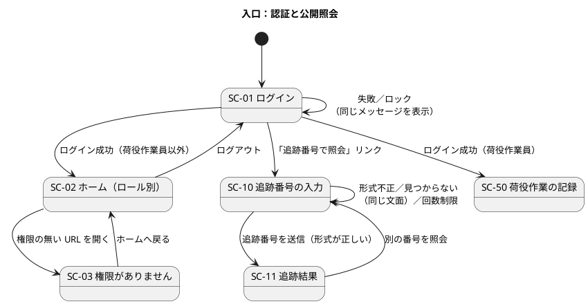

### 5.2 営業担当者：見積から予約の確定まで

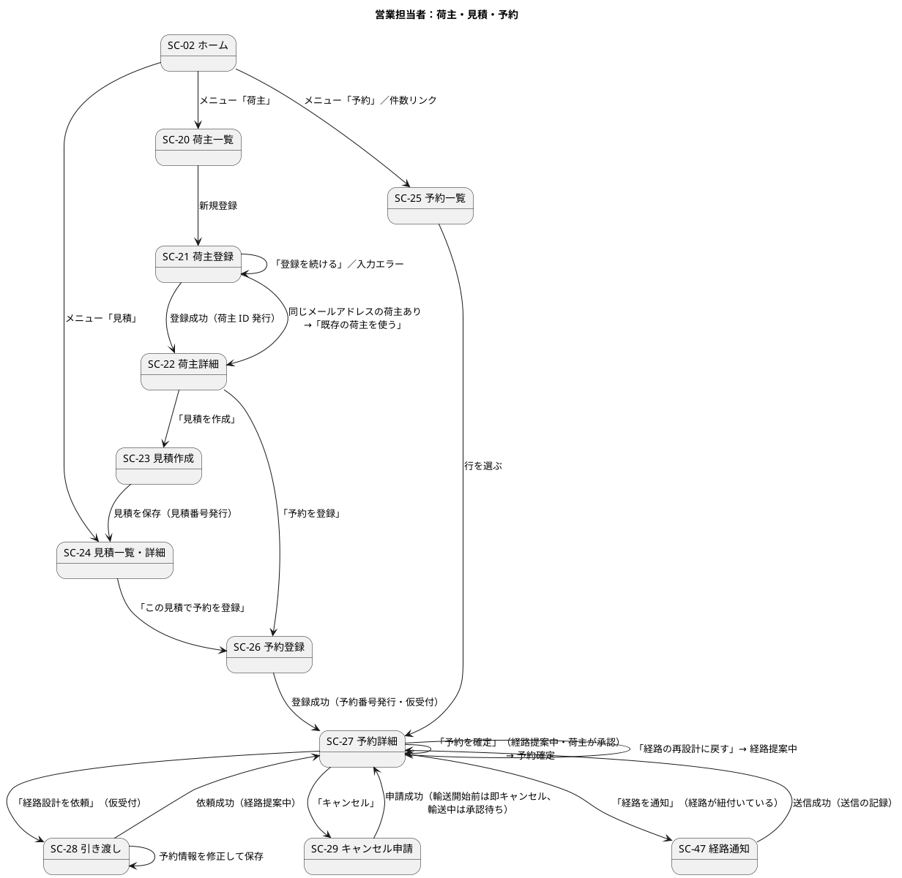

### 5.3 経路設計者：航海の管理から経路の確定まで

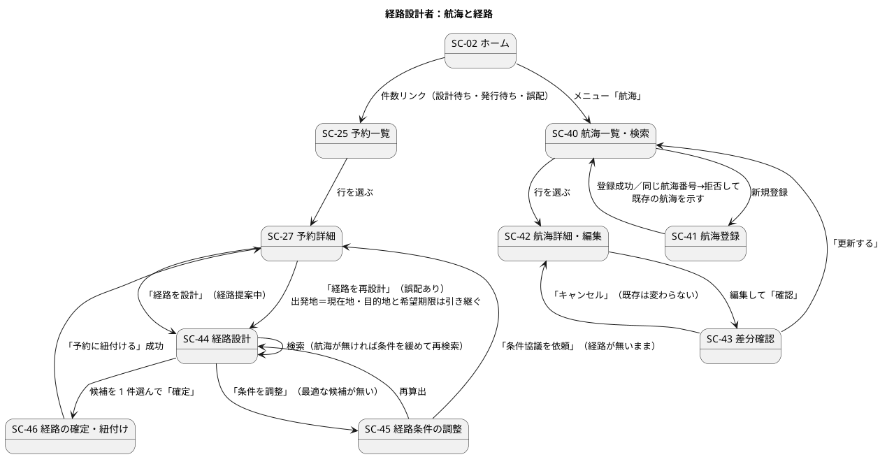

### 5.4 荷役・追跡：記録・例外・通関

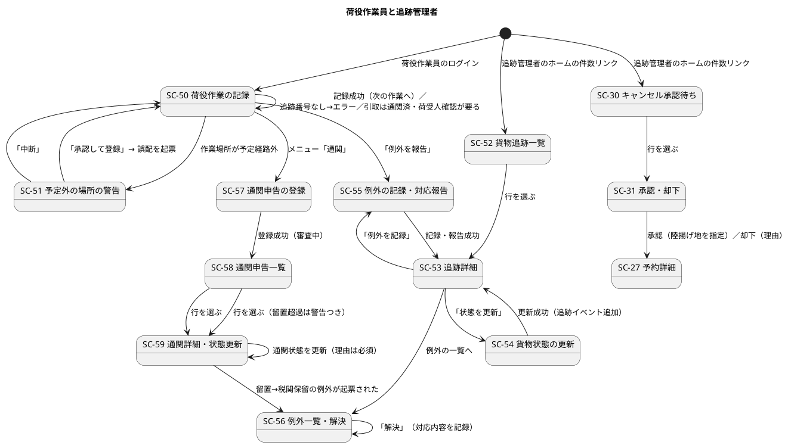

### 5.5 経理担当者：料金と精算

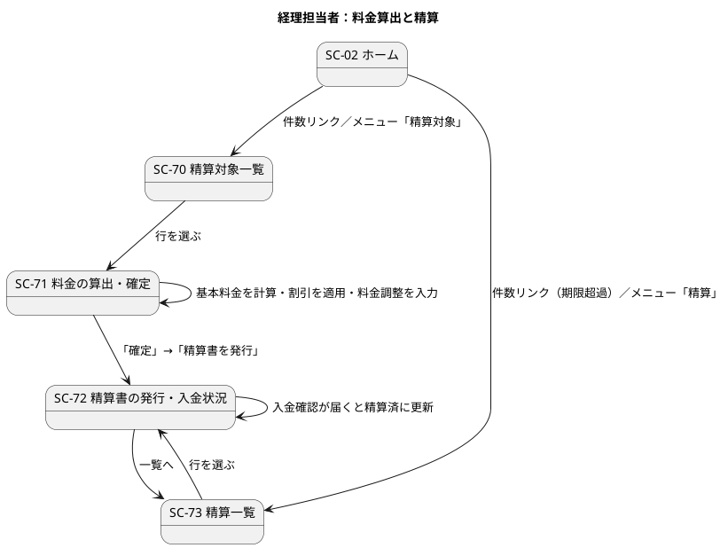

---

## 6. 画面イメージ

ウォーキングスケルトン（Bolt 1）の画面から順に、主要な画面の配置を示します。情報の優先順位とグルーピングを表すもので、ピクセルの精度は持ちません。画面の例に使う港湾コードは実在する UN/LOCODE（東京 `JPTYO`、シンガポール `SGSIN`、ロッテルダム `NLRTM`）で、荷主名・番号は架空です。追跡番号と予約番号の**形式は未定**（バックエンド 4.4）のため、`T-XXXX` のように仮の表記にします。

### 6.1 共通の枠（PC）

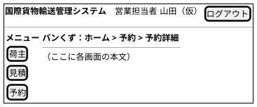

- ヘッダーに利用者名とロール、ログアウトを置く。ロールごとに左のメニュー項目が変わる（4.1）
- 反映待ち・通信エラーの通知は、本文の上端に帯で出す（8.4）

### 6.2 SC-01 ログイン（US26, US31）

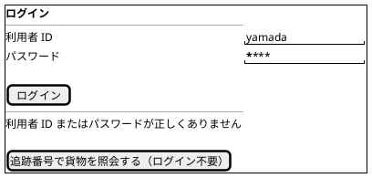

- 失敗・ロック・存在しない利用者で**同じ文面**を出す（US31 AC-03）。無効化されたアカウントだけ、管理者への問い合わせを案内する（AC-05）。この 2 つの文面の方針が衝突する点は要確認（[第 11 章](#11-未決事項と-ai-の仮定)）
- 公開照会へのリンクを置く（認証の外の入口。フロントエンド 5.2）

### 6.3 SC-02 ホーム：追跡管理者の例（US26 AC-01, US29 AC-07）

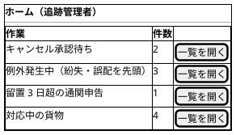

- 件数 0 の行も残す（0 件であることが分かる）。リンクは絞り込み済みの一覧を開く

### 6.4 SC-21 荷主登録（US02, US03）

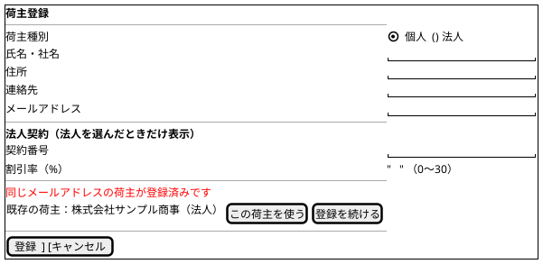

- 割引率が範囲外（30 を超える・負）なら、登録せず、その欄に「0〜30 の範囲で入力してください」を出す（US03 AC-03 は AI の仮定）
- 同じメールアドレスの検出は、メールアドレス欄から離れた時点（確認の帯）と登録時（確定）の両方で行う。確定時はサーバーが重複を判定し、「登録を続ける」が選ばれたときは重複を承認した登録として受け付ける（一意制約にはしない）
- 必須項目が未入力のときの振る舞いは受入条件に無い。欄ごとに「必須です」を出す（AI の仮定）

### 6.5 SC-26 予約登録（US04, US05）

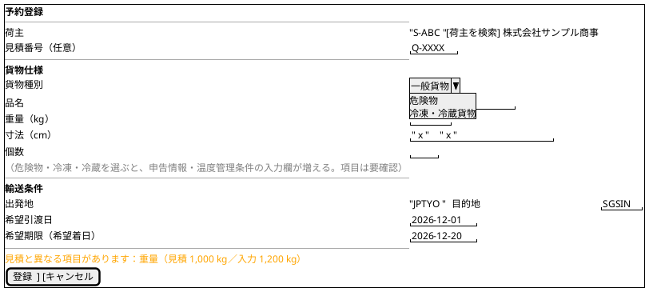

- 登録成功で SC-27（予約詳細）へ移り、予約番号と状態「仮受付」を示す（AC-02）。経路設計者への通知は画面に出さない（システムが送る。AC-03）
- 見積との整合の警告は、差異のある項目だけを並べる。**登録を止めるか警告に留めるかは要確認**（US04 の確認ポイント。AI の仮定は警告に留める）
- 「希望着日」と用語集の「希望期限」が同じかは要確認。画面の見出しは「希望期限」を主とし、括弧で補う
- 出発地・目的地は UN/LOCODE の選択式（港湾名で検索して選ぶ）にし、コードの手入力の誤りを避ける

### 6.6 SC-27 予約詳細（US06, US13, US14, US28 AC-03, US30）

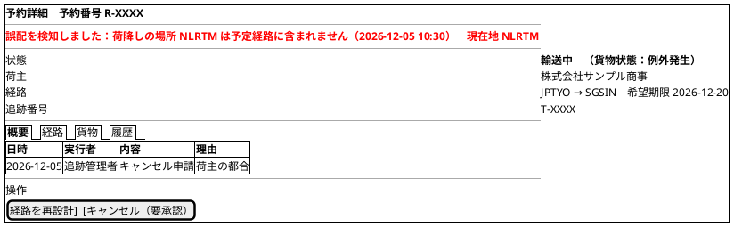

- 状態ごとの操作（実行できる操作は読み取りモデルが返す）:

| 予約状態 | 営業担当者 | 経路設計者 |
| :--- | :--- | :--- |
| 仮受付 | 経路設計を依頼（SC-28）、キャンセル | — |
| 経路提案中（経路未選択） | キャンセル | 経路を設計（SC-44） |
| 経路提案中（経路選択済） | 経路を通知（SC-47）、予約を確定、経路の再設計に戻す、キャンセル | — |
| 予約確定 | キャンセル | 追跡番号を発行 |
| 追跡番号発行済 | キャンセル | — |
| 輸送中 | `[キャンセル（要承認）]` だけ（US30 AC-02） | 誤配あり：経路を再設計 |
| 配送完了以降 | 操作なし。キャンセル不可（US30 AC-07） | — |

- 誤配の警告バナーは、検知した追跡イベント（場所・日時）と現在地を並べる（US28 AC-03）
- 履歴（申請・承認・却下の日時・実行者・理由）は「履歴」タブに時系列で出す（US30 AC-09）
- 「概要」「経路」「貨物」「履歴」のタブはフロントエンドの `pages/` で、booking・routing・tracking の読み取りを合成する

### 6.7 SC-41 航海登録（US24）

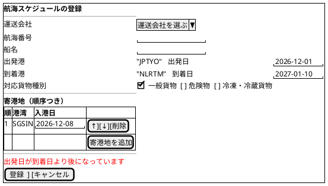

- 登録成功で登録番号を示し、SC-40 に戻る（AC-01）。未入力の項目は赤枠と欄の下の文言で示し、登録しない（AC-02）
- 同じ航海番号は登録を拒否し、既存の航海へのリンクを示す（AC-04 は AI の仮定）。更新へ誘導するかは要確認
- 寄港地の入港日は US24 の項目に無い。**項目に入港日を含めるかは要確認**（経路の接続の評価に使うため）

### 6.8 SC-43 更新内容の差分確認（US25）

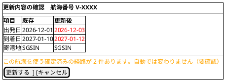

- 変わった項目だけを強調する。「キャンセル」で既存は変わらない（AC-04）
- 更新した航海を使う経路が予約に紐付いている場合の扱いは未定義（US25 の確認ポイント）。AI の仮定は「自動では反映しない」で、画面は件数を知らせるだけにする

### 6.9 SC-44 経路設計（US07, US08, US09）

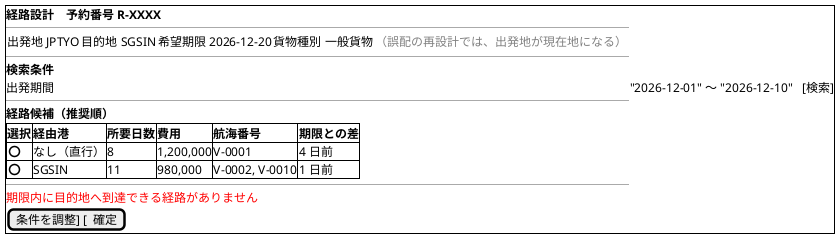

- 候補は「乗り継ぎ無し」を先頭、その次は所要日数の短い順（US08 の AI の仮定。推奨順の基準は要確認）
- 費用は概算の通貨と単位が未定義（金額の表示は桁区切りのみで通貨は出さない。**要確認**）
- 候補が 0 件のときは、帯に理由を出し、「条件を調整」を主ボタンにする（US08 AC-04）
- 検索結果が 0 件（航海そのものが無い）のときは「該当する航海がありません」を出し、条件を緩めて再検索できる（US07 AC-05）
- 貨物種別が危険物・冷凍・冷蔵なら、検索条件に「対応する航海に絞り込み」を示す（US07 AC-04。航海側の項目は U-03 の定義による）

### 6.10 SC-50 荷役作業の記録（モバイル。US15, US16）

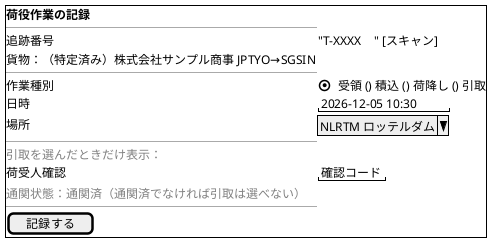

- 追跡番号が見つからなければ、入力欄の下にエラーを出し再入力を促す（US15 AC-03）
- 記録成功の帯に「記録しました」と作業内容を出し、フォームを初期化して次の作業に備える
- 作業種別「引取」: 通関済でない貨物は選べず、現在の通関状態を示す（US29 AC-04）。荷受人確認（署名または確認コード）を入力しない限り記録できない（US16 AC-03 は AI の仮定）
- 確認コードの発行者と受け渡し方法は未定義（US16 の確認ポイント）。入力欄の形式は要確認
- スキャン（AC-01）は方式が未定。手入力で実装し、スキャンのボタンは方式が決まってから有効にする（フロントエンド第 6 章）

### 6.11 SC-51 予定外の作業場所の警告（US15 AC-04, US28 AC-01・02）

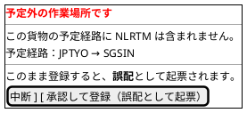

- US15 は警告の表示までで、誤配の起票は US28 が担う（US15 の AI の仮定）。Bolt 10 では「確認して続行／中断」、Bolt 16 で続行時の誤配の起票を加える
- 警告は登録の**前**に出す（US28 AC-01）。承認の操作を主ボタンにせず、「中断」を既定の位置に置く

### 6.12 SC-59 通関申告の詳細・状態更新（US29）

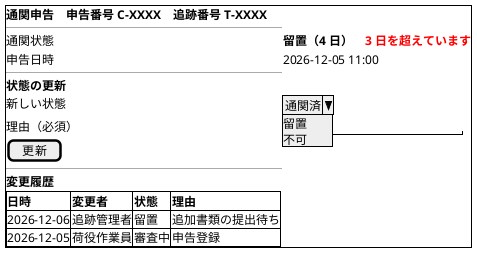

- 理由が空なら更新ボタンを押せないようにせず、押して「理由は必須です」を出す（理由欄に注意を向けるため。US29 AC-03）
- 「通関済」への更新で荷主・荷受人に通知される（AC-05）旨を、更新ボタンの下に一行で示す
- 「不可」への更新後の返送・廃棄の判断（UC21 3b）は、受入条件に無い。画面は状態の更新と荷主への通知までとし、判断の画面は作らない（要確認）

### 6.13 SC-31 キャンセル承認・却下（US30）

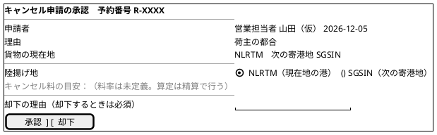

- 陸揚げ地の選択肢は「現在地の港」と「次の寄港地」だけ（US30 AC-05）。現在地と次の寄港地は追跡情報の読み取りから取る
- 承認後は SC-27 へ戻り、荷降しの手配と荷主への通知が走ったことを履歴に出す。却下は理由を必須とし、予約は「輸送中」のまま維持される（AC-06）
- キャンセル料の料率は未定義（AC-08 が判定できない）。**この画面に金額を表示するのは料率が決まってから**とし、当面は文言だけを置く

### 6.14 SC-71 輸送料金の算出・割引・確定（US21, US22）

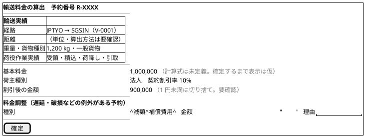

- 基本料金の計算式・距離の定義・端数処理はストーリーで未定義（US21 の確認ポイント）。**計算式を受入条件に定義してから実装する**。画面イメージの金額は配置の説明用の仮の値
- 個人荷主には割引の行を出さない（US22 AC-02）。割引率は荷主の登録値を自動で表示し、編集させない
- 例外が無い予約には料金調整の欄を出さない（AC-03）。確定すると状態「確定」になり、編集不可になる

### 6.15 SC-72 精算書の発行・入金状況（US23）

```plantuml
@startsalt
{+
  <b>精算書　請求番号 B-XXXX　予約番号 R-XXXX
  ----
  請求金額 | 900,000　（基本料金 1,000,000／割引率 10%）
  支払い期限 | 2026-12-31
  精算状態 | <b>発行済（入金待ち）
  ----
  {#
    <b>状態 | <b>日時 | <b>備考
    発行済 | 2026-12-10 | 荷主へメール通知済み
  }
  <color:gray>入金は決済機関からの通知で自動的に「精算済」に更新される（手動の入力欄は置かない）
  ----
  [精算書を発行]（確定した料金があるとき）
}
@endsalt
```

- 精算書に割引率・基本料金・割引後の料金を載せる（US22 AC-03）
- 支払い期限を過ぎて入金が無いとき、SC-73 の行と経理担当者のホームに警告を出す（US23 AC-03）
- 入金は決済機関のポート越しの通知で更新する（US23 の AI の仮定）。通知が来るまでは「入金待ち」のまま

### 6.16 SC-10 / SC-11 公開の追跡照会（US18）

```plantuml
@startsalt
{+
  <b>貨物の追跡
  ----
  追跡番号 | "T-XXXX           " [照会]
  ----
  <b>結果
  現在の状態 | 輸送中
  現在位置 | シンガポール（SGSIN）
  推定到着日 | 2026-12-18
  通関 | 審査中
  ----
  {#
    <b>日時 | <b>場所 | <b>作業
    2026-12-05 10:30 | SGSIN | 荷降し
    2026-12-03 09:00 | JPTYO | 積込
  }
  ----
  追跡番号が見つかりません
}
@endsalt
```

- 荷主名・住所・連絡先など個人情報は出さない。見つからない番号と形式不正の番号で**同じ文面**を出す
- 照会回数の制限に達したら「しばらくしてからもう一度お試しください」を出す
- 推定到着日は紐付いた経路の最終航海の到着日（US18 の AI の仮定）。算出できないときは「未定」と表示する
- 通関が遅れているとき（留置）は、荷主が追跡画面から把握できる表示を出す（UC21 の利害関係者）

---

## 7. インタラクション設計

### 7.1 主要シナリオ

**S1 荷主を登録して予約を仮受付にする（ウォーキングスケルトン。US02, US04）**

1. 営業担当者が SC-20 の「新規登録」から SC-21 を開く。
2. 荷主種別・氏名・住所・連絡先・メールアドレスを入力して「登録」を押す。
3. システムが荷主を登録し、荷主 ID を発行して SC-22（荷主詳細）を表示する。
4. 「予約を登録」で SC-26 を開く。荷主は選択済みで、貨物仕様と輸送条件を入力して「登録」を押す。
5. システムが予約番号を発行し、状態「仮受付」で SC-27 を表示する。画面は応答の版以上になるまで取得して表示する。
6. 営業担当者が SC-25 を開くと、登録した予約が一覧にある（結果整合の検査項目）。

**S2 経路を設計し、予約に紐付けて荷主に通知する（US07〜US12）**

1. 経路設計者がホームの「経路設計の依頼待ち」から SC-25 を開き、予約を選んで SC-27 から「経路を設計」で SC-44 を開く。
2. 検索条件を確認して検索する。候補が出たら 1 件選んで「確定」を押す。
3. SC-46 で確定経路と予約番号を確認し、「予約に紐付ける」を押す。SC-27 に戻る。
4. 営業担当者のホームに「経路が紐付き通知待ち」の件数が出る。SC-27 の「経路を通知」で SC-47 を開き、通知内容を確認して送信する。
5. 荷主が経路を承認したら、営業担当者が SC-27 で「予約を確定」を押す。

**S3 荷役作業を記録する（荷役作業員。US15, US28 AC-01・02）**

1. 荷役作業員がログインすると SC-50 が開く。追跡番号を入力する。
2. 作業種別・日時・場所を確認する。場所が予定経路外なら SC-51 の警告が出る。
3. 「承認して登録」を選ぶと、記録され、誤配が起票される。追跡管理者と経路設計者のホームの件数が増える。

**S4 輸送中の予約のキャンセルを承認する（US30）**

1. 営業担当者が SC-27 の「キャンセル（要承認）」で SC-29 を開き、理由を入力して申請する。
2. 追跡管理者のホームの「キャンセル承認待ち」が増える。SC-30 → SC-31 を開く。
3. 陸揚げ地を選んで承認するか、理由を入力して却下する。結果は SC-27 の履歴に残り、営業担当者に通知される。

**S5 通関を管理して引取に進める（US29）**

1. 荷役作業員が荷降しを記録した後、SC-57 で申告番号・申告日時を登録する（状態は「審査中」）。
2. 追跡管理者が SC-59 で理由を入力して状態を更新する。「留置」にすると例外が起票され、3 日を超えると SC-58 の行に警告が出てホームの件数に入る。
3. 「通関済」になった貨物だけ、SC-50 で「引取」を選べる。

**S6 料金を算出して精算する（US21〜US23）**

1. 配送完了（貨物状態「引取済」）の予約が SC-70 に現れる。経理担当者が選んで SC-71 を開く。
2. 基本料金と割引を確認し、例外があれば料金調整を入力して「確定」を押す。
3. SC-72 で精算書を発行する。入金が確認されると精算済になる。

### 7.2 操作パターンの統一

| 操作 | パターン | 適用 |
| :--- | :--- | :--- |
| 作成 | ブランクのフォームを開く。作成後は作成したオブジェクトの詳細へ移る | 荷主、予約、航海、見積 |
| 更新 | 詳細から編集に入り、確認画面（差分）を経て保存する。軽い更新は同じ画面で行う | 航海の更新は確認画面あり。貨物状態の更新は同じ画面 |
| 状態の遷移 | 詳細の操作ボタン。押せない状態では**ボタンを出さない**（無効表示にしない）。出す根拠は読み取りモデルの「実行できる操作」 | 予約の確定、追跡番号の発行、経路の確定 |
| 取り消し系 | 理由の入力が必須のダイアログ。確認の追加は置かない（理由の入力が確認を兼ねる） | キャンセル申請、却下、通関状態の更新 |
| 警告の承認 | 登録の前に警告のダイアログを出し、「中断」と「承認して続行」を並べる | 予定外の作業場所 |
| 一覧 | 検索・絞り込み、状態の列、行を選ぶと詳細。新規登録は一覧の右上 | すべての一覧 |
| 件数のリンク | 絞り込み条件を引き継いだ一覧を開く | ホーム |

### 7.3 コマンドの重複を防ぐ

- 送信ボタンは押した直後から応答まで無効にする（連打を防ぐ）
- 同じ画面から再送するとき、冪等性キーは同じにする（フロントエンド 4.2）。画面を開き直すと新しいキーにする
- 通信エラーで結果が分からないときは、「結果を確認する」ボタンで読み取りを取り直し、登録済みかを見てから再送を促す

---

## 8. エラー・フィードバックの設計

### 8.1 エラーの種類と表示

| 種類 | 例 | 表示の場所と文面 | 回復の方法 |
| :--- | :--- | :--- | :--- |
| 入力の検証（クライアント） | 必須項目の未入力、割引率の範囲外、出発日が到着日より後 | 欄の下に赤字で理由。送信時に最初のエラー欄へフォーカスを移す | 修正して再送 |
| 業務エラー（サーバー） | 不正な状態遷移、同じ航海番号、通関済でない貨物の引取 | 本文上端の帯に、原因と現在の状態を出す（例：「通関状態は『審査中』です」） | 帯のリンクから状態を確認する |
| 権限（403） | 権限の無い画面・操作 | SC-03 に移る。ホームへ戻る導線を置く | ホームへ戻る |
| 認証切れ（401） | セッション切れ | SC-01 へ。「ログインし直してください」を出す。入力途中の内容を失う旨 | 再ログイン |
| 通信エラー | 接続不能 | 帯に「通信できません。もう一度お試しください」と「再試行」。入力は保持 | 再試行（同じ冪等性キー） |
| タイムアウト | 応答が遅い | 通信エラーと同じ。ただし「処理は完了している可能性があります。結果を確認してください」を添える | 結果を確認する |
| 反映待ち | 書き込み後に読み取りが追いつかない | 帯に「反映を待っています」。上限時間を超えたら「反映に時間がかかっています。更新してください」と手動の更新を出す | 更新 |
| 回数制限（公開照会） | 短時間の多数の照会 | 「しばらくしてからもう一度お試しください」 | 時間をおく |
| 想定外のエラー | 500 など | 帯に「問題が発生しました」と問い合わせ用の相関 ID | 管理者に連絡 |

- 上限時間・再試行の間隔・タイムアウトの秒数は**非機能要件定義で決める**（本書では決めない。提案は[非機能要件 NFR-P11・P12](non_functional.md)：上限 15 秒、間隔 500 ms から 2 秒まで）
- 認証の失敗とロックでは、画面でも**同じ文面**にする。無効化だけ別の案内（管理者への問い合わせ）

### 8.2 バリデーションの規則

- 入力の検証は「その場で分かるもの」だけクライアントで行う（必須、範囲、形式）。**業務の規則はサーバーが判定し、画面は結果を表示するだけ**にする（画面に規則の写しを持たない）
- 期限と到着の比較など、日付と日時にまたがる判定は画面で行わない（バックエンドの判定を表示する）
- UN/LOCODE は選択式で入力させ、形式の誤りを画面で防ぐ。実在しないコードの判定はサーバーが行う

### 8.3 確認とフィードバックの原則

- 成功は帯で一言（「登録しました」＋次の操作へのリンク）。モーダルで止めない
- 状態が変わる操作の後は、詳細の状態表示が更新されるのを確認してから成功を出す（結果整合）
- 取り消せない操作（確定・発行）の前だけ、確認の文を添える。確定ボタンのラベルに結果を書く（「予約を確定」）

### 8.4 反映待ち（結果整合）の見せ方

```plantuml
@startuml
title 書き込み後の画面の流れ

actor 利用者
participant 画面
participant "command-api" as C
participant "query-api" as Q

利用者 -> 画面 : 「登録」
画面 -> C : Mutation（冪等性キー）
C --> 画面 : ID と最後の版
画面 -> 画面 : 「反映を待っています」の帯
loop 版が追いつくまで（上限時間まで）
  画面 -> Q : 取得
  Q --> 画面 : 読み取りモデルの版
end
alt 追いついた
  画面 -> 利用者 : 詳細を表示し「登録しました」
else 上限時間を過ぎた
  画面 -> 利用者 : 「反映に時間がかかっています」と［更新］
end
@enduml
```

---

## 9. アクセシビリティとモバイル

| 項目 | 設計 |
| :--- | :--- |
| キーボード | すべての操作がキーボードだけでできる。ダイアログは開いたらフォーカスを移し、閉じたら元に戻す。Esc で閉じる（取り消し系は理由入力があるため、Esc でも入力は破棄せず確認する） |
| 色に頼らない | 状態（誤配・留置・紛失・緊急）は色に加えて文言とアイコンで示す。赤・橙の警告帯にも見出しの語（「誤配」「期限超過」）を入れる |
| 読み上げ | 一覧は表のセマンティクスを使う。帯の通知は `aria-live` で読み上げる。ボタンのラベルは結果を表す（「予約を確定」） |
| モバイル（荷役作業員） | タップ領域は広く取り、入力は最小。日時は現在時刻を既定値にする。場所は選択式。画面は 1 カラム |
| PC の画面幅 | 一覧は横スクロールを許さず、重要な列から順に表示し、狭い幅では詳細に折りたたむ |
| 言語 | 日本語のみ（AI の仮定。要確認） |

---

## 10. 画面の検査

フロントエンド第 8 章の F5・F6・F8 に、この設計の表を入力として与えます。

| # | 検査 | 入力（本書の表） | 失敗の現れ方 |
| :--- | :--- | :--- | :--- |
| U1 | すべてのロールが、4.2 の○の画面へメニューまたはホームの件数から 2 操作以内で辿り着ける | 4.1・4.2 | 画面があるのに辿り着けない |
| U2 | 4.2 で空欄の画面を URL 直打ちで開くと 403 になる | 4.2 | 権限の無い画面が開く |
| U3 | ホームの件数のリンクが、絞り込み済みの一覧を開き、件数と一覧の行数が一致する | 4.1 | 件数と一覧がずれる |
| U4 | 状態ごとの操作ボタンが、6.6 の表どおりに出る。出ているボタンは押すと成功する | 6.6 | 押せるのに失敗するボタン |
| U5 | 共有画面（SC-27、SC-25）の「戻る」リンクが、開いたロールごとに 403 にならない | 4.2 | あるロールで戻ると 403 |
| U6 | 書き込み直後に、自分が作ったものが一覧と詳細に見える（一覧から対象を選んで始める） | 7.1 の S1 | 反映待ちのまま消える |
| U7 | 認証の失敗・ロック・存在しない利用者が同じ文面になる。公開照会の見つからない番号と形式不正が同じ文面になる | 6.2・6.16 | 存在が漏れる |
| U8 | ストーリーの受入条件（AC）の数だけ、画面から踏む受け入れテストがある | 3.8 | 画面から踏む検査が無い AC が残る |

> U4 は、画面の判定とドメインの判定が別々だと、片方だけ正しい状態を生みます。画面で判定を再実装せず、読み取りモデルの項目を使う（方針 P3）ことで防ぎます。

---

## 11. 未決事項と AI の仮定

### 11.1 人に確認する点

画面に影響する、ストーリーの「確認ポイント」と本書で新たに生じた論点です。

| # | 論点 | 影響する画面 | 出典 |
| :--- | :--- | :--- | :--- |
| Q1 | 荷主ロールは追跡照会以外の画面（自分の予約・精算書）を持つか | メニュー、SC-02、SC-72 | フロントエンド 10.1 |
| Q2 | システム管理者を 7 つ目のロールにするか（SC-04 の持ち主） | SC-04 | US31 |
| Q3 | 管理職（紛失時のエスカレーション先）のロールと画面 | SC-55 | US20 |
| Q4 | 危険物申告情報・温度管理条件の項目（R-05） | SC-26 | US05 |
| Q5 | 見積との整合の確認で、差異があるとき登録を止めるか警告に留めるか | SC-26 | US04 AC-04 |
| Q6 | 推奨順の基準・費用の算出方法・通貨 | SC-44, SC-23 | US08, US01 |
| Q7 | 航海の入港日を項目に含めるか。同じ航海番号の登録時に更新へ誘導するか | SC-41 | US24 |
| Q8 | 更新した航海を使う経路が紐付いているときの扱い | SC-43 | US25 |
| Q9 | 基本料金の計算式・距離の定義・端数処理・キャンセル料率 | SC-71, SC-31 | US21, US22, US30 |
| Q10 | 荷受人確認（署名または確認コード）の方式 | SC-50 | US16 |
| Q11 | 追跡番号・予約番号・見積番号・請求番号の形式 | 全画面の表示 | バックエンド 4.4 |
| Q12 | 無効化アカウントの案内と、認証失敗の同一文面の方針の衝突 | SC-01 | US31 |
| Q13 | 通関「不可」の後の返送・廃棄の判断をシステムで扱うか | SC-59 | UC21 3b |
| Q14 | 追跡番号のスキャンの方式とオフライン対応の要否 | SC-50 | US15, FE-05 |
| Q15 | 営業担当者のホームの「経路が紐付き通知待ち」の定義（経路選択済の予約） | SC-02 | US11 の内部状態 |
| Q16 | 予約詳細の追跡管理者への閲覧許可（4.2） | SC-27 | 本書の仮定 |

### 11.2 AI の仮定

- 画面の ID・名前・数は本書で決めた仮のもの。ドメインモデル設計とデータモデル設計で、オブジェクト名と属性が変わりうる
- ロール × 画面の表（4.2）は、ストーリーの主語から作った暫定。認可の根拠は BE-09 で確定する
- 日付・金額・番号の画面の例は、配置の説明のための仮の値。計算式・形式・端数処理を定めるものではない
- 一覧から詳細への遷移は 1 画面遷移（2 ペイン分割にしない）。レイアウトの詳細は実装の Bolt で詰める
- 言語は日本語のみ。通貨の表示は未定
- 荷役作業員のホームは持たない（ログイン直後に SC-50）。通関と例外の入口は下部タブ

### 11.3 次の設計活動

1. 承認ゲート：画面の ID と、Q1〜Q16 のうち Bolt 1・2 に関わるもの（Q1・Q2・Q11・Q16）の判断
2. ドメインモデル設計（`analyzing-domain-model`）：本書のオブジェクトと状態を集約・値オブジェクトに落とす
3. データモデル設計（`analyzing-data-model`）：画面ごとの読み取りモデルの項目（「実行できる操作」を含む）
4. テスト戦略（`analyzing-test-strategy`）：第 10 章の検査を水準に割り当てる
5. `developing-frontend`：Bolt 1 の SC-20・SC-21・SC-22・SC-25・SC-26・SC-27 から着手する
